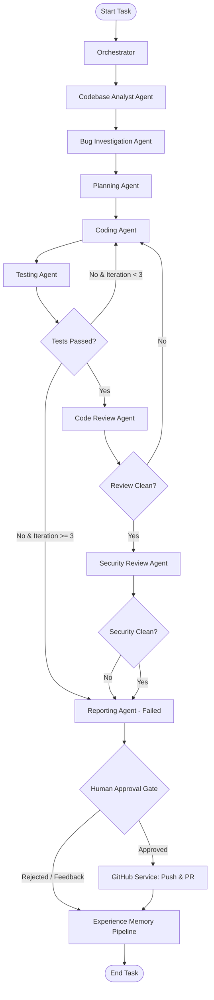

# Specialist Agents & Multi-Agent Orchestration Specification
## Devora AI: Autonomous AI Software Engineer

---

### 1. Multi-Agent Paradigm & Orchestration Strategy

Devora AI uses **LangGraph** to model software engineering workflows as a stateful, directed computational graph. Rather than relying on an unstructured conversational loop where a single model attempts all engineering tasks, Devora divides cognitive responsibilities among **nine specialist agents**.

#### Key Design Rules:
1. **Separation of Concerns:** Each specialist agent has a single, strictly bounded responsibility, a dedicated system prompt, and access to a curated, permission-controlled toolset.
2. **Immutable State Governance:** Agents communicate solely through updates to the typed shared state (`DevoraWorkflowState`). Agents cannot inject arbitrary fields.
3. **Structured Pydantic Contracts:** Agent outputs are validated against strict Pydantic schemas before state reduction.
4. **Bounded Retry Loops:** The fix-test debugging loop is bounded to a maximum of **three (3) iterations**. If tests fail after 3 iterations, execution halts and transitions to the Reporting Agent with a clear failure diagnosis.
5. **No Claims Without Evidence:** The Orchestrator requires real tool execution logs and sandbox exit codes before declaring any step successful.

---

### 2. Shared Typed Workflow State (`DevoraWorkflowState`)

```python
from typing import TypedDict, List, Dict, Any, Optional
from pydantic import BaseModel, Field

class DevoraWorkflowState(TypedDict):
    # Task metadata & scope
    task_id: str
    project_id: str
    repository_id: str
    workspace_path: str
    baseline_commit_sha: str
    target_branch: str
    
    # User intent
    user_request: str
    error_traceback: Optional[str]
    task_category: str  # "bug_fix", "feature", "refactor", "exploration"
    
    # ML Classification
    ml_bug_prediction: Optional[Dict[str, Any]]
    
    # Analysis & Context
    relevant_files: List[str]
    symbol_graph: Dict[str, Any]
    retrieved_experiences: List[Dict[str, Any]]
    
    # Plan
    plan: Optional[Dict[str, Any]]
    current_step_index: int
    
    # Code changes & Sandbox state
    iteration_count: int
    max_iterations: int
    modified_files: List[Dict[str, Any]]
    git_diff: str
    
    # Test results
    test_results: Optional[Dict[str, Any]]
    last_test_exit_code: Optional[int]
    last_test_stdout: Optional[str]
    last_test_stderr: Optional[str]
    
    # Reviews
    code_review: Optional[Dict[str, Any]]
    security_findings: List[Dict[str, Any]]
    
    # Audit & Status
    active_agent: str
    agent_logs: List[Dict[str, Any]]
    status: str  # "PLANNING", "IN_PROGRESS", "WAITING_APPROVAL", "COMPLETED", "FAILED"
    error_message: Optional[str]
    final_report: Optional[str]
```

---

### 3. Detailed Specification of the 9 Specialist Agents

---

#### 3.1 Orchestrator Agent
* **Role:** Central workflow supervisor, task dispatcher, and lifecycle monitor.
* **Responsibilities:**
  * Ingests the initial request, initializes the workflow state.
  * Monitors progress against the plan.
  * Coordinates transitions between agents.
  * Handles human-in-the-loop interruption triggers and resume signals.
* **Input Schema:** Initial task request, repository context.
* **Output Schema:** Target agent dispatch, state status update.
* **Allowed Tools:** Workflow state control, event streaming dispatcher.
* **Permission:** Read-Only on repository; Write on task state machine.

```python
class OrchestratorDecision(BaseModel):
    next_agent: str = Field(..., description="Target specialist agent to invoke")
    status: str = Field(..., description="Current high-level task status")
    reasoning: str = Field(..., description="Justification for routing decision")
    requires_human_approval: bool = Field(default=False)
```

---

#### 3.2 Codebase Analyst Agent
* **Role:** Static analysis, code search, and symbol graph construction.
* **Responsibilities:**
  * Uses Tree-sitter and AST parsers to inspect files, definitions, and references.
  * Queries `pgvector` for semantically relevant code snippets and documentation.
  * Identifies minimal candidate files relevant to the user request.
* **Input Schema:** User request, error traceback, repository path.
* **Output Schema:** List of localized file paths, symbol call graphs, context snippets.
* **Allowed Tools:** `ast_search`, `tree_sitter_query`, `vector_similarity_search`, `read_file_snippet`.
* **Permission:** Read-Only on repository.

```python
class AnalysisOutput(BaseModel):
    candidate_files: List[str] = Field(..., description="Files relevant to the task")
    key_symbols: List[str] = Field(..., description="Functions/classes involved")
    dependencies: List[str] = Field(..., description="Import dependencies")
    architectural_summary: str = Field(..., description="Brief architectural context")
```

---

#### 3.3 Bug Investigation Agent
* **Role:** Diagnostic root-cause determination and error reproduction.
* **Responsibilities:**
  * Parses raw tracebacks, log outputs, and error messages.
  * Calls the **ML Bug Classifier** API to determine error type and taxonomy.
  * Formulates hypotheses regarding why the failure occurs.
  * Designs reproduction tests if no test currently captures the issue.
* **Input Schema:** Error traceback, candidate files, ML classification result.
* **Output Schema:** Root cause analysis, reproduction strategy.
* **Allowed Tools:** `ml_bug_classifier`, `read_file`, `search_traceback`.
* **Permission:** Read-Only on repository.

```python
class BugInvestigationOutput(BaseModel):
    bug_category: str = Field(..., description="Predicted bug category from ML model")
    root_cause: str = Field(..., description="Identified root cause of the failure")
    trigger_condition: str = Field(..., description="Circumstances triggering the bug")
    recommended_fix_pattern: str = Field(..., description="Conceptual fix strategy")
```

---

#### 3.4 Planning Agent
* **Role:** Task decomposition and execution strategy.
* **Responsibilities:**
  * Translates requirements and investigation findings into a discrete step-by-step DAG.
  * Establishes concrete verification criteria (which tests must pass).
  * Estimates risk and establishes rollback checkpoints.
* **Input Schema:** User request, analysis output, bug investigation output.
* **Output Schema:** Structured `TaskPlan` with numbered steps and exit criteria.
* **Allowed Tools:** None (Pure reasoning over state).

```python
class PlanStep(BaseModel):
    step_number: int
    description: str
    target_files: List[str]
    verification_check: str

class TaskPlanOutput(BaseModel):
    objective: str
    steps: List[PlanStep]
    test_criteria: List[str]
    risk_level: str  # "LOW", "MEDIUM", "HIGH"
```

---

#### 3.5 Coding Agent
* **Role:** Minimal, precision code patch authoring.
* **Responsibilities:**
  * Generates clean code edits adhering to existing project style.
  * Operates strictly on files identified during planning.
  * On retry iterations, ingests the compiler/test error outputs and corrects the patch.
* **Input Schema:** Relevant files, current plan step, previous test failure logs (if retry).
* **Output Schema:** Unified diff or file modification payload.
* **Allowed Tools:** `apply_file_diff`, `write_file_patch`, `read_file`.
* **Permission:** Write restricted exclusively to ephemeral task workspace directory.

```python
class FileEdit(BaseModel):
    file_path: str
    original_snippet: str
    new_snippet: str
    explanation: str

class CodingOutput(BaseModel):
    changes: List[FileEdit]
    summary_of_changes: str
```

---

#### 3.6 Testing Agent
* **Role:** Headless test runner and verification auditor.
* **Responsibilities:**
  * Executes `pytest` or task-specific test commands inside the isolated sandbox.
  * Parses stdout, stderr, execution times, and exit codes.
  * Determines whether the test suite passed, failed, or timed out.
* **Input Schema:** Sandbox workspace ID, test command.
* **Output Schema:** Structured test run report with exit code and failure breakdown.
* **Allowed Tools:** `sandbox_exec` (`pytest`, `python -m unittest`).
* **Permission:** Execute inside isolated sandbox only (`--network none`, 60s timeout).

```python
class TestRunOutput(BaseModel):
    exit_code: int
    passed: bool
    total_tests: int
    passed_tests: int
    failed_tests: int
    duration_ms: float
    raw_stdout: str
    raw_stderr: str
    failure_details: Optional[List[str]] = None
```

---

#### 3.7 Code Review Agent
* **Role:** Quality assurance, static analysis, and maintainability check.
* **Responsibilities:**
  * Runs Ruff for style/linting and Mypy for type checks inside sandbox.
  * Inspects git diff for unintended side-effects, debug statements, or complexity spikes.
* **Input Schema:** Git diff, modified files list.
* **Output Schema:** Review verdict (`APPROVED`, `CHANGES_REQUESTED`), linter outputs, comments.
* **Allowed Tools:** `sandbox_exec` (`ruff check`, `mypy`).
* **Permission:** Execute read-only linters inside sandbox.

```python
class CodeReviewOutput(BaseModel):
    approved: bool
    ruff_clean: bool
    mypy_clean: bool
    comments: List[str]
    suggested_refactorings: Optional[List[str]] = None
```

---

#### 3.8 Security Review Agent
* **Role:** Automated vulnerability detection and secret leak prevention.
* **Responsibilities:**
  * Runs Semgrep with OWASP Top 10 and CWE Top 25 rulesets against modified files.
  * Scans for hardcoded credentials, API keys, or unsafe calls (`eval`, raw SQL injection).
  * Blocks workflow if high-severity issues are uncovered.
* **Input Schema:** Git diff, modified files list.
* **Output Schema:** Security audit verdict, list of identified vulnerabilities.
* **Allowed Tools:** `sandbox_exec` (`semgrep --config auto`).
* **Permission:** Execute read-only security tools inside sandbox.

```python
class SecurityFinding(BaseModel):
    rule_id: str
    severity: str  # "LOW", "MEDIUM", "HIGH", "CRITICAL"
    file_path: str
    line_number: int
    description: str

class SecurityReviewOutput(BaseModel):
    passed: bool
    findings: List[SecurityFinding]
    remediation_required: bool
```

---

#### 3.9 Reporting Agent
* **Role:** Engineering synthesis and GitHub PR narrative drafting.
* **Responsibilities:**
  * Synthesizes all execution evidence into an audit-ready Markdown Engineering Report.
  * Formulates PR title, description, and test summary for human approval.
* **Input Schema:** Complete `DevoraWorkflowState` history.
* **Output Schema:** Final Markdown report and PR payload.
* **Allowed Tools:** None (Pure synthesis).

```python
class FinalReportOutput(BaseModel):
    title: str
    summary: str
    root_cause_analysis: str
    changes_made: List[str]
    verification_evidence: str
    limitations: Optional[str]
    markdown_report: str
```

---

### 4. LangGraph Workflow Graph & Transitions



---

### 5. Checkpoints & Human-in-the-Loop Interruption

LangGraph's checkpoint mechanism uses PostgreSQL (`AsyncPostgresSaver`) to store graph state snapshots after each step.
* **Interrupt Point:** Before publishing to GitHub, the workflow yields execution:
  `workflow.compile(checkpointer=checkpointer, interrupt_before=["github_publisher"])`
* The API updates task status to `WAITING_APPROVAL` and emits an event to the frontend.
* Upon developer approval (`POST /api/v1/tasks/{id}/approvals/{approval_id}/action`), the graph resumes from the saved checkpoint.
