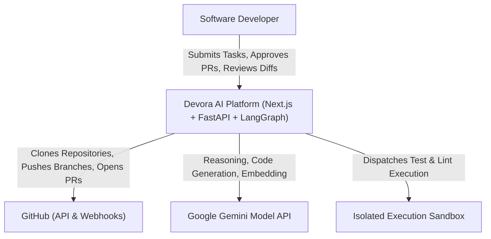
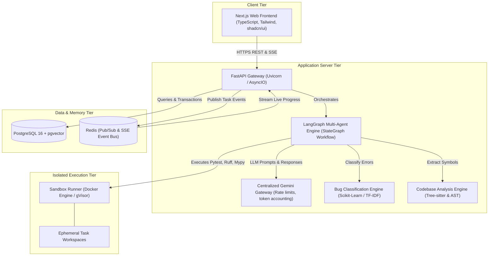
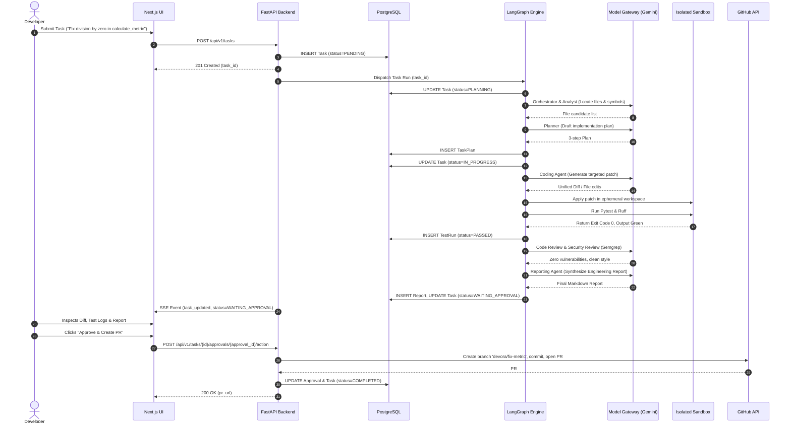

# System Architecture Specification
## Devora AI: Autonomous AI Software Engineer

---

### 1. High-Level Architectural Vision & Principles

Devora AI is designed as a **modular monorepo** separating presentation, business logic, asynchronous agent execution, machine learning pipelines, and isolated code execution sandboxes.

#### Core Architectural Tenets
1. **Separation of Concerns:** The Next.js frontend is strictly decoupled from the FastAPI backend via RESTful APIs and Server-Sent Events (SSE).
2. **Defensive Execution:** Untrusted code or generated patches are **never** executed on the host server; all execution occurs inside isolated, resource-constrained sandbox containers.
3. **Structured State Governance:** The multi-agent workflow is implemented in **LangGraph**, where all state transitions operate on a single, immutable, typed state contract (`DevoraWorkflowState`).
4. **Deterministic Validation Over Hallucination:** Agent claims must be substantiated by recorded tool outputs, exit codes, and test results.
5. **Centralized Model Gateway:** All LLM interactions (Gemini API) route through a centralized gateway that enforces rate limits, token budgets, retries, and structured JSON schema outputs.

---

### 2. Monorepo Directory Structure

```
devoraai/
├── docs/                               # Architectural & Technical Documentation
│   ├── PRD.md
│   ├── ARCHITECTURE.md
│   ├── AGENTS.md
│   ├── DATABASE.md
│   ├── API.md
│   ├── SECURITY.md
│   ├── ML_LEARNING.md
│   └── IMPLEMENTATION_PLAN.md
├── backend/                            # FastAPI Application & Agent Engine
│   ├── app/
│   │   ├── __init__.py
│   │   ├── main.py                     # Application entrypoint & middleware
│   │   ├── config.py                   # Pydantic BaseSettings & env configs
│   │   ├── api/                        # REST & SSE route handlers
│   │   │   ├── v1/
│   │   │   │   ├── auth.py
│   │   │   │   ├── repositories.py
│   │   │   │   ├── projects.py
│   │   │   │   ├── tasks.py
│   │   │   │   ├── approvals.py
│   │   │   │   ├── reports.py
│   │   │   │   ├── feedback.py
│   │   │   │   ├── ml.py
│   │   │   │   └── health.py
│   │   ├── core/                       # Core infrastructure services
│   │   │   ├── logging.py              # Structured JSON logging (structlog)
│   │   │   ├── exceptions.py           # Custom exception hierarchy
│   │   │   ├── security.py             # JWT, password hashing, token validation
│   │   │   └── model_gateway.py        # Centralized Gemini LLM client
│   │   ├── db/                         # Database connection & session lifecycle
│   │   │   ├── base.py                 # Declarative Base
│   │   │   ├── session.py              # Async SQLAlchemy engine & session factory
│   │   │   └── migrations/             # Alembic migration scripts
│   │   ├── models/                     # SQLAlchemy ORM database models
│   │   │   ├── user.py
│   │   │   ├── repository.py
│   │   │   ├── project.py
│   │   │   ├── task.py
│   │   │   ├── task_plan.py
│   │   │   ├── agent_run.py
│   │   │   ├── file_change.py
│   │   │   ├── test_run.py
│   │   │   ├── approval.py
│   │   │   ├── report.py
│   │   │   ├── feedback.py
│   │   │   ├── repository_knowledge.py
│   │   │   └── engineering_experience.py
│   │   ├── schemas/                    # Pydantic v2 validation schemas
│   │   │   ├── auth.py
│   │   │   ├── repository.py
│   │   │   ├── project.py
│   │   │   ├── task.py
│   │   │   ├── approval.py
│   │   │   ├── report.py
│   │   │   ├── feedback.py
│   │   │   ├── ml.py
│   │   │   └── common.py
│   │   ├── services/                   # Business domain services
│   │   │   ├── repo_service.py         # Git & Tree-sitter ingestion
│   │   │   ├── task_service.py         # Task scheduling & worker dispatch
│   │   │   ├── memory_service.py       # pgvector semantic indexing & search
│   │   │   ├── github_service.py       # GitHub REST/GraphQL integration
│   │   │   └── sandbox_service.py      # Docker execution & filesystem manager
│   │   └── agents/                     # LangGraph Multi-Agent Engineering System
│   │       ├── state.py                # Typed Dict DevoraWorkflowState
│   │       ├── graph.py                # StateGraph orchestration & conditional edges
│   │       ├── prompts.py              # Agent-specific system prompts
│   │       ├── tools/                  # Controlled tool definitions
│   │       └── specialists/            # Specialist agent node implementations
│   │           ├── orchestrator.py
│   │           ├── analyst.py
│   │           ├── investigator.py
│   │           ├── planner.py
│   │           ├── coder.py
│   │           ├── tester.py
│   │           ├── code_reviewer.py
│   │           ├── security_reviewer.py
│   │           └── reporter.py
│   ├── ml/                             # Bug Classification Engine
│   │   ├── dataset.py                  # Training data loader & validation
│   │   ├── preprocessor.py             # Traceback cleaning & tokenization
│   │   ├── train.py                    # Model training, CV & evaluation script
│   │   ├── inference.py                # Real-time inference engine
│   │   └── artifacts/                  # Serialized joblib models & metadata
│   ├── tests/                          # Backend test suite (Pytest)
│   │   ├── conftest.py
│   │   ├── unit/
│   │   └── integration/
│   ├── Dockerfile
│   ├── requirements.txt
│   └── pyproject.toml
├── frontend/                           # Next.js 14 Web Application
│   ├── src/
│   │   ├── app/                        # Next.js App Router (Layouts & Pages)
│   │   │   ├── layout.tsx
│   │   │   ├── page.tsx                # Landing page
│   │   │   ├── login/
│   │   │   ├── signup/
│   │   │   ├── dashboard/              # Main developer dashboard
│   │   │   ├── repositories/           # Repo management & detail
│   │   │   ├── tasks/                  # Task creation & detail
│   │   │   │   ├── new/
│   │   │   │   └── [id]/               # Agent Workspace & Live Terminal
│   │   │   └── settings/
│   │   ├── components/                 # Reusable UI components
│   │   │   ├── ui/                     # shadcn/ui primitives
│   │   │   ├── workspace/              # Agent workspace panels (Diff, Terminal, Plan)
│   │   │   ├── dashboard/              # Metric cards & execution charts
│   │   │   └── common/                 # Header, Sidebar, Badges
│   │   ├── lib/                        # API client, SSE hooks, utils
│   │   │   ├── api.ts                  # Typed Axios/Fetch client
│   │   │   ├── events.ts               # SSE stream consumer
│   │   │   └── utils.ts
│   │   └── types/                      # TypeScript definitions (mirrored from backend)
│   ├── package.json
│   ├── tailwind.config.ts
│   └── tsconfig.json
├── sandbox/                            # Execution Sandbox Environment
│   ├── Dockerfile.sandbox              # Minimal Python/Node test container
│   ├── seccomp-profile.json            # Strict Linux syscall whitelist
│   └── entrypoint.sh
└── docker-compose.yml                  # Local development orchestration
```

---

### 3. C4 Architecture Models

#### 3.1 C4 Level 1: System Context Diagram



#### 3.2 C4 Level 2: Container Diagram



---

### 4. Component Architecture Details

#### 4.1 Centralized Model Gateway (`backend/app/core/model_gateway.py`)
To prevent ad-hoc, untracked, and un-throttled calls to Gemini, all agents must call LLMs exclusively via `ModelGateway`:
* **Token Budgeting:** Tracks prompt and completion tokens per task and tenant.
* **Structured Output Enforcement:** Uses Gemini `response_schema` or robust JSON repair algorithms.
* **Resilience:** Implements exponential backoff with jitter on HTTP 429/503.
* **Auditability:** Logs input prompt digests and response latency without leaking sensitive code to third parties.

#### 4.2 Multi-Agent Orchestration Layer (`backend/app/agents/`)
Implemented as a compiled LangGraph `StateGraph`:
* **State Immutability:** Nodes return partial state updates; LangGraph reducers merge updates cleanly.
* **Checkpointing:** State snapshots saved to PostgreSQL after every agent node execution, enabling resumption if interrupted.
* **Conditional Routing:** Edge logic evaluates test outcomes and iteration counters to route to `CodingAgent` (retry) or `CodeReviewAgent` (success) or `ReportingAgent` (failure exhaustion).

#### 4.3 Code Parsing & Tree-sitter Engine (`backend/app/services/repo_service.py`)
* Provides deterministic structural understanding without burning LLM context tokens.
* Extracts Class, Function, Interface, and Import symbols across Python, TypeScript, and Go.
* Generates an in-memory Dependency Graph to identify callers and callees when localizing bugs.

#### 4.4 Isolated Execution Sandbox (`backend/app/services/sandbox_service.py`)
* Runs headless tests in Docker containers with:
  * `--network none` (blocked network access).
  * `--memory 1500m --cpus 2.0 --pids-limit 100`.
  * Read-only root filesystem with a mounted ephemeral task workspace.
  * Strict timeout execution wrapper (defaults to 60s max per command).
* Captures exit code, stdout, stderr, and generated test report artifacts.

#### 4.5 Data & Vector Storage Layer (`backend/app/models/` & `db/`)
* **Relational Tables:** Manage users, projects, tasks, file changes, test runs, approvals, and reports.
* **Vector Tables:**
  * `repository_knowledge`: Code chunks and architectural summaries with `vector(768)`.
  * `engineering_experiences`: Verified bug resolutions and human feedback with `vector(768)`.

---

### 5. Data Flow Diagrams

#### 5.1 End-to-End Task Lifecycle



---

### 6. State Management & Real-Time Synchronization

1. **Backend Real-Time Stream:** FastAPI exposes an SSE endpoint (`GET /api/v1/tasks/{id}/events`). As LangGraph transitions through nodes, agent logs and step changes are published to a Redis channel and streamed to subscribed clients.
2. **Frontend Reactive State:** Next.js uses React Query for cached entity state and an SSE listener hook (`useTaskStream`) to update live terminal logs, active agent badges, and progress bars without polling.
3. **Optimistic Locking:** Task state transitions verify current database status to prevent race conditions during concurrent updates.
