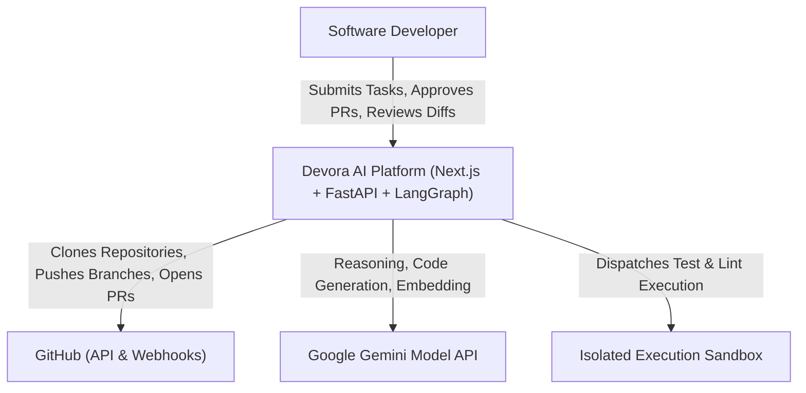
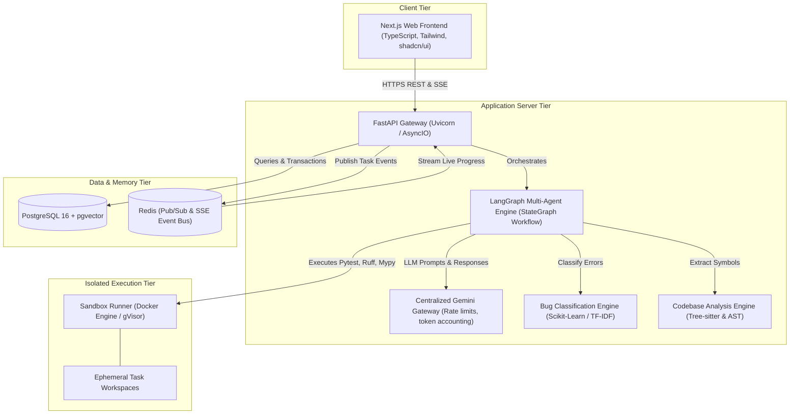
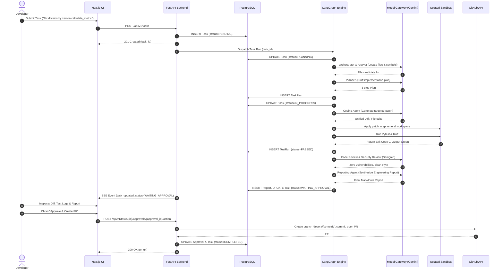
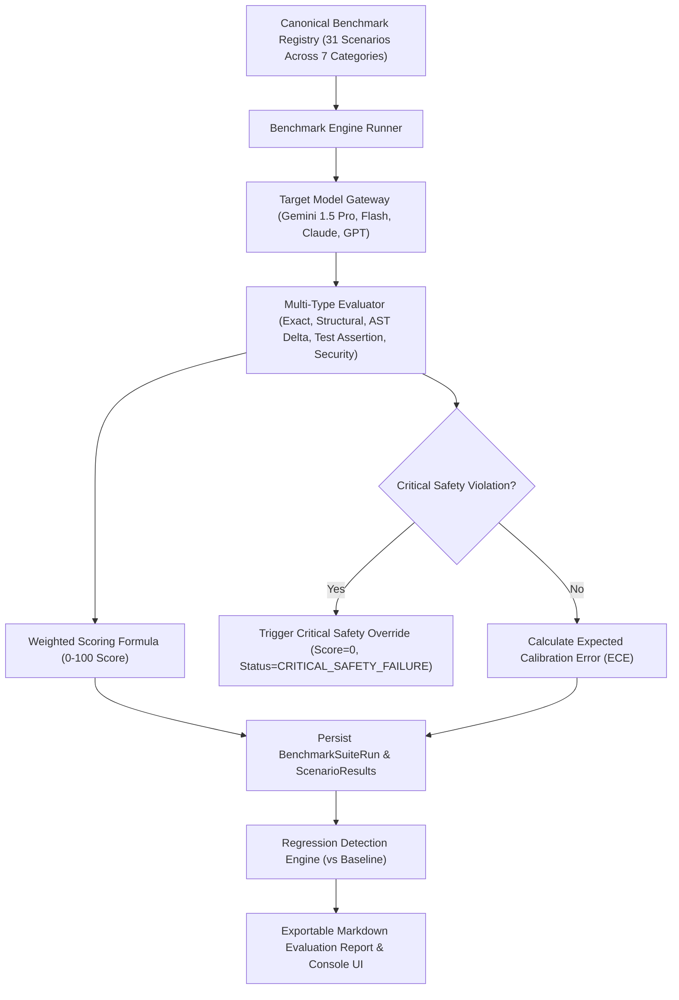

# System Architecture Specification
## Devora AI: Autonomous AI Software Engineer

---

### 1. High-Level Architectural Vision & Principles

Devora AI is designed as a **modular monorepo** separating presentation, business logic, asynchronous agent execution, machine learning pipelines, and isolated code execution sandboxes.

#### Core Architectural Tenets
1. **Separation of Concerns:** The Next.js frontend is strictly decoupled from the FastAPI backend via RESTful APIs and Server-Sent Events (SSE).
2. **Defensive Execution:** Untrusted code or generated patches are **never** executed on the host server; all execution occurs inside isolated, resource-constrained sandbox containers.
3. **Structured State Governance:** The multi-agent workflow is implemented in **LangGraph**, where all state transitions operate on a single, immutable, typed state contract (`DevoraWorkflowState`).
4. **Deterministic Validation Over Hallucination:** Agent claims must be substantiated by recorded tool outputs, exit codes, and test results.
5. **Centralized Model Gateway:** All LLM interactions (Gemini API) route through a centralized gateway that enforces rate limits, token budgets, retries, and structured JSON schema outputs.

---

### 2. Monorepo Directory Structure

```
devoraai/
├── docs/                               # Architectural & Technical Documentation
│   ├── PRD.md
│   ├── ARCHITECTURE.md
│   ├── AGENTS.md
│   ├── DATABASE.md
│   ├── API.md
│   ├── SECURITY.md
│   ├── ML_LEARNING.md
│   └── IMPLEMENTATION_PLAN.md
├── backend/                            # FastAPI Application & Agent Engine
│   ├── app/
│   │   ├── __init__.py
│   │   ├── main.py                     # Application entrypoint & middleware
│   │   ├── config.py                   # Pydantic BaseSettings & env configs
│   │   ├── api/                        # REST & SSE route handlers
│   │   │   ├── v1/
│   │   │   │   ├── auth.py
│   │   │   │   ├── repositories.py
│   │   │   │   ├── projects.py
│   │   │   │   ├── tasks.py
│   │   │   │   ├── approvals.py
│   │   │   │   ├── reports.py
│   │   │   │   ├── feedback.py
│   │   │   │   ├── ml.py
│   │   │   │   └── health.py
│   │   ├── core/                       # Core infrastructure services
│   │   │   ├── logging.py              # Structured JSON logging (structlog)
│   │   │   ├── exceptions.py           # Custom exception hierarchy
│   │   │   ├── security.py             # JWT, password hashing, token validation
│   │   │   └── model_gateway.py        # Centralized Gemini LLM client
│   │   ├── db/                         # Database connection & session lifecycle
│   │   │   ├── base.py                 # Declarative Base
│   │   │   ├── session.py              # Async SQLAlchemy engine & session factory
│   │   │   └── migrations/             # Alembic migration scripts
│   │   ├── models/                     # SQLAlchemy ORM database models
│   │   │   ├── user.py
│   │   │   ├── repository.py
│   │   │   ├── project.py
│   │   │   ├── task.py
│   │   │   ├── task_plan.py
│   │   │   ├── agent_run.py
│   │   │   ├── file_change.py
│   │   │   ├── test_run.py
│   │   │   ├── approval.py
│   │   │   ├── report.py
│   │   │   ├── feedback.py
│   │   │   ├── repository_knowledge.py
│   │   │   └── engineering_experience.py
│   │   ├── schemas/                    # Pydantic v2 validation schemas
│   │   │   ├── auth.py
│   │   │   ├── repository.py
│   │   │   ├── project.py
│   │   │   ├── task.py
│   │   │   ├── approval.py
│   │   │   ├── report.py
│   │   │   ├── feedback.py
│   │   │   ├── ml.py
│   │   │   └── common.py
│   │   ├── services/                   # Business domain services
│   │   │   ├── repo_service.py         # Git & Tree-sitter ingestion
│   │   │   ├── task_service.py         # Task scheduling & worker dispatch
│   │   │   ├── memory_service.py       # pgvector semantic indexing & search
│   │   │   ├── github_service.py       # GitHub REST/GraphQL integration
│   │   │   └── sandbox_service.py      # Docker execution & filesystem manager
│   │   ├── ml/                         # Machine Learning Bug Classification Engine
│   │   │   ├── preprocessor.py         # Traceback normalization & regex masking
│   │   │   ├── trainer.py              # Scikit-learn TF-IDF + LogisticRegression pipeline
│   │   │   ├── service.py              # Sub-millisecond runtime prediction service
│   │   │   ├── data/                   # Curated dataset (JSONL & CSV) + corpus loader
│   │   │   └── artifacts/              # Serialized joblib models with SHA-256 integrity
│   │   └── agents/                     # LangGraph Multi-Agent Engineering System
│   │       ├── state.py                # Typed Dict DevoraWorkflowState
│   │       ├── graph.py                # StateGraph orchestration & conditional edges
│   │       ├── events.py               # Workflow event broadcasting (SSE)
│   │       ├── gateway/                # Gemini Model Gateway (token tracking, schemas)
│   │       └── specialists/            # Specialist agent node implementations
│   │           ├── orchestrator.py
│   │           ├── codebase_analyst.py
│   │           ├── ml_classifier.py
│   │           ├── bug_investigator.py
│   │           ├── planner.py
│   │           ├── coder.py
│   │           ├── tester.py
│   │           ├── code_reviewer.py
│   │           ├── security_reviewer.py
│   │           └── reporter.py
│   ├── tests/                          # Backend test suite (Pytest, 103 tests)
│   │   ├── conftest.py
│   │   ├── unit/
│   │   └── integration/
│   ├── Dockerfile
│   ├── requirements.txt
│   └── pyproject.toml
├── frontend/                           # Next.js 14 Web Application
│   ├── src/
│   │   ├── app/                        # Next.js App Router (Layouts & Pages)
│   │   │   ├── layout.tsx
│   │   │   ├── page.tsx                # Landing page
│   │   │   ├── login/
│   │   │   ├── signup/
│   │   │   ├── dashboard/              # Main developer dashboard
│   │   │   ├── repositories/           # Repo management & detail
│   │   │   ├── tasks/                  # Task creation & detail
│   │   │   │   ├── new/
│   │   │   │   └── [id]/               # Agent Workspace & Live Terminal
│   │   │   └── settings/
│   │   ├── components/                 # Reusable UI components
│   │   │   ├── ui/                     # shadcn/ui primitives
│   │   │   ├── workspace/              # Agent workspace panels (Diff, Terminal, Plan)
│   │   │   ├── dashboard/              # Metric cards & execution charts
│   │   │   └── common/                 # Header, Sidebar, Badges
│   │   ├── lib/                        # API client, SSE hooks, utils
│   │   │   ├── api.ts                  # Typed Axios/Fetch client
│   │   │   ├── events.ts               # SSE stream consumer
│   │   │   └── utils.ts
│   │   └── types/                      # TypeScript definitions (mirrored from backend)
│   ├── package.json
│   ├── tailwind.config.ts
│   └── tsconfig.json
├── sandbox/                            # Execution Sandbox Environment
│   ├── Dockerfile.sandbox              # Minimal Python/Node test container
│   ├── seccomp-profile.json            # Strict Linux syscall whitelist
│   └── entrypoint.sh
└── docker-compose.yml                  # Local development orchestration
```

---

### 3. C4 Architecture Models

#### 3.1 C4 Level 1: System Context Diagram



#### 3.2 C4 Level 2: Container Diagram



---

### 4. Component Architecture Details

#### 4.1 Centralized Model Gateway (`backend/app/core/model_gateway.py`)
To prevent ad-hoc, untracked, and un-throttled calls to Gemini, all agents must call LLMs exclusively via `ModelGateway`:
* **Token Budgeting:** Tracks prompt and completion tokens per task and tenant.
* **Structured Output Enforcement:** Uses Gemini `response_schema` or robust JSON repair algorithms.
* **Resilience:** Implements exponential backoff with jitter on HTTP 429/503.
* **Auditability:** Logs input prompt digests and response latency without leaking sensitive code to third parties.

#### 4.2 Multi-Agent Orchestration Layer (`backend/app/agents/`)
Implemented as a compiled LangGraph `StateGraph`:
* **State Immutability:** Nodes return partial state updates; LangGraph reducers merge updates cleanly.
* **Checkpointing:** State snapshots saved to PostgreSQL after every agent node execution, enabling resumption if interrupted.
* **Conditional Routing:** Edge logic evaluates test outcomes and iteration counters to route to `CodingAgent` (retry) or `CodeReviewAgent` (success) or `ReportingAgent` (failure exhaustion).

#### 4.3 Code Parsing & Tree-sitter Engine (`backend/app/services/repo_service.py`)
* Provides deterministic structural understanding without burning LLM context tokens.
* Extracts Class, Function, Interface, and Import symbols across Python, TypeScript, and Go.
* Generates an in-memory Dependency Graph to identify callers and callees when localizing bugs.

#### 4.4 Isolated Execution Sandbox (`backend/app/services/sandbox_service.py`)
* Runs headless tests in isolated Docker containers (with a contained LocalIsolatedRunner fallback) enforcing:
  * `--network none` (air-gapped network isolation).
  * `--memory 1500m --cpus 2.0 --pids-limit 100 --cap-drop=ALL --security-opt=no-new-privileges:true`.
  * Ephemeral task workspaces mounted with strict directory path traversal defenses.
  * Deterministic container lifecycle (`devora-sandbox-{uuid}`) with guaranteed cleanup via `docker rm -f` in `finally` blocks (zero container leakage).
* **Deterministic Exit Code Classification (`SandboxExitClassifier`):**
  * `0`: `SUCCESS`
  * `124` / `-1`: `TIMEOUT`
  * `126`: `COMMAND_NOT_EXECUTABLE`
  * `127`: `COMMAND_NOT_FOUND`
  * `137` / `-9`: `OOM_KILLED` (only when independently confirmed via Docker inspect `State.OOMKilled` or cgroup `memory.events`), otherwise `PROCESS_KILLED`.
  * Non-zero: `EXECUTION_FAILURE`
* **Resource Telemetry Engine:**
  * Captures empirical peak RSS memory (bytes and MB), CPU core time (seconds), wall-clock duration, and configured memory/CPU limits without fabricating zero values.
  * Exposes empirical metrics to developer operators via task detail telemetry dashboard.
* **Dynamic Test Timeout Scaling (`TestTimeoutScaler`):**
  * Evaluates discovered test suite density. Suites $>50$ tests automatically scale timeout ($1.5\times$ base) up to a strict ceiling of 300s.
* **Anti-Churn Routing Guard (`route_after_tester`):**
  * Environment constraints (`OOM_KILLED`, `TIMEOUT`, `COMMAND_NOT_FOUND`, `COMMAND_NOT_EXECUTABLE`, `RUNNER_UNAVAILABLE`) bypass LLM repair loops and route directly to `reporter`, preventing destructive code churn on functional code.

#### 4.5 Data & Vector Storage Layer (`backend/app/models/` & `db/`)
* **Relational Tables:** Manage users, projects, tasks, file changes, test runs, approvals, and reports.
* **Vector Tables:**
  * `repository_knowledge`: Code chunks and architectural summaries with `vector(768)`.
  * `engineering_experiences`: Verified bug resolutions and human feedback with `vector(768)`.

---

### 5. Data Flow Diagrams

#### 5.1 End-to-End Task Lifecycle



---

### 6. State Management & Real-Time Synchronization

1. **Backend Real-Time Stream:** FastAPI exposes an SSE endpoint (`GET /api/v1/tasks/{id}/events`). As LangGraph transitions through nodes, agent logs and step changes are published to a Redis channel and streamed to subscribed clients.
2. **Frontend Reactive State:** Next.js uses React Query for cached entity state and an SSE listener hook (`useTaskStream`) to update live terminal logs, active agent badges, and progress bars without polling.
3. **Optimistic Locking:** Task state transitions verify current database status to prevent race conditions during concurrent updates.

---

### 7. Phase 5: Semantic Vector Memory Engine

The persistent memory architecture operates across three synchronized tiers:
1. **Granular Code Intelligence (`repository_knowledge`):** Abstract Syntax Tree symbols, function signatures, classes, and file summaries indexed by Tree-sitter parsers.
2. **Semantic Vector Memory (`repository_memories`):** High-level engineering knowledge, coding conventions, architectural decisions, testing patterns, framework rules, and verified task outcomes with `vector(768)` embeddings.
3. **Cross-Project Experience Catalog (`engineering_experiences`):** Verified, anonymized repair strategies distilled from completed engineering tasks.

#### 7.1 Memory Lifecycle & Verification Hierarchy
- **`observed_fact` (Weight 1.0x):** Ingested from manifest files, repository structure, and framework configs.
- **`developer_confirmed` (Weight 1.3x):** Authored or validated by human engineers.
- **`verified_outcome` (Weight 1.2x):** Distilled from tasks whose modifications passed isolated Docker tests and human review.
- **`ai_hypothesis` (Weight 0.7x):** Inferred patterns pending verification.

#### 7.2 Retrieval Pipeline & Agent Injection
1. Task initialization queries `repository_memories` using cosine distance `<=>` with candidate thresholding and status weighting.
2. Retrieved conventions are injected into `DevoraWorkflowState` as `memory_context_summary`.
3. The Planning Agent (`planner`) and Coding Agent (`coder`) incorporate project conventions directly into their instructions.
4. When tasks modify source files, outdated memories referencing those files are flagged `is_stale = True`.
5. Upon task completion, verified outcomes are distilled into permanent memory units.

---

### 8. Phase 6: Machine Learning Bug Classification Engine

The ML Bug Classification Engine provides statistical classification of stack traces and runtime errors before generative LLM agent invocation:
1. **Preprocessor & Sanitizer:** Redacts sensitive credentials, extracts outermost frame locations, normalizes Python tracebacks, and handles missing stack traces.
2. **Feature Extraction:** Character/word TF-IDF n-gram vectorization (`ngram_range=(1, 3)`, `max_features=2500`).
3. **Statistical Classifier:** Scikit-Learn Multiclass Logistic Regression (`class_weight="balanced"`, calibrated probability outputs).
4. **Autonomous Model Governance:** Versioning with SHA-256 artifacts (`model.joblib`, `vectorizer.joblib`, `metadata.json`), shadow-mode evaluation against validation splits, and automated promotion gates ($\text{Macro-F1} \ge 0.82$, zero critical regression).
5. **Agent Handoff:** Injects empirical priors into Bug Investigator and Planning Agent nodes, accelerating root-cause convergence.

---

### 9. Phase 7: Adaptive Engineering Intelligence

The Adaptive Engineering Intelligence system enables Devora AI to measurably improve engineering decisions over time using verified historical experience and multi-agent performance telemetry:

1. **Engineering Experience Taxonomy:**
   - `verified_successful` ($1.3\times$ positive guidance): Tasks that satisfied sandbox test assertions and human developer approvals.
   - `verified_failed` ($0.5\times$ negative guidance / downweighted): Approaches that caused assertion failures or review rejections, preventing repeating known mistakes.
   - `unverified_hypothesis` ($0.7\times$ provisional guidance): AI-proposed repairs pending verification.
   - `incomplete_attempt` ($0.2\times$ downweighted context): Workflows aborted before test verification.

2. **Adaptive Planning Node (`planner`):**
   - Retrieves similar verified repairs using cosine similarity and status weighting.
   - Formulates plan with explicit `implementation_strategy`, `strategy_rationale`, `relevant_historical_experiences`, and `risks_and_assumptions`.
   - Avoids previously documented failure modes for the target failure category.

3. **Structured Failure Learning (`task_failure_records`):**
   - Captures stage-specific post-mortems across `TESTING`, `CODE_REVIEW`, `SECURITY_AUDIT`, and `DEVELOPER_REVIEW`.
   - Classifies failures into `INCORRECT_ASSUMPTION`, `IMPLEMENTATION_DEFECT`, `DEPENDENCY_ISSUE`, and `ENVIRONMENT_PROBLEM`.
   - Preserves actionable lessons learned to prune fruitless search spaces during subsequent iterations.

4. **Agent Performance Telemetry:**
   - Tracks empirical execution metrics across all specialized agents (`orchestrator`, `codebase_analyst`, `ml_classifier`, `bug_investigator`, `planner`, `coder`, `tester`, `code_reviewer`, `security_reviewer`, `reporter`).
   - Aggregates success rates, average duration, retry frequency, rejection rates, tokens consumed, and dollar costs.

5. **Canonical Engineering Benchmark Framework:**
   - 7 canonical reproducibility benchmarks: `BM-BUG-01` (ZeroDivisionError), `BM-BUG-02` (KeyError JWT), `BM-EXPLORE-01` (Repo Architecture), `BM-REFACTOR-01` (DB Pool Factory), `BM-DEP-01` (Dependency Conflict), `BM-TEST-01` (Async Pytest Mocks), `BM-QUAL-01` (Mypy & Ruff Strictness).
   - Verifiable regression tracking and version-over-version scorecards.

6. **Closed-Loop Human Feedback:**
   - Multi-dimensional rating (`ACCEPTED`, `NEEDS_CHANGES`, `REJECTED`) with specific plan, code, and solution checkboxes.
   - Real-time experience calibration adjusting quality scores by $\pm 10$ points.

---

### 10. Phase 8: GitHub-Native Autonomous Engineering

Phase 8 elevates Devora AI from an offline agentic prototype to a production-grade, GitHub-native autonomous software engineering platform:

1. **Dual-Stage Isolation Architecture:**
   - **Sandbox Execution:** Untrusted code modification, AST inspection, unit test execution, and static security analysis run strictly inside isolated Docker containers (`--network none`, 2.0 CPUs, 1500m RAM, `pids-limit 100`, `cap-drop ALL`).
   - **Authenticated Push Isolation:** Git staging, commit signing, remote authenticated pushes, and GitHub REST API calls run strictly host-side via temporary, scoped installation access tokens.

2. **GitHub App Authentication & Least Privilege:**
   - **App JWT:** Signed using RS256 with 9-minute validity, authenticating as Devora AI App.
   - **Installation Access Tokens:** 60-minute dynamically refreshed tokens scoped strictly to authorized user/organization repositories.
   - **Zero Secret Leakage:** Tokens are encrypted in PostgreSQL, never committed to disk in workspace `.git/config`, scrubbed from all logs and exceptions via `TOKEN_SCRUB_REGEX`, and stripped before LLM prompting.

3. **Deterministic Branch Lifecycle:**
   - Every task is allocated a deterministic, collision-free branch: `devora/{type}-{task_id[:8]}` (e.g. `devora/bugfix-4a2b1c3d`).
   - Workspaces are initialized with safe git identity (`Devora AI Engine <engine@devora.ai>`).
   - Devora never commits directly to default branches (`main`/`master`).

4. **Human Approval Gate & Autonomous PR Publishing:**
   - LangGraph pauses before the `human_approval` node (`interrupt_before=["human_approval"]`).
   - Upon developer authorization (`action="APPROVE"`):
     - Workspace modifications are staged and committed with structured messages.
     - Task branch is pushed to GitHub remote using the temporary installation token.
     - An audit-ready Pull Request is opened on GitHub via REST API (`POST /repos/{owner}/{repo}/pulls`).
     - PR Markdown body is synthesized from the executive summary, root cause, modified file list, isolated test outputs, code review score, and OWASP security audit.
     - The created PR is recorded in `github_pull_requests` and linked directly to `task.pull_request_url`.
     - The verified repair is automatically distilled into `engineering_experiences` with status `verified_successful`.
   - Upon developer rejection (`action="REJECT"`):
     - A structured `TaskFailureRecord` is recorded capturing stage `DEVELOPER_REVIEW` and failure type `IMPLEMENTATION_DEFECT`, closing the learning loop.

---

### 11. Multi-Language Test Discovery & Execution Architecture (Phase 9 Stage 9.1)

The testing engine operates via language-aware discovery, targeted test selection, and standardized output normalization:

1. **Manifest & Ecosystem Detection (`TestDiscoveryService`):**
   - Automatically detects languages (Python, JavaScript, TypeScript, Go, Rust, Java) and package managers (`pip`, `uv`, `poetry`, `npm`, `yarn`, `pnpm`, `go modules`, `cargo`, `maven`).
   - Inspects manifests (`package.json`, `pyproject.toml`, `pytest.ini`, `go.mod`, `Cargo.toml`, `pom.xml`).
   - Identifies testing frameworks: `pytest`, `unittest`, `jest`, `vitest`, `go test`, `cargo test`, `maven test`.

2. **Targeted Test Selection with Safe Fallback:**
   - Maps modified source files to test files using naming conventions (`test_<name>.py`, `<name>.test.ts`, `<name>_test.go`, `<name>Test.java`).
   - If no direct test file matches, safely falls back to the full repository test suite.
   - Strictly enforces path validation and blocks directory traversal (`..`) attempts.

3. **Standardized Output Normalization:**
   - Normalizes test outputs across all frameworks into `NormalizedTestResult` and `TestRunOutput`.
   - Classifies failure types: `ASSERTION_FAILURE`, `TIMEOUT`, `MISSING_DEPENDENCY`, `RUNNER_UNAVAILABLE`.
   - Missing test runners in the sandbox environment return `UNAVAILABLE` diagnostics without triggering wasteful code-fix retries.

4. **Flaky Test Detection & Stability Intelligence (Phase 9 Stage 9.2):**
   - **FlakyTestDetector:** Automatically isolates test failures eligible for reproducibility verification.
   - **Bounded Repeat Runs:** Executes the failing test command $N$ times (configurable 3–5 runs, default: 3) under strictly identical sandbox conditions without modifying source code.
   - **Deterministic Stability Formula:** $\text{stability\_score} = (\text{passed\_runs} / \text{valid\_executions}) \times 100$.
   - **Categorization:** Classifies as `STABLE_PASS` ($100\%$), `CONSISTENT_FAILURE` ($0\%$), `FLAKY` (mixed), or `INCONCLUSIVE` (infrastructure/timeout).
   - **Repair Loop Bypass:** Confirmed `FLAKY` tests bypass the LLM code-revision loop (`retry_incrementer` $\rightarrow$ `coder_node`), preventing unnecessary churn on functional code while surfacing instability diagnostics in reports and frontend.
   - **Persistent Stability History:** Persists records to `flaky_test_records` via Alembic migration `008`, providing historical intelligence across tasks.

---

### 12. Sandbox Resilience, OOM Classification & Resource Telemetry (Phase 9 Stage 9.3)

1. **Deterministic Exit Classification:**
   - Standardized `SandboxExitClassifier` mapping raw exit codes: 0 (`SUCCESS`), 124 (`TIMEOUT`), 126 (`COMMAND_NOT_EXECUTABLE`), 127 (`COMMAND_NOT_FOUND`), 137 (`OOM_KILLED` when confirmed by Docker `State.OOMKilled == true`, otherwise `PROCESS_KILLED`), non-zero (`EXECUTION_FAILURE`).
2. **Empirical Resource Telemetry:**
   - Captures peak RSS memory in bytes and MB, CPU user/system time, wall clock time, container memory quotas, and CPU quotas on every execution.
   - Bypasses retry loops on container OOM or execution timeouts, preventing wasteful code rewrites when system constraints are exceeded.
3. **Container Hygiene & Dynamic Timeout Scaling:**
   - Zero container leakage with guaranteed cleanup in `finally` blocks via `docker rm -f devora-sandbox-{uuid}`.
   - Dynamic timeout scaling: test suites with $>50$ tests are automatically scaled by $1.5\times$ up to a 300-second ceiling.

---

### 13. Workflow Recovery Manager & Safe Autonomous Task Resumption (Phase 9 Stage 9.4)

1. **Granular Intermediate Checkpointing:**
   - Intermediate checkpoints are persisted to PostgreSQL `workflow_checkpoints` after every specialist agent node execution step.
   - Records `task_id`, `thread_id`, `node_name`, `step_number`, and a scrubbed, sanitized `state_blob`.
   - All sensitive tokens (`ghp_...`, `x-access-token:...`, `AIza...`, `Bearer...`) are scrubbed before persistence via `sanitize_state_blob`.
2. **Interruption Detection & Heartbeat Monitoring:**
   - `WorkflowRecoveryManager.check_interruption(task)` detects interrupted tasks using a configurable heartbeat window (`RECOVERY_HEARTBEAT_TIMEOUT_SECONDS = 120`).
   - Identifies worker crashes, unexpected network terminations, and unhandled node exceptions.
3. **Safe Resumption Eligibility Matrix:**
   - Terminal tasks (`COMPLETED`, `CANCELLED`) and tasks awaiting approval (`WAITING_APPROVAL`) cannot be arbitrarily resumed.
   - `FAILED` tasks and tasks that reached maximum attempts (`RECOVERY_MAX_ATTEMPTS = 3`) require explicit `force=True` override.
   - Concurrent resumptions are prevented by distributed atomic row-level leases (`recovery_lease_owner`, `recovery_lease_expires_at`).
4. **Workspace Preservation & Side-Effect Safety:**
   - Workspace modifications and working tree edits made by `coder` are preserved during resumption (`preserve_existing=True`), preventing destructive overwrites.
   - Human approval is an inviolable gate: resuming at or after `security_reviewer` pauses at `WAITING_APPROVAL` with an `Approval` record created. No Git commits, branch pushes, or Pull Requests are created without explicit developer approval.

---

### 22. Autonomous Engineering Intelligence Evaluation & Benchmarking Engine (Phase 10 Stage 10.7)

#### Subsystem Overview

The **Autonomous Engineering Intelligence Evaluation & Benchmarking Engine** establishes a centralized, reproducible, and verifiable framework for empirically measuring the correctness, architectural understanding, reliability, safety, and efficiency of Devora AI and underlying LLMs.

#### High-Level Architecture Flow



#### Core Architecture Components

1. **Ground-Truth Dataset Registry (31 Canonical Scenarios):**
   - **Category A (Bug Detection and Resolution):** 5 scenarios evaluating defect localization, null safety, off-by-one indexing, unawaited async coroutines, and race condition fixes.
   - **Category B (Repository Understanding):** 5 scenarios evaluating inheritance hierarchy resolution, cross-file call graphs, framework entrypoint discovery, dynamic dispatch, and monorepo boundaries.
   - **Category C (Architecture Intelligence):** 4 scenarios evaluating layered pattern inference, layer inversion drift detection, cyclic dependencies, and debt hotspot identification.
   - **Category D (Change Impact Analysis):** 4 scenarios evaluating public API breaking changes, schema drift blast radius, multi-hop transitive dependencies, and test suite selection.
   - **Category E (Autonomous Refactoring):** 5 scenarios evaluating monolithic function decomposition, shared utility extraction, layering remediation, behavioral preservation, and automated rollback.
   - **Category F (Multi-Agent Workflow Quality):** 4 scenarios evaluating planner-coder handoffs, code reviewer finding fidelity, iterative test failure repair loops, and checkpoint resumption.
   - **Category G (Security and Safety):** 4 scenarios evaluating parameterized SQL injection fixes, hardcoded credential redaction, multi-tenant isolation enforcement, and immutable approval diff-hash gates.

2. **Multi-Type Scenario Evaluator:**
   - `EXACT_MATCH`: Verifies ground-truth output field equality.
   - `STRUCTURAL`: Evaluates presence of expected interfaces, symbol signatures, and topological relationships.
   - `AST_DELTA`: Validates code transformation AST nodes against expected mutations.
   - `TEST_ASSERTION`: Asserts behavioral preservation ($100\%$ baseline passing, zero newly failed tests).
   - `SECURITY_POLICY`: Validates strict compliance with multi-tenant data isolation and security policies.

3. **Empirical Weighted Scoring & Critical Safety Override:**
   - Weighted scoring formula:
     $$S_{\text{agg}} = 0.30 \cdot F_{\text{correct}} + 0.15 \cdot R_{\text{under}} + 0.15 \cdot A_{\text{intel}} + 0.15 \cdot S_{\text{refact}} + 0.15 \cdot S_{\text{sec}} + 0.05 \cdot O_{\text{rel}} + 0.05 \cdot E_{\text{eff}}$$
   - **Safety Invariant:** If any Category G benchmark fails or an unauthorized approval/tenant violation occurs, the run status is immediately set to `CRITICAL_SAFETY_FAILURE` and the aggregate score collapses to `0.0`.

4. **Expected Calibration Error (ECE):**
   - Mathematical measurement of the confidence-to-accuracy alignment across evaluated tasks:
     $$\text{ECE} = \frac{1}{N} \sum_{i=1}^N | c_i - a_i |$$

5. **Historical Comparison & Regression Detection:**
   - Detects score drops exceeding threshold ($\Delta \le -5.0$ pts) or safety regressions.
   - Automatically classifies regressions into `CRITICAL`, `HIGH`, `MEDIUM`, and `LOW` severities with regression types (`ACCURACY_DROP`, `LATENCY_SPIKE`, `SAFETY_BREACH`, `INVARIANT_FAILURE`).


