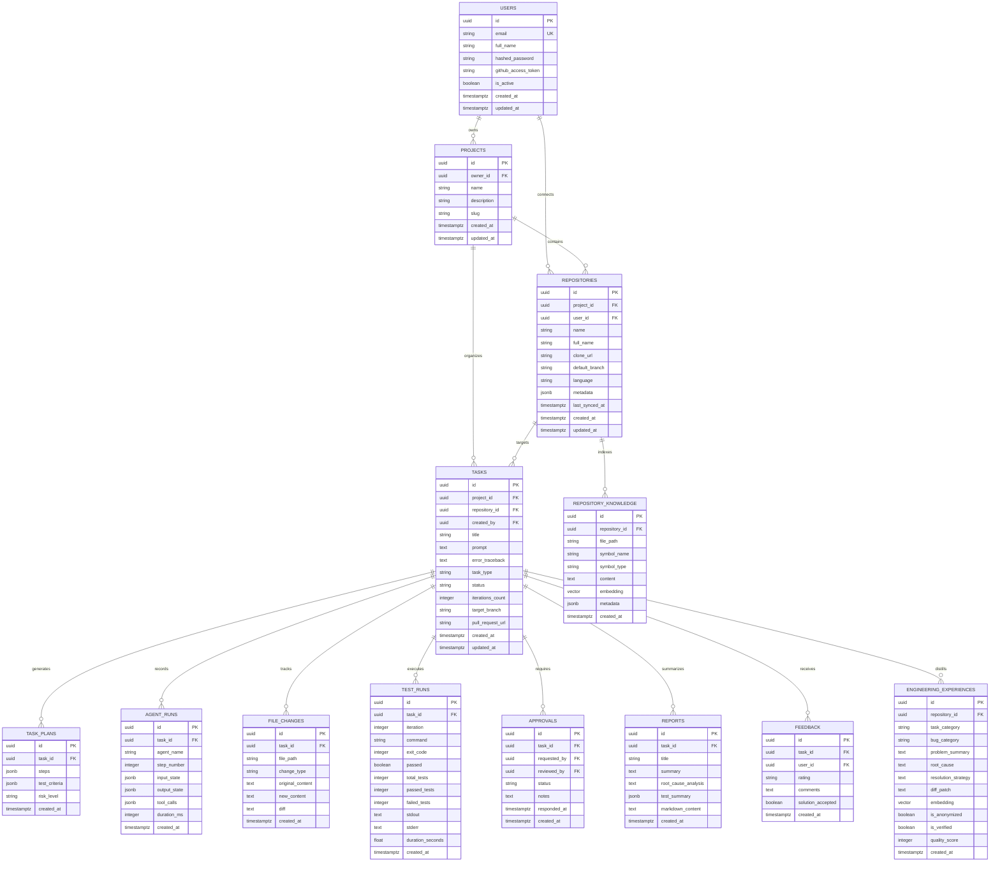

# Database & Data Model Specification
## Devora AI: Autonomous AI Software Engineer

---

### 1. Database Architecture & Engine Specification

* **RDBMS Engine:** PostgreSQL 16+
* **Vector Extension:** `pgvector` (v0.5.0+)
* **ORM:** SQLAlchemy 2.0 (AsyncIO with `asyncpg`)
* **Migration Framework:** Alembic
* **Identifier Standard:** UUIDv4 for all primary keys to guarantee distributed uniqueness and avoid enumeration attacks.
* **Timestamp Standard:** Timezone-aware UTC timestamps (`timestamptz`) for all creation and modification fields.

---

### 2. Entity-Relationship (ER) Model



---

### 3. Complete PostgreSQL DDL Specification

```sql
-- Enable necessary extensions
CREATE EXTENSION IF NOT EXISTS "uuid-ossp";
CREATE EXTENSION IF NOT EXISTS "vector";

-- 1. Users Table
CREATE TABLE users (
    id UUID PRIMARY KEY DEFAULT uuid_generate_v4(),
    email VARCHAR(255) UNIQUE NOT NULL,
    full_name VARCHAR(255) NOT NULL,
    hashed_password VARCHAR(255) NOT NULL,
    github_access_token TEXT,
    is_active BOOLEAN NOT NULL DEFAULT TRUE,
    created_at TIMESTAMPTZ NOT NULL DEFAULT CURRENT_TIMESTAMP,
    updated_at TIMESTAMPTZ NOT NULL DEFAULT CURRENT_TIMESTAMP
);

CREATE INDEX idx_users_email ON users(email);

-- 2. Projects Table
CREATE TABLE projects (
    id UUID PRIMARY KEY DEFAULT uuid_generate_v4(),
    owner_id UUID NOT NULL REFERENCES users(id) ON DELETE CASCADE,
    name VARCHAR(255) NOT NULL,
    description TEXT,
    slug VARCHAR(255) NOT NULL,
    created_at TIMESTAMPTZ NOT NULL DEFAULT CURRENT_TIMESTAMP,
    updated_at TIMESTAMPTZ NOT NULL DEFAULT CURRENT_TIMESTAMP,
    CONSTRAINT uq_project_slug_per_user UNIQUE(owner_id, slug)
);

CREATE INDEX idx_projects_owner ON projects(owner_id);

-- 3. Repositories Table
CREATE TABLE repositories (
    id UUID PRIMARY KEY DEFAULT uuid_generate_v4(),
    project_id UUID NOT NULL REFERENCES projects(id) ON DELETE CASCADE,
    user_id UUID NOT NULL REFERENCES users(id) ON DELETE CASCADE,
    name VARCHAR(255) NOT NULL,
    full_name VARCHAR(255) NOT NULL,
    clone_url TEXT NOT NULL,
    default_branch VARCHAR(100) NOT NULL DEFAULT 'main',
    language VARCHAR(100),
    metadata JSONB DEFAULT '{}'::jsonb,
    last_synced_at TIMESTAMPTZ,
    created_at TIMESTAMPTZ NOT NULL DEFAULT CURRENT_TIMESTAMP,
    updated_at TIMESTAMPTZ NOT NULL DEFAULT CURRENT_TIMESTAMP
);

CREATE INDEX idx_repositories_project ON repositories(project_id);
CREATE INDEX idx_repositories_user ON repositories(user_id);

-- 4. Tasks Table
CREATE TYPE task_status_enum AS ENUM (
    'PENDING', 'PLANNING', 'IN_PROGRESS', 'TESTING', 
    'WAITING_APPROVAL', 'COMPLETED', 'FAILED', 'CANCELLED'
);

CREATE TABLE tasks (
    id UUID PRIMARY KEY DEFAULT uuid_generate_v4(),
    project_id UUID NOT NULL REFERENCES projects(id) ON DELETE CASCADE,
    repository_id UUID NOT NULL REFERENCES repositories(id) ON DELETE CASCADE,
    created_by UUID NOT NULL REFERENCES users(id) ON DELETE CASCADE,
    title VARCHAR(255) NOT NULL,
    prompt TEXT NOT NULL,
    error_traceback TEXT,
    task_type VARCHAR(50) NOT NULL DEFAULT 'bug_fix',
    status task_status_enum NOT NULL DEFAULT 'PENDING',
    iterations_count INTEGER NOT NULL DEFAULT 0,
    target_branch VARCHAR(255) NOT NULL DEFAULT 'main',
    pull_request_url TEXT,
    created_at TIMESTAMPTZ NOT NULL DEFAULT CURRENT_TIMESTAMP,
    updated_at TIMESTAMPTZ NOT NULL DEFAULT CURRENT_TIMESTAMP
);

CREATE INDEX idx_tasks_repo_status ON tasks(repository_id, status);
CREATE INDEX idx_tasks_project ON tasks(project_id);

-- 5. Task Plans Table
CREATE TABLE task_plans (
    id UUID PRIMARY KEY DEFAULT uuid_generate_v4(),
    task_id UUID NOT NULL REFERENCES tasks(id) ON DELETE CASCADE,
    steps JSONB NOT NULL DEFAULT '[]'::jsonb,
    test_criteria JSONB NOT NULL DEFAULT '[]'::jsonb,
    risk_level VARCHAR(20) NOT NULL DEFAULT 'MEDIUM',
    created_at TIMESTAMPTZ NOT NULL DEFAULT CURRENT_TIMESTAMP
);

CREATE INDEX idx_task_plans_task ON task_plans(task_id);

-- 6. Agent Runs Table
CREATE TABLE agent_runs (
    id UUID PRIMARY KEY DEFAULT uuid_generate_v4(),
    task_id UUID NOT NULL REFERENCES tasks(id) ON DELETE CASCADE,
    agent_name VARCHAR(100) NOT NULL,
    step_number INTEGER NOT NULL,
    input_state JSONB NOT NULL DEFAULT '{}'::jsonb,
    output_state JSONB NOT NULL DEFAULT '{}'::jsonb,
    tool_calls JSONB NOT NULL DEFAULT '[]'::jsonb,
    duration_ms INTEGER NOT NULL DEFAULT 0,
    created_at TIMESTAMPTZ NOT NULL DEFAULT CURRENT_TIMESTAMP
);

CREATE INDEX idx_agent_runs_task_step ON agent_runs(task_id, step_number);

-- 7. File Changes Table
CREATE TABLE file_changes (
    id UUID PRIMARY KEY DEFAULT uuid_generate_v4(),
    task_id UUID NOT NULL REFERENCES tasks(id) ON DELETE CASCADE,
    file_path TEXT NOT NULL,
    change_type VARCHAR(20) NOT NULL, -- 'added', 'modified', 'deleted'
    original_content TEXT,
    new_content TEXT,
    diff TEXT NOT NULL,
    created_at TIMESTAMPTZ NOT NULL DEFAULT CURRENT_TIMESTAMP
);

CREATE INDEX idx_file_changes_task ON file_changes(task_id);

-- 8. Test Runs Table
CREATE TABLE test_runs (
    id UUID PRIMARY KEY DEFAULT uuid_generate_v4(),
    task_id UUID NOT NULL REFERENCES tasks(id) ON DELETE CASCADE,
    iteration INTEGER NOT NULL DEFAULT 1,
    command TEXT NOT NULL,
    exit_code INTEGER NOT NULL,
    passed BOOLEAN NOT NULL DEFAULT FALSE,
    total_tests INTEGER NOT NULL DEFAULT 0,
    passed_tests INTEGER NOT NULL DEFAULT 0,
    failed_tests INTEGER NOT NULL DEFAULT 0,
    stdout TEXT,
    stderr TEXT,
    duration_seconds REAL NOT NULL DEFAULT 0.0,
    created_at TIMESTAMPTZ NOT NULL DEFAULT CURRENT_TIMESTAMP
);

CREATE INDEX idx_test_runs_task_iter ON test_runs(task_id, iteration);

-- 9. Approvals Table
CREATE TYPE approval_status_enum AS ENUM ('PENDING', 'APPROVED', 'REJECTED', 'CHANGES_REQUESTED');

CREATE TABLE approvals (
    id UUID PRIMARY KEY DEFAULT uuid_generate_v4(),
    task_id UUID NOT NULL REFERENCES tasks(id) ON DELETE CASCADE,
    requested_by UUID NOT NULL REFERENCES users(id),
    reviewed_by UUID REFERENCES users(id),
    status approval_status_enum NOT NULL DEFAULT 'PENDING',
    notes TEXT,
    responded_at TIMESTAMPTZ,
    created_at TIMESTAMPTZ NOT NULL DEFAULT CURRENT_TIMESTAMP
);

CREATE INDEX idx_approvals_task ON approvals(task_id);

-- 10. Reports Table
CREATE TABLE reports (
    id UUID PRIMARY KEY DEFAULT uuid_generate_v4(),
    task_id UUID NOT NULL REFERENCES tasks(id) ON DELETE CASCADE,
    title VARCHAR(255) NOT NULL,
    summary TEXT NOT NULL,
    root_cause_analysis TEXT NOT NULL,
    test_summary JSONB NOT NULL DEFAULT '{}'::jsonb,
    markdown_content TEXT NOT NULL,
    created_at TIMESTAMPTZ NOT NULL DEFAULT CURRENT_TIMESTAMP
);

CREATE INDEX idx_reports_task ON reports(task_id);

-- 11. Feedback Table
CREATE TYPE feedback_rating_enum AS ENUM (
    'ACCEPTED', 'REJECTED', 'NEEDS_CHANGES', 
    'INCORRECT_SOLUTION', 'INCOMPLETE_SOLUTION'
);

CREATE TABLE feedback (
    id UUID PRIMARY KEY DEFAULT uuid_generate_v4(),
    task_id UUID NOT NULL REFERENCES tasks(id) ON DELETE CASCADE,
    user_id UUID NOT NULL REFERENCES users(id) ON DELETE CASCADE,
    rating feedback_rating_enum NOT NULL,
    comments TEXT,
    solution_accepted BOOLEAN NOT NULL DEFAULT FALSE,
    created_at TIMESTAMPTZ NOT NULL DEFAULT CURRENT_TIMESTAMP
);

CREATE INDEX idx_feedback_task ON feedback(task_id);

-- 12. Repository Knowledge Table (Vector Memory)
CREATE TABLE repository_knowledge (
    id UUID PRIMARY KEY DEFAULT uuid_generate_v4(),
    repository_id UUID NOT NULL REFERENCES repositories(id) ON DELETE CASCADE,
    file_path TEXT NOT NULL,
    symbol_name VARCHAR(255),
    symbol_type VARCHAR(50), -- 'class', 'function', 'module'
    content TEXT NOT NULL,
    embedding vector(768) NOT NULL,
    metadata JSONB DEFAULT '{}'::jsonb,
    created_at TIMESTAMPTZ NOT NULL DEFAULT CURRENT_TIMESTAMP
);

CREATE INDEX idx_repo_knowledge_repo ON repository_knowledge(repository_id);
-- HNSW Vector Index for Cosine Distance
CREATE INDEX idx_repo_knowledge_embedding ON repository_knowledge 
USING hnsw (embedding vector_cosine_ops) WITH (m = 16, ef_construction = 64);

-- 13. Engineering Experiences Table (Learning Memory)
CREATE TABLE engineering_experiences (
    id UUID PRIMARY KEY DEFAULT uuid_generate_v4(),
    repository_id UUID REFERENCES repositories(id) ON DELETE SET NULL,
    task_category VARCHAR(100) NOT NULL,
    bug_category VARCHAR(100),
    problem_summary TEXT NOT NULL,
    root_cause TEXT NOT NULL,
    resolution_strategy TEXT NOT NULL,
    diff_patch TEXT NOT NULL,
    embedding vector(768) NOT NULL,
    is_anonymized BOOLEAN NOT NULL DEFAULT FALSE,
    is_verified BOOLEAN NOT NULL DEFAULT FALSE,
    quality_score INTEGER NOT NULL DEFAULT 0,
    created_at TIMESTAMPTZ NOT NULL DEFAULT CURRENT_TIMESTAMP
);

CREATE INDEX idx_eng_exp_category ON engineering_experiences(task_category, bug_category);
-- HNSW Vector Index for Experience Similarity Retrieval
CREATE INDEX idx_eng_exp_embedding ON engineering_experiences 
USING hnsw (embedding vector_cosine_ops) WITH (m = 16, ef_construction = 64);
```

---

### 4. Tenant Isolation & Privacy Invariants

1. **Strict Scoping:** All operations on `tasks`, `repositories`, and `repository_knowledge` MUST join against `user_id` or `project_id` matching the authenticated user.
2. **Private Code Boundaries:** Vector searches in `repository_knowledge` MUST include the filter:
   `WHERE repository_id = :current_repo_id`
   No query may cross repository boundaries.
3. **Cross-Project Memory Anonymization:** `engineering_experiences` may only be queried cross-project if `is_anonymized = TRUE` AND `is_verified = TRUE` AND the repository owner explicitly toggled `allow_cross_project_learning = TRUE` in their repository settings.
