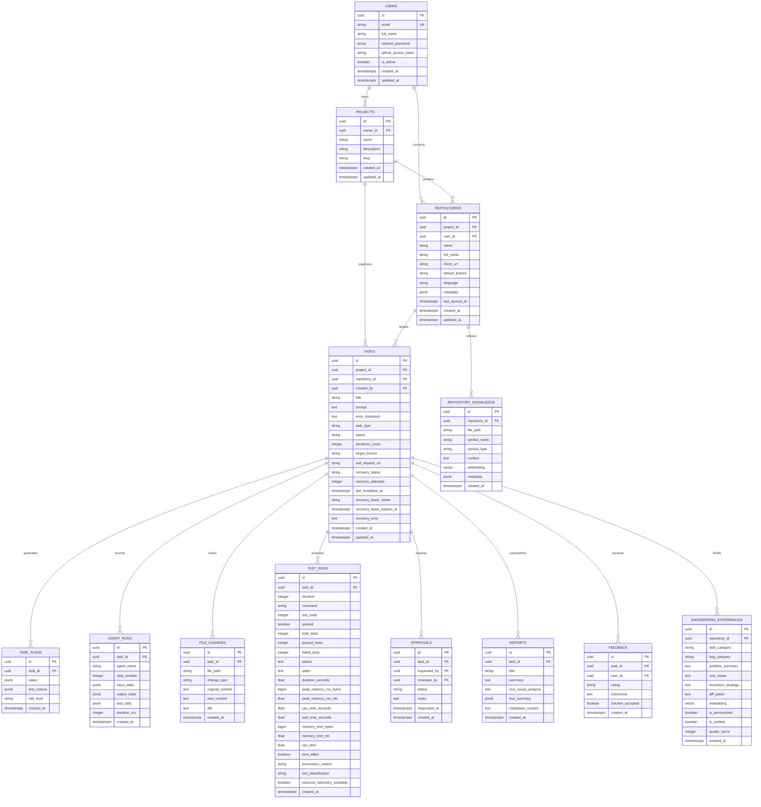

# Database & Data Model Specification
## Devora AI: Autonomous AI Software Engineer

---

### 1. Database Architecture & Engine Specification

* **RDBMS Engine:** PostgreSQL 16+
* **Vector Extension:** `pgvector` (v0.5.0+)
* **ORM:** SQLAlchemy 2.0 (AsyncIO with `asyncpg`)
* **Migration Framework:** Alembic
* **Identifier Standard:** UUIDv4 for all primary keys to guarantee distributed uniqueness and avoid enumeration attacks.
* **Timestamp Standard:** Timezone-aware UTC timestamps (`timestamptz`) for all creation and modification fields.

---

### 2. Entity-Relationship (ER) Model



---

### 3. Complete PostgreSQL DDL Specification

```sql
-- Enable necessary extensions
CREATE EXTENSION IF NOT EXISTS "uuid-ossp";
CREATE EXTENSION IF NOT EXISTS "vector";

-- 1. Users Table
CREATE TABLE users (
    id UUID PRIMARY KEY DEFAULT uuid_generate_v4(),
    email VARCHAR(255) UNIQUE NOT NULL,
    full_name VARCHAR(255) NOT NULL,
    hashed_password VARCHAR(255) NOT NULL,
    github_access_token TEXT,
    is_active BOOLEAN NOT NULL DEFAULT TRUE,
    created_at TIMESTAMPTZ NOT NULL DEFAULT CURRENT_TIMESTAMP,
    updated_at TIMESTAMPTZ NOT NULL DEFAULT CURRENT_TIMESTAMP
);

CREATE INDEX idx_users_email ON users(email);

-- 2. Projects Table
CREATE TABLE projects (
    id UUID PRIMARY KEY DEFAULT uuid_generate_v4(),
    owner_id UUID NOT NULL REFERENCES users(id) ON DELETE CASCADE,
    name VARCHAR(255) NOT NULL,
    description TEXT,
    slug VARCHAR(255) NOT NULL,
    created_at TIMESTAMPTZ NOT NULL DEFAULT CURRENT_TIMESTAMP,
    updated_at TIMESTAMPTZ NOT NULL DEFAULT CURRENT_TIMESTAMP,
    CONSTRAINT uq_project_slug_per_user UNIQUE(owner_id, slug)
);

CREATE INDEX idx_projects_owner ON projects(owner_id);

-- 3. Repositories Table
CREATE TABLE repositories (
    id UUID PRIMARY KEY DEFAULT uuid_generate_v4(),
    project_id UUID NOT NULL REFERENCES projects(id) ON DELETE CASCADE,
    user_id UUID NOT NULL REFERENCES users(id) ON DELETE CASCADE,
    name VARCHAR(255) NOT NULL,
    full_name VARCHAR(255) NOT NULL,
    clone_url TEXT NOT NULL,
    default_branch VARCHAR(100) NOT NULL DEFAULT 'main',
    language VARCHAR(100),
    metadata JSONB DEFAULT '{}'::jsonb,
    last_synced_at TIMESTAMPTZ,
    created_at TIMESTAMPTZ NOT NULL DEFAULT CURRENT_TIMESTAMP,
    updated_at TIMESTAMPTZ NOT NULL DEFAULT CURRENT_TIMESTAMP
);

CREATE INDEX idx_repositories_project ON repositories(project_id);
CREATE INDEX idx_repositories_user ON repositories(user_id);

-- 4. Tasks Table
CREATE TYPE task_status_enum AS ENUM (
    'PENDING', 'PLANNING', 'IN_PROGRESS', 'TESTING', 
    'WAITING_APPROVAL', 'COMPLETED', 'FAILED', 'CANCELLED'
);

CREATE TABLE tasks (
    id UUID PRIMARY KEY DEFAULT uuid_generate_v4(),
    project_id UUID NOT NULL REFERENCES projects(id) ON DELETE CASCADE,
    repository_id UUID NOT NULL REFERENCES repositories(id) ON DELETE CASCADE,
    created_by UUID NOT NULL REFERENCES users(id) ON DELETE CASCADE,
    title VARCHAR(255) NOT NULL,
    prompt TEXT NOT NULL,
    error_traceback TEXT,
    task_type VARCHAR(50) NOT NULL DEFAULT 'bug_fix',
    status task_status_enum NOT NULL DEFAULT 'PENDING',
    iterations_count INTEGER NOT NULL DEFAULT 0,
    target_branch VARCHAR(255) NOT NULL DEFAULT 'main',
    task_branch VARCHAR(255),
    commit_sha VARCHAR(100),
    pull_request_url TEXT,
    recovery_status VARCHAR(50) NOT NULL DEFAULT 'NOT_REQUIRED',
    recovery_attempts INTEGER NOT NULL DEFAULT 0,
    last_heartbeat_at TIMESTAMPTZ,
    recovery_lease_owner VARCHAR(100),
    recovery_lease_expires_at TIMESTAMPTZ,
    recovery_error TEXT,
    created_at TIMESTAMPTZ NOT NULL DEFAULT CURRENT_TIMESTAMP,
    updated_at TIMESTAMPTZ NOT NULL DEFAULT CURRENT_TIMESTAMP
);

CREATE INDEX idx_tasks_repo_status ON tasks(repository_id, status);
CREATE INDEX idx_tasks_recovery_status ON tasks(recovery_status);
CREATE INDEX idx_tasks_project ON tasks(project_id);

-- 5. Task Plans Table
CREATE TABLE task_plans (
    id UUID PRIMARY KEY DEFAULT uuid_generate_v4(),
    task_id UUID NOT NULL REFERENCES tasks(id) ON DELETE CASCADE,
    steps JSONB NOT NULL DEFAULT '[]'::jsonb,
    test_criteria JSONB NOT NULL DEFAULT '[]'::jsonb,
    risk_level VARCHAR(20) NOT NULL DEFAULT 'MEDIUM',
    created_at TIMESTAMPTZ NOT NULL DEFAULT CURRENT_TIMESTAMP
);

CREATE INDEX idx_task_plans_task ON task_plans(task_id);

-- 6. Agent Runs Table
CREATE TABLE agent_runs (
    id UUID PRIMARY KEY DEFAULT uuid_generate_v4(),
    task_id UUID NOT NULL REFERENCES tasks(id) ON DELETE CASCADE,
    agent_name VARCHAR(100) NOT NULL,
    step_number INTEGER NOT NULL,
    input_state JSONB NOT NULL DEFAULT '{}'::jsonb,
    output_state JSONB NOT NULL DEFAULT '{}'::jsonb,
    tool_calls JSONB NOT NULL DEFAULT '[]'::jsonb,
    duration_ms INTEGER NOT NULL DEFAULT 0,
    created_at TIMESTAMPTZ NOT NULL DEFAULT CURRENT_TIMESTAMP
);

CREATE INDEX idx_agent_runs_task_step ON agent_runs(task_id, step_number);

-- 7. File Changes Table
CREATE TABLE file_changes (
    id UUID PRIMARY KEY DEFAULT uuid_generate_v4(),
    task_id UUID NOT NULL REFERENCES tasks(id) ON DELETE CASCADE,
    file_path TEXT NOT NULL,
    change_type VARCHAR(20) NOT NULL, -- 'added', 'modified', 'deleted'
    original_content TEXT,
    new_content TEXT,
    diff TEXT NOT NULL,
    created_at TIMESTAMPTZ NOT NULL DEFAULT CURRENT_TIMESTAMP
);

CREATE INDEX idx_file_changes_task ON file_changes(task_id);

-- 8. Test Runs Table
CREATE TABLE test_runs (
    id UUID PRIMARY KEY DEFAULT uuid_generate_v4(),
    task_id UUID NOT NULL REFERENCES tasks(id) ON DELETE CASCADE,
    iteration INTEGER NOT NULL DEFAULT 1,
    command TEXT NOT NULL,
    exit_code INTEGER NOT NULL,
    passed BOOLEAN NOT NULL DEFAULT FALSE,
    total_tests INTEGER NOT NULL DEFAULT 0,
    passed_tests INTEGER NOT NULL DEFAULT 0,
    failed_tests INTEGER NOT NULL DEFAULT 0,
    stdout TEXT,
    stderr TEXT,
    duration_seconds REAL NOT NULL DEFAULT 0.0,
    peak_memory_rss_bytes BIGINT,
    peak_memory_rss_mb REAL,
    cpu_time_seconds REAL,
    wall_time_seconds REAL,
    memory_limit_bytes BIGINT,
    memory_limit_mb REAL,
    cpu_limit REAL,
    oom_killed BOOLEAN NOT NULL DEFAULT FALSE,
    termination_reason VARCHAR(255),
    exit_classification VARCHAR(50) NOT NULL DEFAULT 'EXECUTION_FAILURE',
    resource_telemetry_available BOOLEAN NOT NULL DEFAULT FALSE,
    created_at TIMESTAMPTZ NOT NULL DEFAULT CURRENT_TIMESTAMP
);

CREATE INDEX idx_test_runs_task_iter ON test_runs(task_id, iteration);

-- 9. Approvals Table
CREATE TYPE approval_status_enum AS ENUM ('PENDING', 'APPROVED', 'REJECTED', 'CHANGES_REQUESTED');

CREATE TABLE approvals (
    id UUID PRIMARY KEY DEFAULT uuid_generate_v4(),
    task_id UUID NOT NULL REFERENCES tasks(id) ON DELETE CASCADE,
    requested_by UUID NOT NULL REFERENCES users(id),
    reviewed_by UUID REFERENCES users(id),
    status approval_status_enum NOT NULL DEFAULT 'PENDING',
    notes TEXT,
    responded_at TIMESTAMPTZ,
    created_at TIMESTAMPTZ NOT NULL DEFAULT CURRENT_TIMESTAMP
);

CREATE INDEX idx_approvals_task ON approvals(task_id);

-- 10. Reports Table
CREATE TABLE reports (
    id UUID PRIMARY KEY DEFAULT uuid_generate_v4(),
    task_id UUID NOT NULL REFERENCES tasks(id) ON DELETE CASCADE,
    title VARCHAR(255) NOT NULL,
    summary TEXT NOT NULL,
    root_cause_analysis TEXT NOT NULL,
    test_summary JSONB NOT NULL DEFAULT '{}'::jsonb,
    markdown_content TEXT NOT NULL,
    created_at TIMESTAMPTZ NOT NULL DEFAULT CURRENT_TIMESTAMP
);

CREATE INDEX idx_reports_task ON reports(task_id);

-- 11. Feedback Table
CREATE TYPE feedback_rating_enum AS ENUM (
    'ACCEPTED', 'REJECTED', 'NEEDS_CHANGES', 
    'INCORRECT_SOLUTION', 'INCOMPLETE_SOLUTION'
);

CREATE TABLE feedback (
    id UUID PRIMARY KEY DEFAULT uuid_generate_v4(),
    task_id UUID NOT NULL REFERENCES tasks(id) ON DELETE CASCADE,
    user_id UUID NOT NULL REFERENCES users(id) ON DELETE CASCADE,
    rating feedback_rating_enum NOT NULL,
    comments TEXT,
    solution_accepted BOOLEAN NOT NULL DEFAULT FALSE,
    created_at TIMESTAMPTZ NOT NULL DEFAULT CURRENT_TIMESTAMP
);

CREATE INDEX idx_feedback_task ON feedback(task_id);

-- 12. Repository Knowledge Table (Vector Memory)
CREATE TABLE repository_knowledge (
    id UUID PRIMARY KEY DEFAULT uuid_generate_v4(),
    repository_id UUID NOT NULL REFERENCES repositories(id) ON DELETE CASCADE,
    file_path TEXT NOT NULL,
    symbol_name VARCHAR(255),
    symbol_type VARCHAR(50), -- 'class', 'function', 'module'
    content TEXT NOT NULL,
    embedding vector(768) NOT NULL,
    metadata JSONB DEFAULT '{}'::jsonb,
    created_at TIMESTAMPTZ NOT NULL DEFAULT CURRENT_TIMESTAMP
);

CREATE INDEX idx_repo_knowledge_repo ON repository_knowledge(repository_id);
-- HNSW Vector Index for Cosine Distance
CREATE INDEX idx_repo_knowledge_embedding ON repository_knowledge 
USING hnsw (embedding vector_cosine_ops) WITH (m = 16, ef_construction = 64);

-- 13. Engineering Experiences Table (Learning Memory)
CREATE TABLE engineering_experiences (
    id UUID PRIMARY KEY DEFAULT uuid_generate_v4(),
    repository_id UUID REFERENCES repositories(id) ON DELETE SET NULL,
    task_category VARCHAR(100) NOT NULL,
    bug_category VARCHAR(100),
    problem_summary TEXT NOT NULL,
    root_cause TEXT NOT NULL,
    resolution_strategy TEXT NOT NULL,
    diff_patch TEXT NOT NULL,
    embedding vector(768) NOT NULL,
    is_anonymized BOOLEAN NOT NULL DEFAULT FALSE,
    is_verified BOOLEAN NOT NULL DEFAULT FALSE,
    quality_score INTEGER NOT NULL DEFAULT 0,
    created_at TIMESTAMPTZ NOT NULL DEFAULT CURRENT_TIMESTAMP
);

CREATE INDEX idx_eng_exp_category ON engineering_experiences(task_category, bug_category);
-- HNSW Vector Index for Experience Similarity Retrieval
CREATE INDEX idx_eng_exp_embedding ON engineering_experiences 
USING hnsw (embedding vector_cosine_ops) WITH (m = 16, ef_construction = 64);

-- 14. Repository Memories Table (Phase 5 Semantic Vector Memory)
CREATE TABLE repository_memories (
    id UUID PRIMARY KEY DEFAULT uuid_generate_v4(),
    repository_id UUID NOT NULL REFERENCES repositories(id) ON DELETE CASCADE,
    category VARCHAR(50) NOT NULL, -- 'architecture', 'coding_conventions', 'testing_patterns', 'common_errors', 'task_outcome', etc.
    title VARCHAR(255),
    content TEXT NOT NULL,
    embedding vector(768) NOT NULL,
    source_reference VARCHAR(255),
    commit_sha VARCHAR(40),
    verification_status VARCHAR(50) NOT NULL DEFAULT 'observed_fact', -- 'observed_fact', 'ai_hypothesis', 'developer_confirmed', 'verified_outcome'
    access_scope VARCHAR(50) NOT NULL DEFAULT 'repository',
    is_stale BOOLEAN NOT NULL DEFAULT FALSE,
    stale_reason TEXT,
    helpful_count INTEGER NOT NULL DEFAULT 0,
    unhelpful_count INTEGER NOT NULL DEFAULT 0,
    metadata JSONB DEFAULT '{}'::jsonb,
    created_at TIMESTAMPTZ NOT NULL DEFAULT CURRENT_TIMESTAMP,
    updated_at TIMESTAMPTZ NOT NULL DEFAULT CURRENT_TIMESTAMP
);

CREATE INDEX idx_repo_memories_repo_cat ON repository_memories(repository_id, category);
CREATE INDEX idx_repo_memories_status ON repository_memories(repository_id, verification_status);
CREATE INDEX idx_repo_memories_stale ON repository_memories(repository_id, is_stale);

-- 15. Memory Feedback Table
CREATE TABLE memory_feedback (
    id UUID PRIMARY KEY DEFAULT uuid_generate_v4(),
    memory_id UUID NOT NULL REFERENCES repository_memories(id) ON DELETE CASCADE,
    user_id UUID NOT NULL REFERENCES users(id) ON DELETE CASCADE,
    task_id UUID REFERENCES tasks(id) ON DELETE SET NULL,
    is_helpful BOOLEAN NOT NULL,
    notes TEXT,
    created_at TIMESTAMPTZ NOT NULL DEFAULT CURRENT_TIMESTAMP,
    updated_at TIMESTAMPTZ NOT NULL DEFAULT CURRENT_TIMESTAMP
);

CREATE INDEX idx_memory_feedback_mem ON memory_feedback(memory_id);
CREATE INDEX idx_memory_feedback_user ON memory_feedback(user_id);

-- 16. ML Models Table (Phase 6 Bug Classification Engine)
CREATE TABLE ml_models (
    id UUID PRIMARY KEY DEFAULT uuid_generate_v4(),
    version VARCHAR(50) UNIQUE NOT NULL,
    algorithm VARCHAR(100) NOT NULL DEFAULT 'LogisticRegression',
    is_active BOOLEAN NOT NULL DEFAULT FALSE,
    accuracy FLOAT NOT NULL DEFAULT 0.0,
    macro_f1 FLOAT NOT NULL DEFAULT 0.0,
    weighted_f1 FLOAT NOT NULL DEFAULT 0.0,
    metrics JSONB NOT NULL DEFAULT '{}'::jsonb,
    training_sample_count INTEGER NOT NULL DEFAULT 0,
    model_sha256 VARCHAR(64) NOT NULL,
    vectorizer_sha256 VARCHAR(64) NOT NULL,
    promotion_reason VARCHAR(255),
    created_at TIMESTAMPTZ NOT NULL DEFAULT CURRENT_TIMESTAMP,
    updated_at TIMESTAMPTZ NOT NULL DEFAULT CURRENT_TIMESTAMP
);

CREATE INDEX idx_ml_models_version ON ml_models(version);
CREATE INDEX idx_ml_models_active ON ml_models(is_active);

-- 17. ML Predictions Table
CREATE TABLE ml_predictions (
    id UUID PRIMARY KEY DEFAULT uuid_generate_v4(),
    task_id UUID REFERENCES tasks(id) ON DELETE SET NULL,
    input_hash VARCHAR(64) NOT NULL,
    error_sample_preview TEXT NOT NULL DEFAULT '',
    predicted_category VARCHAR(50) NOT NULL,
    confidence FLOAT NOT NULL,
    top_probabilities JSONB NOT NULL DEFAULT '[]'::jsonb,
    is_low_confidence BOOLEAN NOT NULL DEFAULT FALSE,
    model_version VARCHAR(50) NOT NULL,
    inference_time_ms FLOAT NOT NULL DEFAULT 0.0,
    verified_category VARCHAR(50),
    is_correct BOOLEAN,
    created_at TIMESTAMPTZ NOT NULL DEFAULT CURRENT_TIMESTAMP,
    updated_at TIMESTAMPTZ NOT NULL DEFAULT CURRENT_TIMESTAMP
);

CREATE INDEX idx_ml_predictions_task ON ml_predictions(task_id);
CREATE INDEX idx_ml_predictions_hash ON ml_predictions(input_hash);
CREATE INDEX idx_ml_predictions_cat ON ml_predictions(predicted_category);
CREATE INDEX idx_ml_pred_task_cat ON ml_predictions(task_id, predicted_category);

-- 18. Task Failure Records Table (Phase 7)
CREATE TABLE task_failure_records (
    id UUID PRIMARY KEY DEFAULT uuid_generate_v4(),
    task_id UUID NOT NULL REFERENCES tasks(id) ON DELETE CASCADE,
    stage VARCHAR(50) NOT NULL, -- 'TESTING', 'CODE_REVIEW', 'SECURITY_AUDIT', 'DEVELOPER_REVIEW'
    failure_type VARCHAR(50) NOT NULL, -- 'INCORRECT_ASSUMPTION', 'IMPLEMENTATION_DEFECT', 'DEPENDENCY_ISSUE', 'ENVIRONMENT_PROBLEM'
    attempt_number INTEGER NOT NULL DEFAULT 1,
    failed_strategy TEXT NOT NULL,
    error_log TEXT NOT NULL DEFAULT '',
    review_notes TEXT,
    lessons_learned TEXT NOT NULL,
    created_at TIMESTAMPTZ NOT NULL DEFAULT CURRENT_TIMESTAMP
);

CREATE INDEX idx_task_failures_task ON task_failure_records(task_id);
CREATE INDEX idx_task_failures_stage ON task_failure_records(stage);
CREATE INDEX idx_task_failures_type ON task_failure_records(failure_type);

-- 19. Benchmark Definitions Table (Phase 7)
CREATE TABLE benchmark_definitions (
    id VARCHAR(50) PRIMARY KEY, -- 'BM-BUG-01', 'BM-BUG-02', etc.
    name VARCHAR(255) NOT NULL,
    category VARCHAR(100) NOT NULL,
    description TEXT NOT NULL,
    initial_repo_snapshot VARCHAR(255) NOT NULL,
    expected_outcomes JSONB NOT NULL DEFAULT '{}'::jsonb,
    evaluation_criteria JSONB NOT NULL DEFAULT '{}'::jsonb,
    baseline_pass_rate FLOAT NOT NULL DEFAULT 0.0,
    created_at TIMESTAMPTZ NOT NULL DEFAULT CURRENT_TIMESTAMP,
    updated_at TIMESTAMPTZ NOT NULL DEFAULT CURRENT_TIMESTAMP
);

CREATE INDEX idx_benchmark_defs_cat ON benchmark_definitions(category);

-- 20. Benchmark Runs Table (Phase 7)
CREATE TABLE benchmark_runs (
    id UUID PRIMARY KEY DEFAULT uuid_generate_v4(),
    benchmark_id VARCHAR(50) NOT NULL REFERENCES benchmark_definitions(id) ON DELETE CASCADE,
    system_version VARCHAR(50) NOT NULL,
    model_version VARCHAR(50) NOT NULL,
    task_completed BOOLEAN NOT NULL DEFAULT FALSE,
    tests_passed BOOLEAN NOT NULL DEFAULT FALSE,
    retries_count INTEGER NOT NULL DEFAULT 0,
    planning_efficiency_score FLOAT NOT NULL DEFAULT 0.0,
    execution_time_ms INTEGER NOT NULL DEFAULT 0,
    tokens_used INTEGER NOT NULL DEFAULT 0,
    estimated_cost_usd FLOAT NOT NULL DEFAULT 0.0,
    review_passed BOOLEAN NOT NULL DEFAULT FALSE,
    metrics JSONB NOT NULL DEFAULT '{}'::jsonb,
    created_at TIMESTAMPTZ NOT NULL DEFAULT CURRENT_TIMESTAMP
);

CREATE INDEX idx_benchmark_runs_bm ON benchmark_runs(benchmark_id);
CREATE INDEX idx_benchmark_runs_sys_ver ON benchmark_runs(system_version);
CREATE INDEX idx_benchmark_runs_created ON benchmark_runs(created_at);

-- 21. GitHub Installations Table (Phase 8)
CREATE TABLE github_installations (
    id UUID PRIMARY KEY DEFAULT uuid_generate_v4(),
    user_id UUID NOT NULL REFERENCES users(id) ON DELETE CASCADE,
    installation_id BIGINT UNIQUE NOT NULL,
    account_login VARCHAR(255) NOT NULL,
    account_type VARCHAR(50) NOT NULL DEFAULT 'User',
    repository_selection VARCHAR(50) NOT NULL DEFAULT 'selected',
    permissions JSONB NOT NULL DEFAULT '{}'::jsonb,
    access_token_encrypted TEXT,
    token_expires_at TIMESTAMPTZ,
    is_active BOOLEAN NOT NULL DEFAULT TRUE,
    created_at TIMESTAMPTZ NOT NULL DEFAULT CURRENT_TIMESTAMP,
    updated_at TIMESTAMPTZ NOT NULL DEFAULT CURRENT_TIMESTAMP
);

CREATE INDEX idx_gh_installations_user ON github_installations(user_id);
CREATE INDEX idx_gh_installations_id ON github_installations(installation_id);

-- 22. GitHub Pull Requests Table (Phase 8)
CREATE TABLE github_pull_requests (
    id UUID PRIMARY KEY DEFAULT uuid_generate_v4(),
    task_id UUID UNIQUE NOT NULL REFERENCES tasks(id) ON DELETE CASCADE,
    repository_id UUID NOT NULL REFERENCES repositories(id) ON DELETE CASCADE,
    pr_number INTEGER NOT NULL,
    title VARCHAR(255) NOT NULL,
    body TEXT NOT NULL,
    html_url TEXT NOT NULL,
    head_branch VARCHAR(255) NOT NULL,
    base_branch VARCHAR(255) NOT NULL DEFAULT 'main',
    state VARCHAR(50) NOT NULL DEFAULT 'open',
    is_merged BOOLEAN NOT NULL DEFAULT FALSE,
    merge_commit_sha VARCHAR(100),
    merged_at TIMESTAMPTZ,
    closed_at TIMESTAMPTZ,
    created_at TIMESTAMPTZ NOT NULL DEFAULT CURRENT_TIMESTAMP,
    updated_at TIMESTAMPTZ NOT NULL DEFAULT CURRENT_TIMESTAMP
);

CREATE INDEX idx_gh_prs_task ON github_pull_requests(task_id);
CREATE INDEX idx_gh_prs_repo ON github_pull_requests(repository_id);
CREATE INDEX idx_gh_prs_number ON github_pull_requests(pr_number);

-- 23. Git Branches Table (Phase 8)
CREATE TABLE git_branches (
    id UUID PRIMARY KEY DEFAULT uuid_generate_v4(),
    task_id UUID NOT NULL REFERENCES tasks(id) ON DELETE CASCADE,
    repository_id UUID NOT NULL REFERENCES repositories(id) ON DELETE CASCADE,
    branch_name VARCHAR(255) NOT NULL,
    base_branch VARCHAR(255) NOT NULL DEFAULT 'main',
    commit_sha VARCHAR(100),
    is_pushed BOOLEAN NOT NULL DEFAULT FALSE,
    pushed_at TIMESTAMPTZ,
    created_at TIMESTAMPTZ NOT NULL DEFAULT CURRENT_TIMESTAMP
);

CREATE INDEX idx_git_branches_task ON git_branches(task_id);
CREATE INDEX idx_git_branches_repo ON git_branches(repository_id);
CREATE INDEX idx_git_branches_name ON git_branches(branch_name);

-- 24. Flaky Test Records Table (Phase 9 Stage 9.2)
CREATE TABLE flaky_test_records (
    id UUID PRIMARY KEY DEFAULT gen_random_uuid(),
    repository_id UUID NOT NULL REFERENCES repositories(id) ON DELETE CASCADE,
    task_id UUID NOT NULL REFERENCES tasks(id) ON DELETE CASCADE,
    test_identifier VARCHAR(500) NOT NULL,
    test_file VARCHAR(500) NOT NULL,
    framework VARCHAR(50) NOT NULL DEFAULT 'pytest',
    language VARCHAR(50) NOT NULL DEFAULT 'python',
    test_command TEXT NOT NULL,
    classification VARCHAR(50) NOT NULL DEFAULT 'FLAKY',
    stability_score FLOAT NOT NULL DEFAULT 0.0,
    total_runs INTEGER NOT NULL DEFAULT 0,
    passed_runs INTEGER NOT NULL DEFAULT 0,
    failed_runs INTEGER NOT NULL DEFAULT 0,
    infrastructure_error_runs INTEGER NOT NULL DEFAULT 0,
    timeout_runs INTEGER NOT NULL DEFAULT 0,
    execution_history JSONB NOT NULL DEFAULT '{}'::jsonb,
    first_detected_at TIMESTAMPTZ NOT NULL DEFAULT CURRENT_TIMESTAMP,
    last_detected_at TIMESTAMPTZ NOT NULL DEFAULT CURRENT_TIMESTAMP,
    last_verified_at TIMESTAMPTZ NOT NULL DEFAULT CURRENT_TIMESTAMP,
    created_at TIMESTAMPTZ NOT NULL DEFAULT CURRENT_TIMESTAMP,
    updated_at TIMESTAMPTZ NOT NULL DEFAULT CURRENT_TIMESTAMP
);

CREATE INDEX idx_flaky_test_repo_ident ON flaky_test_records(repository_id, test_identifier);
CREATE INDEX idx_flaky_test_task_id ON flaky_test_records(task_id);
CREATE INDEX idx_flaky_test_classification ON flaky_test_records(classification);

-- 25. Workflow Checkpoints Table (Phase 9 Stage 9.4)
CREATE TABLE workflow_checkpoints (
    id UUID PRIMARY KEY DEFAULT gen_random_uuid(),
    task_id UUID NOT NULL REFERENCES tasks(id) ON DELETE CASCADE,
    thread_id VARCHAR(100) NOT NULL,
    checkpoint_ns VARCHAR(100) NOT NULL DEFAULT '',
    checkpoint_id VARCHAR(100) NOT NULL,
    parent_checkpoint_id VARCHAR(100),
    node_name VARCHAR(100),
    step_number INTEGER NOT NULL DEFAULT 0,
    version INTEGER NOT NULL DEFAULT 1,
    state_blob JSONB NOT NULL DEFAULT '{}'::jsonb,
    created_at TIMESTAMPTZ NOT NULL DEFAULT CURRENT_TIMESTAMP,
    updated_at TIMESTAMPTZ NOT NULL DEFAULT CURRENT_TIMESTAMP
);

CREATE INDEX idx_workflow_checkpoints_task ON workflow_checkpoints(task_id);
CREATE INDEX idx_workflow_checkpoints_thread ON workflow_checkpoints(thread_id);
CREATE INDEX idx_workflow_checkpoints_node ON workflow_checkpoints(node_name);
CREATE INDEX idx_workflow_checkpoints_step ON workflow_checkpoints(task_id, step_number DESC);

-- 26. Model Gateway Health Table (Phase 9 Stage 9.5)
CREATE TABLE model_gateway_health (
    id UUID PRIMARY KEY DEFAULT gen_random_uuid(),
    provider_name VARCHAR(50) NOT NULL,
    model_name VARCHAR(100) NOT NULL,
    circuit_state VARCHAR(20) NOT NULL DEFAULT 'CLOSED',
    consecutive_failures INTEGER NOT NULL DEFAULT 0,
    consecutive_successes INTEGER NOT NULL DEFAULT 0,
    total_calls INTEGER NOT NULL DEFAULT 0,
    total_failures INTEGER NOT NULL DEFAULT 0,
    total_retries INTEGER NOT NULL DEFAULT 0,
    total_fallbacks INTEGER NOT NULL DEFAULT 0,
    average_latency_ms FLOAT NOT NULL DEFAULT 0.0,
    last_failure_reason TEXT,
    last_failure_classification VARCHAR(50),
    last_failure_at TIMESTAMPTZ,
    last_success_at TIMESTAMPTZ,
    last_state_change_at TIMESTAMPTZ NOT NULL DEFAULT CURRENT_TIMESTAMP,
    created_at TIMESTAMPTZ NOT NULL DEFAULT CURRENT_TIMESTAMP,
    updated_at TIMESTAMPTZ NOT NULL DEFAULT CURRENT_TIMESTAMP,
    CONSTRAINT uq_provider_model_health UNIQUE (provider_name, model_name)
);

CREATE INDEX ix_model_gateway_health_provider_name ON model_gateway_health(provider_name);
CREATE INDEX ix_model_gateway_health_model_name ON model_gateway_health(model_name);
CREATE INDEX ix_model_gateway_health_circuit_state ON model_gateway_health(circuit_state);

-- 27. Repository Graph Nodes Table (Phase 10 Stage 10.1)
CREATE TABLE repository_graph_nodes (
    id UUID PRIMARY KEY DEFAULT gen_random_uuid(),
    repository_id UUID NOT NULL REFERENCES repositories(id) ON DELETE CASCADE,
    node_type VARCHAR(32) NOT NULL,
    qualified_name VARCHAR(512) NOT NULL,
    name VARCHAR(255) NOT NULL,
    file_path VARCHAR(1024),
    language VARCHAR(64),
    start_line INTEGER,
    end_line INTEGER,
    start_col INTEGER,
    end_col INTEGER,
    content_hash VARCHAR(64),
    docstring TEXT,
    meta_info JSONB NOT NULL DEFAULT '{}'::jsonb,
    created_at TIMESTAMPTZ NOT NULL DEFAULT CURRENT_TIMESTAMP,
    updated_at TIMESTAMPTZ NOT NULL DEFAULT CURRENT_TIMESTAMP,
    CONSTRAINT uq_repo_graph_nodes_qname UNIQUE (repository_id, qualified_name)
);

CREATE INDEX ix_repo_graph_nodes_repo_id ON repository_graph_nodes(repository_id);
CREATE INDEX ix_repo_graph_nodes_type ON repository_graph_nodes(repository_id, node_type);
CREATE INDEX ix_repo_graph_nodes_filepath ON repository_graph_nodes(repository_id, file_path);

-- 28. Repository Graph Edges Table (Phase 10 Stage 10.1)
CREATE TABLE repository_graph_edges (
    id UUID PRIMARY KEY DEFAULT gen_random_uuid(),
    repository_id UUID NOT NULL REFERENCES repositories(id) ON DELETE CASCADE,
    source_node_id UUID NOT NULL REFERENCES repository_graph_nodes(id) ON DELETE CASCADE,
    target_node_id UUID REFERENCES repository_graph_nodes(id) ON DELETE SET NULL,
    edge_type VARCHAR(32) NOT NULL,
    confidence FLOAT NOT NULL DEFAULT 1.0,
    resolution_status VARCHAR(32) NOT NULL DEFAULT 'RESOLVED',
    target_symbol VARCHAR(512),
    line_number INTEGER,
    meta_info JSONB NOT NULL DEFAULT '{}'::jsonb,
    created_at TIMESTAMPTZ NOT NULL DEFAULT CURRENT_TIMESTAMP
);

CREATE INDEX ix_repo_graph_edges_repo_id ON repository_graph_edges(repository_id);
CREATE INDEX ix_repo_graph_edges_source ON repository_graph_edges(source_node_id);
CREATE INDEX ix_repo_graph_edges_target ON repository_graph_edges(target_node_id);
CREATE INDEX ix_repo_graph_edges_type ON repository_graph_edges(edge_type);
CREATE INDEX ix_repo_graph_edges_resolution ON repository_graph_edges(resolution_status);

-- 29. Repository Architecture Patterns Table (Phase 10 Stage 10.4)
CREATE TABLE repository_architecture_patterns (
    id UUID PRIMARY KEY DEFAULT gen_random_uuid(),
    repository_id UUID NOT NULL REFERENCES repositories(id) ON DELETE CASCADE,
    pattern_id VARCHAR(100) NOT NULL,
    category VARCHAR(50) NOT NULL,
    name VARCHAR(255) NOT NULL,
    description TEXT NOT NULL,
    evidence_status VARCHAR(50) NOT NULL,
    confidence_score FLOAT NOT NULL,
    supporting_files JSONB NOT NULL DEFAULT '[]'::jsonb,
    supporting_symbols JSONB NOT NULL DEFAULT '[]'::jsonb,
    supporting_relationships JSONB NOT NULL DEFAULT '[]'::jsonb,
    supporting_config JSONB NOT NULL DEFAULT '{}'::jsonb,
    counterexamples JSONB NOT NULL DEFAULT '[]'::jsonb,
    conventions JSONB NOT NULL DEFAULT '[]'::jsonb,
    created_at TIMESTAMPTZ NOT NULL DEFAULT CURRENT_TIMESTAMP,
    updated_at TIMESTAMPTZ NOT NULL DEFAULT CURRENT_TIMESTAMP,
    CONSTRAINT uq_repo_pattern_slug UNIQUE (repository_id, pattern_id)
);

CREATE INDEX ix_repo_arch_patterns_repo_id ON repository_architecture_patterns(repository_id);
CREATE INDEX ix_repo_arch_patterns_category ON repository_architecture_patterns(repository_id, category);
CREATE INDEX ix_repo_arch_patterns_status ON repository_architecture_patterns(repository_id, evidence_status);
CREATE INDEX ix_repo_arch_patterns_confidence ON repository_architecture_patterns(confidence_score);

-- 30. Repository Architecture Drift Table (Phase 10 Stage 10.5)
CREATE TABLE repository_architecture_drift (
    id UUID PRIMARY KEY DEFAULT gen_random_uuid(),
    repository_id UUID NOT NULL REFERENCES repositories(id) ON DELETE CASCADE,
    commit_sha VARCHAR(100),
    baseline_commit_sha VARCHAR(100),
    drift_status VARCHAR(50) NOT NULL,
    total_violations INTEGER NOT NULL DEFAULT 0,
    critical_violations INTEGER NOT NULL DEFAULT 0,
    high_violations INTEGER NOT NULL DEFAULT 0,
    medium_violations INTEGER NOT NULL DEFAULT 0,
    low_violations INTEGER NOT NULL DEFAULT 0,
    violations JSONB NOT NULL DEFAULT '[]'::jsonb,
    resolved_violations JSONB NOT NULL DEFAULT '[]'::jsonb,
    summary JSONB NOT NULL DEFAULT '{}'::jsonb,
    created_at TIMESTAMPTZ NOT NULL DEFAULT CURRENT_TIMESTAMP,
    updated_at TIMESTAMPTZ NOT NULL DEFAULT CURRENT_TIMESTAMP
);

CREATE INDEX ix_repo_arch_drift_repo_id ON repository_architecture_drift(repository_id);
CREATE INDEX ix_repo_arch_drift_created_at ON repository_architecture_drift(created_at);
CREATE INDEX ix_repo_arch_drift_status ON repository_architecture_drift(repository_id, drift_status);

-- 31. Repository Technical Debt Table (Phase 10 Stage 10.5)
CREATE TABLE repository_technical_debt (
    id UUID PRIMARY KEY DEFAULT gen_random_uuid(),
    repository_id UUID NOT NULL REFERENCES repositories(id) ON DELETE CASCADE,
    commit_sha VARCHAR(100),
    overall_debt_score FLOAT NOT NULL,
    severity VARCHAR(50) NOT NULL,
    confidence FLOAT NOT NULL DEFAULT 0.0,
    complexity_score FLOAT NOT NULL DEFAULT 0.0,
    duplication_score FLOAT NOT NULL DEFAULT 0.0,
    dependency_score FLOAT NOT NULL DEFAULT 0.0,
    architecture_drift_score FLOAT NOT NULL DEFAULT 0.0,
    test_debt_score FLOAT NOT NULL DEFAULT 0.0,
    maintainability_score FLOAT NOT NULL DEFAULT 0.0,
    findings JSONB NOT NULL DEFAULT '[]'::jsonb,
    summary_metrics JSONB NOT NULL DEFAULT '{}'::jsonb,
    created_at TIMESTAMPTZ NOT NULL DEFAULT CURRENT_TIMESTAMP,
    updated_at TIMESTAMPTZ NOT NULL DEFAULT CURRENT_TIMESTAMP
);

CREATE INDEX ix_repo_tech_debt_repo_id ON repository_technical_debt(repository_id);
CREATE INDEX ix_repo_tech_debt_created_at ON repository_technical_debt(created_at);
CREATE INDEX ix_repo_tech_debt_severity ON repository_technical_debt(repository_id, severity);
CREATE INDEX ix_repo_tech_debt_score ON repository_technical_debt(overall_debt_score);

-- 32. Repository Refactoring Plans Table (Phase 10 Stage 10.6)
CREATE TABLE repository_refactoring_plans (
    id UUID PRIMARY KEY DEFAULT gen_random_uuid(),
    repository_id UUID NOT NULL REFERENCES repositories(id) ON DELETE CASCADE,
    source_revision VARCHAR(100),
    title VARCHAR(255) NOT NULL,
    description TEXT NOT NULL DEFAULT '',
    category VARCHAR(50) NOT NULL,
    risk_level VARCHAR(20) NOT NULL DEFAULT 'LOW',
    risk_score FLOAT NOT NULL DEFAULT 0.0,
    confidence FLOAT NOT NULL DEFAULT 0.0,
    requires_human_approval BOOLEAN NOT NULL DEFAULT FALSE,
    approval_status VARCHAR(50) NOT NULL DEFAULT 'PENDING',
    approved_by UUID REFERENCES users(id) ON DELETE SET NULL,
    approved_at TIMESTAMPTZ,
    approved_diff_hash VARCHAR(64),
    execution_status VARCHAR(50) NOT NULL DEFAULT 'DRAFT',
    target_files JSONB NOT NULL DEFAULT '[]'::jsonb,
    target_symbols JSONB NOT NULL DEFAULT '[]'::jsonb,
    finding_ids JSONB NOT NULL DEFAULT '[]'::jsonb,
    affected_packages JSONB NOT NULL DEFAULT '[]'::jsonb,
    ordered_steps JSONB NOT NULL DEFAULT '[]'::jsonb,
    recommended_tests JSONB NOT NULL DEFAULT '[]'::jsonb,
    expected_outcomes JSONB NOT NULL DEFAULT '{}'::jsonb,
    created_at TIMESTAMPTZ NOT NULL DEFAULT CURRENT_TIMESTAMP,
    updated_at TIMESTAMPTZ NOT NULL DEFAULT CURRENT_TIMESTAMP
);

CREATE INDEX ix_refactor_plans_repo_id ON repository_refactoring_plans(repository_id);
CREATE INDEX ix_refactor_plans_created_at ON repository_refactoring_plans(created_at);
CREATE INDEX ix_refactor_plans_approval ON repository_refactoring_plans(repository_id, approval_status);
CREATE INDEX ix_refactor_plans_category ON repository_refactoring_plans(repository_id, category);

-- 33. Refactoring Executions Table (Phase 10 Stage 10.6)
CREATE TABLE refactoring_executions (
    id UUID PRIMARY KEY DEFAULT gen_random_uuid(),
    plan_id UUID NOT NULL REFERENCES repository_refactoring_plans(id) ON DELETE CASCADE,
    repository_id UUID NOT NULL REFERENCES repositories(id) ON DELETE CASCADE,
    status VARCHAR(50) NOT NULL DEFAULT 'PENDING',
    source_commit_sha VARCHAR(100) NOT NULL,
    target_branch VARCHAR(255) NOT NULL,
    diff_content TEXT,
    diff_hash VARCHAR(64),
    files_changed_count INTEGER NOT NULL DEFAULT 0,
    lines_added INTEGER NOT NULL DEFAULT 0,
    lines_removed INTEGER NOT NULL DEFAULT 0,
    baseline_tests_passed BOOLEAN NOT NULL DEFAULT TRUE,
    post_tests_passed BOOLEAN NOT NULL DEFAULT TRUE,
    tests_executed JSONB NOT NULL DEFAULT '[]'::jsonb,
    before_metrics JSONB NOT NULL DEFAULT '{}'::jsonb,
    after_metrics JSONB NOT NULL DEFAULT '{}'::jsonb,
    new_violations_detected JSONB NOT NULL DEFAULT '[]'::jsonb,
    rollback_occurred BOOLEAN NOT NULL DEFAULT FALSE,
    rollback_reason TEXT,
    error_message TEXT,
    completed_at TIMESTAMPTZ,
    created_at TIMESTAMPTZ NOT NULL DEFAULT CURRENT_TIMESTAMP,
    updated_at TIMESTAMPTZ NOT NULL DEFAULT CURRENT_TIMESTAMP
);

CREATE INDEX ix_refactor_exec_plan_id ON refactoring_executions(plan_id);
CREATE INDEX ix_refactor_exec_repo_id ON refactoring_executions(repository_id);
CREATE INDEX ix_refactor_exec_status ON refactoring_executions(repository_id, status);
CREATE INDEX ix_refactor_exec_created_at ON refactoring_executions(created_at);

-- 34. Benchmark Scenarios Table (Phase 10 Stage 10.7)
CREATE TABLE benchmark_scenarios (
    id UUID PRIMARY KEY DEFAULT gen_random_uuid(),
    scenario_key VARCHAR(100) UNIQUE NOT NULL,
    category VARCHAR(50) NOT NULL,
    name VARCHAR(255) NOT NULL,
    description TEXT NOT NULL DEFAULT '',
    difficulty VARCHAR(50) NOT NULL DEFAULT 'MEDIUM',
    eval_type VARCHAR(50) NOT NULL DEFAULT 'EXACT_MATCH',
    input_context JSONB NOT NULL DEFAULT '{}'::jsonb,
    expected_output JSONB NOT NULL DEFAULT '{}'::jsonb,
    evaluation_criteria JSONB NOT NULL DEFAULT '{}'::jsonb,
    is_active BOOLEAN NOT NULL DEFAULT TRUE,
    version INTEGER NOT NULL DEFAULT 1,
    tags JSONB NOT NULL DEFAULT '[]'::jsonb,
    created_at TIMESTAMPTZ NOT NULL DEFAULT CURRENT_TIMESTAMP,
    updated_at TIMESTAMPTZ NOT NULL DEFAULT CURRENT_TIMESTAMP
);

CREATE INDEX ix_benchmark_scenarios_key ON benchmark_scenarios(scenario_key);
CREATE INDEX ix_benchmark_scenarios_category ON benchmark_scenarios(category);
CREATE INDEX ix_benchmark_scenarios_active ON benchmark_scenarios(is_active);

-- 35. Benchmark Suite Runs Table (Phase 10 Stage 10.7)
CREATE TABLE benchmark_suite_runs (
    id UUID PRIMARY KEY DEFAULT gen_random_uuid(),
    suite_name VARCHAR(100) NOT NULL DEFAULT 'devora_core_intelligence_suite',
    model_name VARCHAR(100) NOT NULL,
    code_revision VARCHAR(100),
    dataset_version VARCHAR(50) NOT NULL DEFAULT 'v1.0',
    status VARCHAR(50) NOT NULL DEFAULT 'PENDING',
    total_scenarios INTEGER NOT NULL DEFAULT 0,
    passed_scenarios INTEGER NOT NULL DEFAULT 0,
    failed_scenarios INTEGER NOT NULL DEFAULT 0,
    critical_safety_failure BOOLEAN NOT NULL DEFAULT FALSE,
    aggregate_score FLOAT NOT NULL DEFAULT 0.0,
    category_scores JSONB NOT NULL DEFAULT '{}'::jsonb,
    calibration_error FLOAT NOT NULL DEFAULT 0.0,
    latency_p50_ms FLOAT NOT NULL DEFAULT 0.0,
    latency_p95_ms FLOAT NOT NULL DEFAULT 0.0,
    token_usage_total INTEGER NOT NULL DEFAULT 0,
    cost_estimate_usd FLOAT NOT NULL DEFAULT 0.0,
    triggered_by UUID REFERENCES users(id) ON DELETE SET NULL,
    created_at TIMESTAMPTZ NOT NULL DEFAULT CURRENT_TIMESTAMP,
    updated_at TIMESTAMPTZ NOT NULL DEFAULT CURRENT_TIMESTAMP,
    completed_at TIMESTAMPTZ
);

CREATE INDEX ix_benchmark_suite_runs_suite ON benchmark_suite_runs(suite_name);
CREATE INDEX ix_benchmark_suite_runs_model ON benchmark_suite_runs(model_name);
CREATE INDEX ix_benchmark_suite_runs_status ON benchmark_suite_runs(status);
CREATE INDEX ix_benchmark_suite_runs_safety ON benchmark_suite_runs(critical_safety_failure);

-- 36. Benchmark Scenario Results Table (Phase 10 Stage 10.7)
CREATE TABLE benchmark_scenario_results (
    id UUID PRIMARY KEY DEFAULT gen_random_uuid(),
    run_id UUID NOT NULL REFERENCES benchmark_suite_runs(id) ON DELETE CASCADE,
    scenario_id UUID NOT NULL REFERENCES benchmark_scenarios(id) ON DELETE CASCADE,
    scenario_key VARCHAR(100) NOT NULL DEFAULT '',
    category VARCHAR(50) NOT NULL DEFAULT '',
    name VARCHAR(255) NOT NULL DEFAULT '',
    status VARCHAR(50) NOT NULL DEFAULT 'PENDING',
    score FLOAT NOT NULL DEFAULT 0.0,
    actual_output JSONB NOT NULL DEFAULT '{}'::jsonb,
    expected_output JSONB NOT NULL DEFAULT '{}'::jsonb,
    diff_summary TEXT,
    execution_time_ms FLOAT NOT NULL DEFAULT 0.0,
    tokens_used INTEGER NOT NULL DEFAULT 0,
    confidence_score FLOAT,
    invariants_met BOOLEAN NOT NULL DEFAULT TRUE,
    safety_violated BOOLEAN NOT NULL DEFAULT FALSE,
    failure_reason TEXT,
    evidence JSONB NOT NULL DEFAULT '{}'::jsonb,
    created_at TIMESTAMPTZ NOT NULL DEFAULT CURRENT_TIMESTAMP,
    updated_at TIMESTAMPTZ NOT NULL DEFAULT CURRENT_TIMESTAMP
);

CREATE INDEX ix_benchmark_results_run_id ON benchmark_scenario_results(run_id);
CREATE INDEX ix_benchmark_results_scenario_id ON benchmark_scenario_results(scenario_id);
CREATE INDEX ix_benchmark_results_safety ON benchmark_scenario_results(safety_violated);

-- 37. Benchmark Regressions Table (Phase 10 Stage 10.7)
CREATE TABLE benchmark_regressions (
    id UUID PRIMARY KEY DEFAULT gen_random_uuid(),
    baseline_run_id UUID NOT NULL REFERENCES benchmark_suite_runs(id) ON DELETE CASCADE,
    target_run_id UUID NOT NULL REFERENCES benchmark_suite_runs(id) ON DELETE CASCADE,
    scenario_id UUID NOT NULL REFERENCES benchmark_scenarios(id) ON DELETE CASCADE,
    scenario_key VARCHAR(100) NOT NULL DEFAULT '',
    category VARCHAR(50) NOT NULL,
    severity VARCHAR(50) NOT NULL,
    baseline_score FLOAT NOT NULL,
    target_score FLOAT NOT NULL,
    score_delta FLOAT NOT NULL,
    percentage_change FLOAT NOT NULL,
    description TEXT NOT NULL,
    regression_type VARCHAR(50) NOT NULL,
    created_at TIMESTAMPTZ NOT NULL DEFAULT CURRENT_TIMESTAMP,
    updated_at TIMESTAMPTZ NOT NULL DEFAULT CURRENT_TIMESTAMP
);

CREATE INDEX ix_benchmark_regressions_base_run ON benchmark_regressions(baseline_run_id);
CREATE INDEX ix_benchmark_regressions_tgt_run ON benchmark_regressions(target_run_id);
CREATE INDEX ix_benchmark_regressions_scenario ON benchmark_regressions(scenario_id);
CREATE INDEX ix_benchmark_regressions_category ON benchmark_regressions(category);
CREATE INDEX ix_benchmark_regressions_severity ON benchmark_regressions(severity);
```

### Migration History (Phase 10 Stage 10.7)
- `012_repository_dependency_graph`: Nodes and edges schema.
- `013_architecture_patterns`: Repository architecture patterns table with composite indices.
- `014_arch_drift_tech_debt`: Schema definitions for `repository_architecture_drift` (Table 30) and `repository_technical_debt` (Table 31). Note: The Alembic revision identifier is capped to $\le 32$ characters (`014_arch_drift_tech_debt`) per PostgreSQL `VARCHAR(32)` table definition for `alembic_version.version_num`.
- `015_refactoring_engine`: Schema definitions for `repository_refactoring_plans` (Table 32) and `refactoring_executions` (Table 33). Alembic revision string `015_refactoring_engine` (22 characters) is safely compliant with PostgreSQL `VARCHAR(32)` constraints.
- `016_benchmark_engine`: Schema definitions for `benchmark_scenarios` (Table 34), `benchmark_suite_runs` (Table 35), `benchmark_scenario_results` (Table 36), and `benchmark_regressions` (Table 37). Revision string `016_benchmark_engine` (22 characters) is safely compliant with PostgreSQL `VARCHAR(32)` constraints.

---

### 4. Tenant Isolation & Privacy Invariants

1. **Strict Scoping:** All operations on `tasks`, `repositories`, and `repository_knowledge` MUST join against `user_id` or `project_id` matching the authenticated user.
2. **Private Code Boundaries:** Vector searches in `repository_knowledge` MUST include the filter:
   `WHERE repository_id = :current_repo_id`
   No query may cross repository boundaries.
3. **Cross-Project Memory Anonymization:** `engineering_experiences` may only be queried cross-project if `is_anonymized = TRUE` AND `is_verified = TRUE` AND the repository owner explicitly toggled `allow_cross_project_learning = TRUE` in their repository settings.
