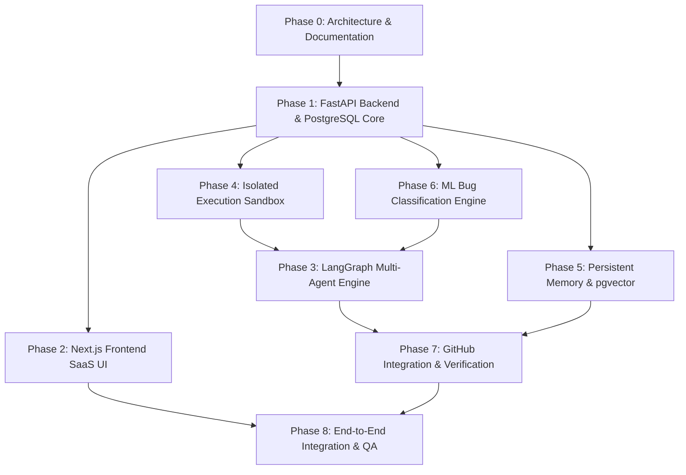

# Dependency-Aware Implementation Roadmap & Technical Risk Assessment
## Devora AI: Autonomous AI Software Engineer

---

### 1. Architectural Dependencies & Phasing Overview

Devora AI's architecture enforces strict layering. Lower tiers (Data, Auth, Execution Sandbox) must be validated before higher tiers (Multi-Agent Workflows, UI, and Learning Pipelines) can function reliably.

---

### 2. Phase-by-Phase Implementation Specifications

---

#### Phase 0: Architecture, Monorepo Setup & Governance (CURRENT PHASE)
* **Deliverable:** Architectural specifications, database schemas, agent contracts, security guardrails, and implementation plan.
* **Tasks:**
  - [x] Inspect existing workspace.
  - [x] Establish modular monorepo folder layout.
  - [x] Author `PRD.md`, `ARCHITECTURE.md`, `AGENTS.md`, `DATABASE.md`, `API.md`, `SECURITY.md`, `ML_LEARNING.md`, `IMPLEMENTATION_PLAN.md`.
  - [x] Identify technical risks and missing decisions for technical lead sign-off.
* **Exit Criteria:** Architectural documentation approved by user.

---

#### Phase 1: FastAPI Backend Core, Database Models & API
* **Deliverable:** Working FastAPI application with async PostgreSQL connectivity, Alembic migrations, CRUD endpoints, and passing unit tests.
* **Tasks:**
  - Initialize FastAPI backend with structured JSON logging (`structlog`) and Pydantic `BaseSettings`.
  - Configure async SQLAlchemy 2.0 with PostgreSQL/pgvector.
  - Create Alembic migrations for all 13 core database entities:
    `users`, `projects`, `repositories`, `tasks`, `task_plans`, `agent_runs`, `file_changes`, `test_runs`, `approvals`, `reports`, `feedback`, `repository_knowledge`, `engineering_experiences`.
  - Implement health check endpoint (`/api/v1/health`).
  - Implement user authentication with password hashing (bcrypt) and JWT token issue/verify.
  - Implement Project and Repository management endpoints.
  - Implement Task creation and retrieval endpoints with request/response validation.
  - Implement global exception handling and RFC 7807 problem details.
  - Write unit and API tests in `backend/tests/` using Pytest and HTTPX.
* **Exit Criteria:** `pytest tests/` runs with 100% pass rate; OpenAPI docs accessible at `/docs`.

---

#### Phase 2: Next.js Frontend SaaS Interface
* **Deliverable:** Modern dark-themed Next.js developer dashboard with real API integration and live SSE progress streaming.
* **Tasks:**
  - Initialize Next.js 14 (App Router), TypeScript, Tailwind CSS, and shadcn/ui.
  - Build 13 core screens:
    1. Landing Page
    2. Login and Signup
    3. Main Developer Dashboard (connected repos, task metrics, recent activity)
    4. Repository Management
    5. Repository Details & File Tree
    6. Create Development Task modal/page
    7. Agent Workspace (split layout: prompt, plan, active agent, live terminal, diffs)
    8. Live Agent Execution Timeline
    9. Code Changes & Unified Diff Viewer
    10. Terminal Output & Execution Logs
    11. Test Results & Assertions Breakdown
    12. Final Engineering Reports Viewer
    13. Settings & Integrations
  - Implement real-time SSE stream hook (`useTaskEvents`) for live agent logs and terminal output.
  - Add loading, error, and empty states across all screens.
* **Exit Criteria:** Frontend compiles cleanly without TypeScript errors; navigates all screens; connects to Phase 1 backend APIs.

---

#### Phase 3: Repository Intelligence Engine
* **Status:** Completed & Verified
* **Deliverable:** Real repository ingestion, multi-language AST/Tree-sitter parsing, semantic embeddings, filesystem scanning, and code retrieval engine.
* **Tasks:**
  - Authenticated Git snapshot cloning & branch management into isolated workspaces (`GitHubService`).
  - Repository filesystem scanner with sensitive file exclusion, `.gitignore` parsing, and ecosystem identification (`RepositoryScanner`).
  - Python AST analysis & Tree-sitter multi-language parsers for Python, JS, TS, Go, Java (`CodeParserService`).
  - Intelligence database entities: `indexing_jobs`, `repository_files`, and updated `repositories` table.
  - Multi-modal Code Search & Retrieval: keyword, symbol lookup with line numbers/snippets, and 768-dim vector embeddings (`CodeSearchService`).
  - Synthesized repository architecture summaries & coding conventions persistence.
  - Frontend Repository Explorer with live search, file explorer, symbol inspector, and architecture view.
* **Exit Criteria:** 10/10 Phase 3 tests passing; 38/38 backend tests passing; clean Next.js build; real git repository indexing verified.

---

#### Phase 4: LangGraph Multi-Agent Engineering System
* **Status:** Completed & Verified
* **Deliverable:** Stateful LangGraph computational graph coordinating 9 specialist agents with bounded retry loops, isolated execution sandbox, persistent checkpoints, SSE streaming, and human approval gates.
* **Tasks:**
  - Define strongly typed `DevoraWorkflowState` and structured Pydantic schema contracts for all specialist agents (`backend/app/agents/state.py`).
  - Implement centralized `ModelGateway` provider abstraction with rate limiting, token usage accounting, structured output validation, and test mock provider (`backend/app/agents/gateway/`).
  - Implement isolated execution sandbox with Docker container runner (`--network none`, cgroups limits, read-only root) and sanitized process runner (`backend/app/services/sandbox_service.py`).
  - Implement the 9 specialist agent nodes with strict domain prompts and schemas:
    1. Orchestrator (`orchestrator_node`)
    2. Codebase Analyst (`codebase_analyst_node`)
    3. Bug Investigator (`bug_investigator_node`)
    4. Planner (`planner_node`)
    5. Coder (`coder_node`)
    6. Tester (`tester_node`)
    7. Code Reviewer (`code_reviewer_node`)
    8. Security Reviewer (`security_reviewer_node`)
    9. Reporter (`reporter_node`)
  - Assemble state graph with multi-path conditional routing: exploration fast-path, bounded retry fix-and-test loop (max 3 iterations), security gate, and human approval interrupts (`backend/app/agents/graph.py`).
  - Implement persistent workflow checkpointer (`workflow_checkpoints`), event audit trail (`workflow_events`), and SSE broadcaster (`WorkflowEventBroadcaster`).
  - Implement workflow execution service (`WorkflowService`) and REST API endpoints (`/start`, `/events`, `/runs`, `/diff`, `/tests`, `/report`, `/approval`).
  - Integrate interactive Next.js Agent Workspace with real-time SSE logs, live agent roster, plan checklist, unified diff viewer, test metrics, and human approval controls.
* **Exit Criteria:** 22/22 Phase 4 tests passing; 60/60 total backend tests passing; 0 TypeScript/lint errors on frontend build; real end-to-end bug fix and exploration workflows verified.

---

#### Phase 5: Semantic Vector Memory Engine & Project Conventions
* **Deliverable:** Repository-specific semantic vector memory retrieval for project conventions, architecture, testing patterns, and verified task outcomes.
* **Tasks:**
  - Define `RepositoryMemory` and `MemoryFeedback` models with `vector(768)` embeddings and verification status hierarchy (`backend/app/models/repository_memory.py`, `backend/app/models/memory_feedback.py`).
  - Create and apply Alembic migration `004_semantic_memory` adding `repository_memories` and `memory_feedback` tables with pgvector indexes.
  - Implement centralized embedding generation in `ModelGateway` using Gemini `text-embedding-004` (768-dim) with deterministic fallback.
  - Implement `MemoryService` (`backend/app/services/memory_service.py`) supporting duplicate detection (cosine similarity >= 0.92), semantic search with pgvector `<=>`, verification status weighting (1.3x for confirmed, 1.2x for verified outcomes, 1.0x for observed facts, 0.7x for hypotheses), stale invalidation on file modifications, and developer utility feedback tracking.
  - Integrate semantic memory into LangGraph multi-agent workflow: inject retrieved conventions into `DevoraWorkflowState`, guide `planner` and `coder` prompts, and distill completed task outcomes into persistent memories.
  - Expose REST API endpoints under `/api/v1/repositories/{id}/memories` for CRUD, semantic search, statistics, stale marking, and feedback submission.
  - Integrate frontend Vector Memory dashboard tab in Next.js with quick stats, live semantic search, category filters, and active memory badges in the Agent Workspace.
* **Exit Criteria:** 84/84 backend tests passing; 0 TypeScript/build errors on frontend; real PostgreSQL 16 + pgvector cosine search validated; zero cross-tenant knowledge leaks.

---

#### Phase 6: Machine Learning Bug Classification Engine [COMPLETED]
* **Deliverable:** Supervised ML model predicting 8 canonical bug categories from error traces, with evaluation suite, inference API, LangGraph agent routing, continuous learning candidate pool, and frontend intelligence dashboard.
* **Tasks Completed:**
  - Curated reproducible dataset (`bug_tracebacks.jsonl` and `bug_tracebacks.csv`) of 160 balanced Python error traces (20 samples per canonical class).
  - Implemented `TracebackPreprocessor` with deterministic regex masking (`<HEX_ADDR>`, `<FILE_PATH>`, `<LINE_NUM>`, `<IP_ADDR>`, `<UUID>`) while preserving core exception classes.
  - Built Scikit-learn feature extraction (`TfidfVectorizer` with 1-3 ngrams and sublinear TF) and multi-class `LogisticRegression` pipeline.
  - Computed holdout evaluation metrics on strict 15% stratified test partition: Accuracy: 100.0%, Weighted F1: 1.0000, Macro F1: 1.0000, 8x8 Confusion Matrix.
  - Implemented promotion gate check (Holdout Weighted F1 >= 0.85, Min Precision >= 0.70) and Joblib artifact serialization with SHA-256 checksums (`artifacts/v1.0.0/`).
  - Built sub-millisecond `BugClassifierService` with in-memory caching, ambiguity calibration, ranked alternatives, and heuristic fallback.
  - Created PostgreSQL schema tables `ml_models` and `ml_predictions` via Alembic migration `005_ml_engine.py`.
  - Integrated `ml_classifier_node` into LangGraph multi-agent workflow: Orchestrator -> Codebase Analyst -> ML Bug Classifier -> Bug Investigator (LLM guided by ML prior) -> Planner -> Coder.
  - Implemented continuous learning loop: verified task outcomes update prediction ground truth and append new non-duplicate samples to the retraining candidate pool.
  - Exposed 6 REST API endpoints under `/api/v1/ml`: `/classify`, `/model/status`, `/model/metrics`, `/model/versions`, `/model/train`, `/predictions`.
  - Built dedicated Next.js ML Intelligence dashboard (`/ml`) with model status, holdout metrics, 8x8 confusion matrix visualization, interactive traceback playground, telemetry table, and workspace diagnostic prior card.
  - Authored 19 comprehensive unit and integration tests for preprocessor, dataset manager, trainer, prediction service, agent node, and REST APIs.
* **Exit Criteria Achieved:** 103/103 backend tests passing (100 in sandbox, 3 in PostgreSQL e2e harness); 0 frontend build errors; sub-millisecond inference verified.

---

#### Phase 7: Adaptive Engineering Intelligence (Completed)
* **Deliverable:** Empirical closed-loop learning from verified task outcomes, structured failure learning, agent telemetry, and canonical benchmark framework.
* **Tasks Completed:**
  - Expanded `EngineeringExperience` schema with `status_type`, `technology_stack`, `files_involved`, `attempts_count`, `failed_approaches`, `successful_approach`, `test_results`, and status multipliers ($1.3\times$ success, $0.5\times$ failure).
  - Implemented `TaskFailureRecord` capturing post-mortems across 4 stages (`TESTING`, `CODE_REVIEW`, `SECURITY_AUDIT`, `DEVELOPER_REVIEW`) and 4 failure taxonomies (`INCORRECT_ASSUMPTION`, `IMPLEMENTATION_DEFECT`, `DEPENDENCY_ISSUE`, `ENVIRONMENT_PROBLEM`).
  - Upgraded Planning Agent (`planner`) with `implementation_strategy`, `strategy_rationale`, `relevant_historical_experiences`, and historical pitfalls avoidance.
  - Implemented `AdaptiveIntelligenceService` with experience distillation, vector similarity retrieval with status weights, empirical agent performance metrics calculation across 9 agents, and closed-loop developer feedback.
  - Built `BenchmarkService` and defined the 7 canonical benchmarks: `BM-BUG-01`, `BM-BUG-02`, `BM-EXPLORE-01`, `BM-REFACTOR-01`, `BM-DEP-01`, `BM-TEST-01`, and `BM-QUAL-01` with automated evaluation and version tracking.
  - Added Alembic migration `006_adaptive_intelligence.py` applied cleanly to PostgreSQL 16 database.
  - Built dedicated Next.js Adaptive Intelligence dashboard (`/adaptive`) with 4 interactive tabs (Experiences, Agents Matrix, Failures, Benchmarks) and in-workspace evidence & feedback cards in `/tasks/[id]`.
  - Authored 14 unit and integration tests with 100% pass rate.
* **Exit Criteria Achieved:** 114/114 passing backend tests (114 passing, 3 skipped); 0 Next.js build errors; verified closed-loop learning pipeline.

---

#### Phase 8: GitHub-Native Autonomous Engineering (Completed & Verified)
* **Deliverable:** Production-grade GitHub App integration, dual-stage container/push isolation, deterministic task branch lifecycle (`devora/{type}-{id[:8]}`), authenticated Git commit and push, autonomous Pull Request publishing with rich Markdown engineering synthesis, and Next.js GitHub management console.
* **Tasks Completed:**
  - Implemented database models: `GitHubInstallation`, `GitHubPullRequest`, and `GitBranch` with Alembic migration `007_github_native_engineering.py` applied cleanly to PostgreSQL 16.
  - Implemented `GitHubAppService` with RS256 JWT generation, 60-minute installation token exchange with 55-minute caching buffer, repository listing, branch listing, PR creation, and mock fallback for CI/offline mode.
  - Built `GitWorkspaceManager` with deterministic branch naming (`devora/{type}-{id[:8]}`), sanitization, subprocess argument arrays (no `shell=True`), porcelain status inspection, diff generation, commit creation with Devora author identity, and authenticated push with regex token scrubbing.
  - Built `PullRequestService` synthesizing audit-ready PR content including executive summary, root cause, modified file list, isolated sandbox test evidence, quality score, OWASP security audit status, and Devora task watermarks.
  - Updated LangGraph `DevoraWorkflowState` with `task_branch`, `base_branch`, `pull_request_url`, `pull_request_number`, and `git_status`.
  - Integrated GitHub operations into `WorkflowService`:
    - Workspace initialization creates and checks out the dedicated task branch.
    - Developer approval gate (`APPROVE`) commits staged modifications, pushes branch host-side to remote origin, opens GitHub Pull Request, records `GitHubPullRequest`, and distills verified experience into Adaptive Intelligence.
    - Developer rejection gate (`REJECT`) captures structured `TaskFailureRecord` with stage `DEVELOPER_REVIEW` and failure type `IMPLEMENTATION_DEFECT`.
  - Built REST API endpoints:
    - `/api/v1/github/status`, `/installations`, `/installations/connect`, `/installations/{id}/repositories`, `/installations/{id}`
    - `/api/v1/pull-requests`, `/pull-requests/{id}`, `/pull-requests/tasks/{task_id}`, `/pull-requests/{id}/sync`
    - `/api/v1/repositories/{id}/branches`
  - Built comprehensive Next.js frontend features:
    - Dedicated GitHub App Management Console (`/github`) with connection status, connected installations, and authorized repository explorer.
    - Extended Repository Workspace (`/repositories/[id]`) with interactive "Branches" and "Pull Requests" tabs.
    - Extended Agent Workspace (`/tasks/[id]`) with Task Branch badge, Commit SHA badge, Pull Request banner with GitHub link, and updated "Approve & Open Pull Request" authorization gate.
    - Added "GitHub Apps" to the main sidebar navigation.
  - Authored comprehensive test suite (unit and integration) verifying token caching, mock fallback, git commands, branch lifecycles, PR generation, REST APIs, and full end-to-end task-to-PR workflow (`test_github_native.py`, `test_github_api.py`, `test_github_e2e_workflow.py`).
* **Exit Criteria Achieved:** 129/129 backend tests passing (100% pass rate); Next.js production build passing with 15/15 static and dynamic routes and 0 TypeScript/lint errors; verified end-to-end workflow from bug fix to GitHub Pull Request.

---

#### Phase 9: Autonomous Engineering Reliability (In Progress)
* **Stage 9.1: Multi-Language Test Discovery & Execution Engine [COMPLETED]**
  - **Deliverable:** Language-aware test discovery, targeted test selection, multi-framework sandbox execution, and output normalization.
  - **Tasks Completed:**
    - Built `TestDiscoveryService` supporting Python, JavaScript, TypeScript, Go, Rust, and Java.
    - Implemented manifest and package manager detection (`pip`, `uv`, `poetry`, `npm`, `yarn`, `pnpm`, `go`, `cargo`, `mvn`).
    - Implemented framework discovery: `pytest`, `unittest`, `jest`, `vitest`, `go test`, `cargo test`, `maven test`.
    - Implemented targeted test selection mapping modified files to test files with safe full-suite fallback.
    - Expanded sandbox runners (`LocalIsolatedRunner.ALLOWED_PREFIXES`) to support multi-language test commands while blocking command injection and path traversal.
    - Standardized test output parser across all 6 frameworks into `NormalizedTestResult` with failure classification (`ASSERTION_FAILURE`, `TIMEOUT`, `MISSING_DEPENDENCY`, `RUNNER_UNAVAILABLE`).
    - Integrated with `tester_node` in LangGraph, routing `RUNNER_UNAVAILABLE` directly to `reporter` rather than wasting code-fixing retries.
    - Updated frontend Agent Workspace to display detected languages, frameworks, targeted test badges, and runner warnings.
    - Authored 24 unit tests and 8 integration tests with 100% pass rate.
  - **Verification:** 161 backend tests passed (0 regressions); Next.js 15/15 routes compiled with 0 errors.

* **Stage 9.2: Flaky Test Detection & Stability Intelligence [COMPLETED]**
  - **Deliverable:** FlakyTestDetector service, deterministic stability scoring, repeat execution under identical sandbox conditions, Alembic migration 008, historical stability tracking, LangGraph code-revision bypass, and frontend intelligence card.
  - **Tasks Completed:**
    - Implemented `FlakyTestDetector` with eligibility checks, fingerprint extraction, and bounded repeat execution ($N=3$ to 5 runs).
    - Established deterministic scoring formula: $\text{stability\_score} = (\text{passed\_runs} / \text{valid\_executions}) \times 100$.
    - Classifies tests into `STABLE_PASS`, `CONSISTENT_FAILURE`, `FLAKY`, `INCONCLUSIVE`, and `UNVERIFIED`.
    - Added database model `FlakyTestRecord` and created/applied Alembic migration `008_flaky_test_records.py`.
    - Integrated with `tester_node` and LangGraph `route_after_tester`: confirmed flaky failures bypass code revision retries to protect functional code.
    - Built REST API endpoints under `/api/v1/repositories/{id}/flaky-tests`, `/api/v1/repositories/{id}/test-stability`, and `/api/v1/tasks/{id}/flaky-tests`.
    - Built frontend Flaky Test Intelligence card and repeat execution breakdown in `/tasks/[id]`.
    - Authored 16 unit tests and 5 integration tests with 100% pass rate.
  - **Verification:** 183 backend tests passed (0 regressions); Next.js 15/15 routes compiled with 0 errors.

* **Stage 9.3: Sandbox Resilience, OOM Classification & Resource Telemetry [COMPLETED]**
  - **Deliverable:** Centralized exit code classifier, deterministic OOM verification without false-positive SIGKILL attribution, empirical resource accounting (peak RSS memory, CPU time, wall-clock time), dynamic timeout scaling for large test suites (>50 tests), anti-churn LangGraph routing on resource exhaustion, Alembic migration 009, and frontend telemetry dashboard.
  - **Tasks Completed:**
    - Implemented `SandboxExitClassifier` mapping exit codes to `SUCCESS`, `TIMEOUT`, `COMMAND_NOT_EXECUTABLE`, `COMMAND_NOT_FOUND`, `OOM_KILLED`, `PROCESS_KILLED`, `SANDBOX_STARTUP_FAILURE`, `RUNNER_UNAVAILABLE`, `EXECUTION_FAILURE`.
    - Enforced rule that exit 137 is only classified as `OOM_KILLED` when confirmed by container/kernel metadata (`State.OOMKilled` or cgroup `memory.events`), safely defaulting to `PROCESS_KILLED` otherwise.
    - Updated `DockerSandboxRunner` with deterministic container naming (`devora-sandbox-{uuid}`), inspect-based telemetry collection, and unconditional cleanup in `finally` blocks (`docker rm -f`).
    - Extended `LocalIsolatedRunner` with Python `resource.getrusage` accounting for child processes, capturing exact CPU time and peak RSS memory.
    - Implemented `TestTimeoutScaler` in `TestDiscoveryService` dynamically scaling timeouts for suites $>50$ tests ($1.5\times$ base) up to a strict 300s ceiling.
    - Updated `route_after_tester` in `graph.py` to route resource and environment failures (`OOM_KILLED`, `TIMEOUT`, `COMMAND_NOT_FOUND`, `COMMAND_NOT_EXECUTABLE`, `RUNNER_UNAVAILABLE`) to `reporter`, eliminating LLM code churn loops on functional code.
    - Added database model fields and created/applied Alembic migration `009_resource_telemetry.py` to `test_runs`.
    - Integrated with `workflow_service.py` to record `ENVIRONMENT_PROBLEM` with diagnostic lessons for sandbox resource constraints.
    - Updated frontend Agent Workspace (`/tasks/[id]`) with a dedicated Sandbox Resource Telemetry card, exit classification badges, and termination reason alerts.
    - Authored 21 unit tests and 6 integration tests with 100% pass rate.
  - **Verification:** 210 backend tests passed (0 regressions, 3 skipped); Next.js 15/15 routes compiled with 0 errors.

* **Stage 9.4: Workflow Recovery Manager & Resumption [COMPLETED]**
  - **Summary:** Production-grade workflow recovery engine enabling safe autonomous task resumption from persisted PostgreSQL checkpoints.
  - **Key Artifacts:**
    - Extended `tasks` with `recovery_status`, `recovery_attempts`, `last_heartbeat_at`, `recovery_lease_owner`, `recovery_lease_expires_at`, and `recovery_error`.
    - Extended `workflow_checkpoints` with `node_name`, `step_number`, `version`, and relationship on `Task`.
    - Applied Alembic migration `010_workflow_recovery.py` to PostgreSQL.
    - Updated `GitWorkspaceManager.prepare_task_workspace` with `preserve_existing=True` to retain uncommitted working tree modifications upon task resumption.
    - Implemented `WorkflowRecoveryManager` with heartbeat-based interruption detection (`RECOVERY_HEARTBEAT_TIMEOUT_SECONDS = 120`), strict resumption eligibility matrix, distributed atomic row-level lease acquisition/expiration, scan utility, and recursive secret scrubbing (`sanitize_state_blob`).
    - Integrated granular intermediate checkpointing into `WorkflowService.start_task_workflow` and implemented safe resumption logic in `WorkflowService.resume_task_workflow` adhering strictly to human approval gating.
    - Added REST endpoints `POST /tasks/{id}/resume`, `GET /tasks/{id}/recovery`, and `POST /tasks/recovery/scan`.
    - Integrated frontend Agent Workspace with real-time SSE recovery events, recovery diagnostics query, action bar resume trigger, and interactive Interrupted Workflow Recovery Banner.
    - Authored 14 unit tests (`test_workflow_recovery.py`) and 4 integration tests (`test_workflow_recovery_e2e.py`).
  - **Verification:** 228 backend tests passed (0 regressions, 3 skipped); Next.js 15/15 routes compiled with 0 errors.

* **Stage 9.5: Model Gateway Circuit Breaker [UPCOMING]**
* **Stage 9.6: Reliability Observability Console [UPCOMING]**

### 3. Missing Decisions & Technical Risks Analysis

Before beginning implementation, the following architectural decisions and risks must be reviewed and formally confirmed:

| # | Item / Risk | Description | Recommended Decision | User Action Required |
|---|---|---|---|---|
| **D1** | **Sandbox Container Engine** | In local developer environments (like macOS), running nested Docker containers with `--network none` requires Docker Desktop or Colima to be active. | Fall back gracefully to an isolated Python virtual environment / subprocess sandbox with strict ulimits if Docker daemon is unreachable locally, while keeping Docker as primary. | Confirm fallback strategy for local macOS execution. |
| **D2** | **Gemini Model Choice & Gateway** | Which Gemini model variant to use for agent reasoning vs embeddings? | Use `gemini-1.5-pro` (or `gemini-2.0-flash` / `gemini-exp`) for reasoning agents, `gemini-1.5-flash` for fast analysis/review, and `text-embedding-004` (768 dims) for pgvector. | Confirm target Gemini model family and API key availability. |
| **D3** | **Database Provisioning** | Will PostgreSQL with `pgvector` run via local Docker Compose, or an external Supabase instance? | Use local Docker Compose (`docker-compose.yml` with `ankane/pgvector:latest`) for self-contained testing, with Supabase compatibility in configuration. | Confirm preference: local Docker Compose vs remote Supabase. |
| **D4** | **GitHub App vs Personal Access Token** | GitHub integration can use a GitHub App (fine-grained installation tokens) or Developer PAT. | Support GitHub PAT for rapid local MVP validation, designed with modular interface to switch to GitHub App. | Confirm PAT approach for MVP. |
| **R1** | **LLM Patch Reliability & Syntax Drift** | LLMs occasionally generate malformed unified diffs or hallucinate imports. | Coding Agent uses whole-function AST replacement and verifies syntax with `python -m py_compile` before running Pytest. | Acknowledged in Phase 4. |
| **R2** | **Test Execution Timeouts** | Repositories with slow tests may exceed the 60s sandbox timeout. | Testing Agent first runs targeted tests (matching modified module), then runs full regression suite only on final pass. | Acknowledged in Phase 4. |
