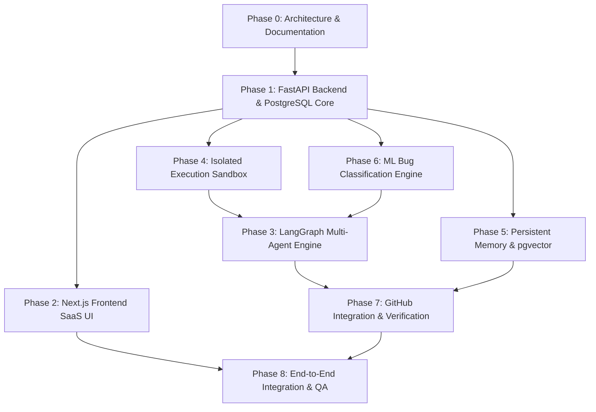

# Dependency-Aware Implementation Roadmap & Technical Risk Assessment
## Devora AI: Autonomous AI Software Engineer

---

### 1. Architectural Dependencies & Phasing Overview

Devora AI's architecture enforces strict layering. Lower tiers (Data, Auth, Execution Sandbox) must be validated before higher tiers (Multi-Agent Workflows, UI, and Learning Pipelines) can function reliably.

---

### 2. Phase-by-Phase Implementation Specifications

---

#### Phase 0: Architecture, Monorepo Setup & Governance (CURRENT PHASE)
* **Deliverable:** Architectural specifications, database schemas, agent contracts, security guardrails, and implementation plan.
* **Tasks:**
  - [x] Inspect existing workspace.
  - [x] Establish modular monorepo folder layout.
  - [x] Author `PRD.md`, `ARCHITECTURE.md`, `AGENTS.md`, `DATABASE.md`, `API.md`, `SECURITY.md`, `ML_LEARNING.md`, `IMPLEMENTATION_PLAN.md`.
  - [x] Identify technical risks and missing decisions for technical lead sign-off.
* **Exit Criteria:** Architectural documentation approved by user.

---

#### Phase 1: FastAPI Backend Core, Database Models & API
* **Deliverable:** Working FastAPI application with async PostgreSQL connectivity, Alembic migrations, CRUD endpoints, and passing unit tests.
* **Tasks:**
  - Initialize FastAPI backend with structured JSON logging (`structlog`) and Pydantic `BaseSettings`.
  - Configure async SQLAlchemy 2.0 with PostgreSQL/pgvector.
  - Create Alembic migrations for all 13 core database entities:
    `users`, `projects`, `repositories`, `tasks`, `task_plans`, `agent_runs`, `file_changes`, `test_runs`, `approvals`, `reports`, `feedback`, `repository_knowledge`, `engineering_experiences`.
  - Implement health check endpoint (`/api/v1/health`).
  - Implement user authentication with password hashing (bcrypt) and JWT token issue/verify.
  - Implement Project and Repository management endpoints.
  - Implement Task creation and retrieval endpoints with request/response validation.
  - Implement global exception handling and RFC 7807 problem details.
  - Write unit and API tests in `backend/tests/` using Pytest and HTTPX.
* **Exit Criteria:** `pytest tests/` runs with 100% pass rate; OpenAPI docs accessible at `/docs`.

---

#### Phase 2: Next.js Frontend SaaS Interface
* **Deliverable:** Modern dark-themed Next.js developer dashboard with real API integration and live SSE progress streaming.
* **Tasks:**
  - Initialize Next.js 14 (App Router), TypeScript, Tailwind CSS, and shadcn/ui.
  - Build 13 core screens:
    1. Landing Page
    2. Login and Signup
    3. Main Developer Dashboard (connected repos, task metrics, recent activity)
    4. Repository Management
    5. Repository Details & File Tree
    6. Create Development Task modal/page
    7. Agent Workspace (split layout: prompt, plan, active agent, live terminal, diffs)
    8. Live Agent Execution Timeline
    9. Code Changes & Unified Diff Viewer
    10. Terminal Output & Execution Logs
    11. Test Results & Assertions Breakdown
    12. Final Engineering Reports Viewer
    13. Settings & Integrations
  - Implement real-time SSE stream hook (`useTaskEvents`) for live agent logs and terminal output.
  - Add loading, error, and empty states across all screens.
* **Exit Criteria:** Frontend compiles cleanly without TypeScript errors; navigates all screens; connects to Phase 1 backend APIs.

---

#### Phase 3: Repository Intelligence Engine
* **Status:** Completed & Verified
* **Deliverable:** Real repository ingestion, multi-language AST/Tree-sitter parsing, semantic embeddings, filesystem scanning, and code retrieval engine.
* **Tasks:**
  - Authenticated Git snapshot cloning & branch management into isolated workspaces (`GitHubService`).
  - Repository filesystem scanner with sensitive file exclusion, `.gitignore` parsing, and ecosystem identification (`RepositoryScanner`).
  - Python AST analysis & Tree-sitter multi-language parsers for Python, JS, TS, Go, Java (`CodeParserService`).
  - Intelligence database entities: `indexing_jobs`, `repository_files`, and updated `repositories` table.
  - Multi-modal Code Search & Retrieval: keyword, symbol lookup with line numbers/snippets, and 768-dim vector embeddings (`CodeSearchService`).
  - Synthesized repository architecture summaries & coding conventions persistence.
  - Frontend Repository Explorer with live search, file explorer, symbol inspector, and architecture view.
* **Exit Criteria:** 10/10 Phase 3 tests passing; 38/38 backend tests passing; clean Next.js build; real git repository indexing verified.

---

#### Phase 4: LangGraph Multi-Agent Engineering System
* **Status:** Completed & Verified
* **Deliverable:** Stateful LangGraph computational graph coordinating 9 specialist agents with bounded retry loops, isolated execution sandbox, persistent checkpoints, SSE streaming, and human approval gates.
* **Tasks:**
  - Define strongly typed `DevoraWorkflowState` and structured Pydantic schema contracts for all specialist agents (`backend/app/agents/state.py`).
  - Implement centralized `ModelGateway` provider abstraction with rate limiting, token usage accounting, structured output validation, and test mock provider (`backend/app/agents/gateway/`).
  - Implement isolated execution sandbox with Docker container runner (`--network none`, cgroups limits, read-only root) and sanitized process runner (`backend/app/services/sandbox_service.py`).
  - Implement the 9 specialist agent nodes with strict domain prompts and schemas:
    1. Orchestrator (`orchestrator_node`)
    2. Codebase Analyst (`codebase_analyst_node`)
    3. Bug Investigator (`bug_investigator_node`)
    4. Planner (`planner_node`)
    5. Coder (`coder_node`)
    6. Tester (`tester_node`)
    7. Code Reviewer (`code_reviewer_node`)
    8. Security Reviewer (`security_reviewer_node`)
    9. Reporter (`reporter_node`)
  - Assemble state graph with multi-path conditional routing: exploration fast-path, bounded retry fix-and-test loop (max 3 iterations), security gate, and human approval interrupts (`backend/app/agents/graph.py`).
  - Implement persistent workflow checkpointer (`workflow_checkpoints`), event audit trail (`workflow_events`), and SSE broadcaster (`WorkflowEventBroadcaster`).
  - Implement workflow execution service (`WorkflowService`) and REST API endpoints (`/start`, `/events`, `/runs`, `/diff`, `/tests`, `/report`, `/approval`).
  - Integrate interactive Next.js Agent Workspace with real-time SSE logs, live agent roster, plan checklist, unified diff viewer, test metrics, and human approval controls.
* **Exit Criteria:** 22/22 Phase 4 tests passing; 60/60 total backend tests passing; 0 TypeScript/lint errors on frontend build; real end-to-end bug fix and exploration workflows verified.

---

#### Phase 5: Isolated Code Modification & Execution Sandbox
* **Deliverable:** Semantic vector memory for project conventions and reusable engineering experiences.
* **Tasks:**
  - Implement Tree-sitter code symbol extractor (functions, classes, docstrings).
  - Implement embedding service using Gemini embedding API (`vector(768)`).
  - Implement `repository_knowledge` indexing and cosine similarity search.
  - Implement `engineering_experiences` capture pipeline:
    - Filter for passed tests and positive human feedback.
    - Anonymize repository-specific identifiers.
    - Deduplicate against existing vectors.
  - Integrate memory retrieval into Planning and Bug Investigation agents.
* **Exit Criteria:** Agent successfully retrieves past fix strategies on similar bug inputs; zero cross-tenant knowledge leaks.

---

#### Phase 6: Machine Learning Bug Classification Engine
* **Deliverable:** Supervised ML model predicting 8 bug categories from error traces, with evaluation suite and inference API.
* **Tasks:**
  - Create curated dataset of labeled stack traces across 8 bug categories.
  - Implement `preprocessor.py` for traceback normalization (hex, paths, lines).
  - Extract word and character n-gram TF-IDF feature matrices.
  - Train Logistic Regression classifier and Random Forest baseline.
  - Compute Precision, Recall, Macro F1, and Confusion Matrix.
  - Serialize model artifact (`model.joblib`) with version metadata.
  - Expose `/api/v1/ml/classify-bug` endpoint and hook into Bug Investigation Agent.
  - Implement offline controlled retraining and promotion script.
* **Exit Criteria:** Classifier achieves > 0.85 weighted F1 on holdout test set; accurately categorizes sample tracebacks via API.

---

#### Phase 7: Verification, Reporting & GitHub PR Workflow
* **Deliverable:** End-to-end GitHub pull request creation pipeline with Semgrep security audits and engineering reports.
* **Tasks:**
  - Integrate Semgrep static analysis into Security Review Agent.
  - Implement Markdown Engineering Report generator synthesizing problem, root cause, diffs, test logs, and limitations.
  - Implement GitHub REST API client:
    - Create git branch `devora/task-{id}`.
    - Commit verified patches.
    - Open Pull Request with the Engineering Report as the body.
  - Wire human approval gate: PR is only pushed when user clicks "Approve" in UI.
* **Exit Criteria:** Approval in Web UI triggers branch and PR creation on GitHub; report contains full verification evidence.

---

#### Phase 8: End-to-End Integration, Validation & QA Scenarios
* **Deliverable:** Comprehensive integration testing verifying the 3 core demonstration scenarios without mock shortcuts.
* **Demonstration Scenarios:**
  - **Scenario A (Bug Fix):** Ingest a repository with a reproducible bug (e.g., ZeroDivisionError or KeyError), diagnose root cause via ML classifier, generate patch, verify pytest passes, and prepare PR.
  - **Scenario B (Small Feature):** Add a new validated field and endpoint to an existing service, adhering to existing conventions and passing regression tests.
  - **Scenario C (Repository Architecture Exploration):** Ingest an unfamiliar repository, index symbols into pgvector, and output an accurate architectural report.
* **System-Wide Quality Verification:**
  - Zero fake success responses.
  - Zero hardcoded secrets.
  - Zero cross-tenant data leakage.
  - All critical workflows covered by integration tests.
* **Exit Criteria:** Final technical report documenting verified test evidence and deployment readiness.

---

### 3. Missing Decisions & Technical Risks Analysis

Before beginning implementation, the following architectural decisions and risks must be reviewed and formally confirmed:

| # | Item / Risk | Description | Recommended Decision | User Action Required |
|---|---|---|---|---|
| **D1** | **Sandbox Container Engine** | In local developer environments (like macOS), running nested Docker containers with `--network none` requires Docker Desktop or Colima to be active. | Fall back gracefully to an isolated Python virtual environment / subprocess sandbox with strict ulimits if Docker daemon is unreachable locally, while keeping Docker as primary. | Confirm fallback strategy for local macOS execution. |
| **D2** | **Gemini Model Choice & Gateway** | Which Gemini model variant to use for agent reasoning vs embeddings? | Use `gemini-1.5-pro` (or `gemini-2.0-flash` / `gemini-exp`) for reasoning agents, `gemini-1.5-flash` for fast analysis/review, and `text-embedding-004` (768 dims) for pgvector. | Confirm target Gemini model family and API key availability. |
| **D3** | **Database Provisioning** | Will PostgreSQL with `pgvector` run via local Docker Compose, or an external Supabase instance? | Use local Docker Compose (`docker-compose.yml` with `ankane/pgvector:latest`) for self-contained testing, with Supabase compatibility in configuration. | Confirm preference: local Docker Compose vs remote Supabase. |
| **D4** | **GitHub App vs Personal Access Token** | GitHub integration can use a GitHub App (fine-grained installation tokens) or Developer PAT. | Support GitHub PAT for rapid local MVP validation, designed with modular interface to switch to GitHub App. | Confirm PAT approach for MVP. |
| **R1** | **LLM Patch Reliability & Syntax Drift** | LLMs occasionally generate malformed unified diffs or hallucinate imports. | Coding Agent uses whole-function AST replacement and verifies syntax with `python -m py_compile` before running Pytest. | Acknowledged in Phase 4. |
| **R2** | **Test Execution Timeouts** | Repositories with slow tests may exceed the 60s sandbox timeout. | Testing Agent first runs targeted tests (matching modified module), then runs full regression suite only on final pass. | Acknowledged in Phase 4. |
