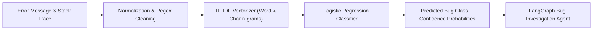
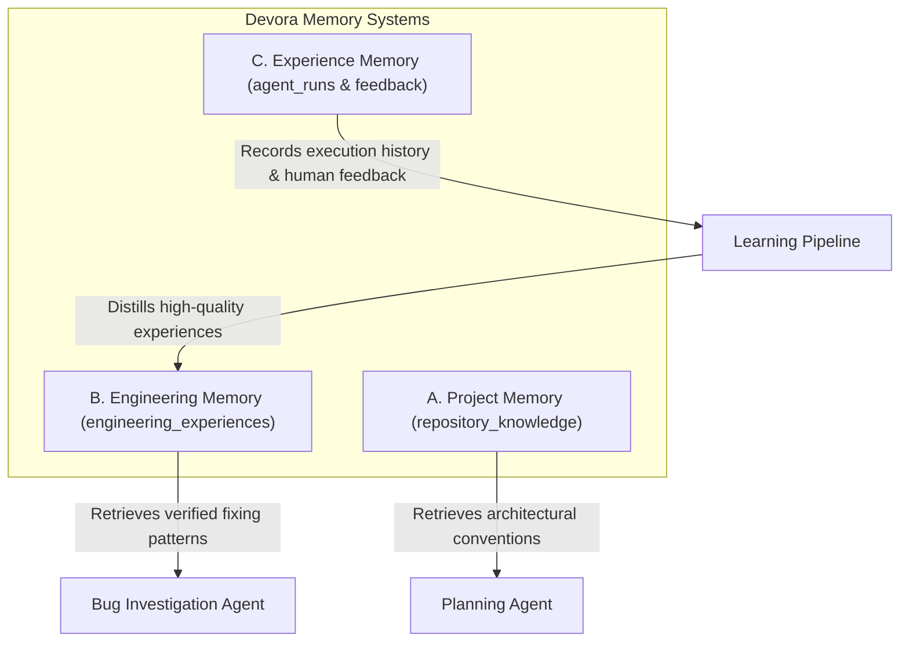

# Machine Learning & Continuous Memory Architecture
## Devora AI: Autonomous AI Software Engineer

---

### 1. Overview & Objectives

Devora AI combines **classical supervised machine learning** for deterministic, fast bug categorization with **vector-based semantic memory** (`pgvector`) to enable continuous learning across software engineering tasks.

The system adheres to two foundational axioms:
1. **Never fabricate evaluation results:** Models must be trained, evaluated, and versioned on validated datasets with strict train/val/test partition isolation.
2. **Never mix private repository knowledge across users:** Project memory is strictly tenant-scoped, and cross-project knowledge reuse requires explicit user authorization and data anonymization.

---

### 2. Dedicated ML Component: Bug Classification Engine

#### 2.1 Problem Formulation & Taxonomy
Software bugs present distinctive diagnostic fingerprints in error logs, tracebacks, and issue descriptions. To enable specialized agent routing and targeted search strategies, the Bug Classification Engine predicts one of **eight discrete bug categories**:

| Category ID | Bug Class Name | Characteristic Signature | Typical Exceptions / Tokens |
|---|---|---|---|
| `CAT_1` | **Syntax errors** | Parser failure prior to bytecode execution | `SyntaxError`, `IndentationError`, `invalid syntax`, `unexpected EOF` |
| `CAT_2` | **Runtime errors** | Unhandled system or operational conditions | `ZeroDivisionError`, `IndexError`, `KeyError`, `RecursionError`, `MemoryError` |
| `CAT_3` | **Type errors** | Incompatible data types or signatures | `TypeError`, `AttributeError` (calling non-callable), `cannot unpack non-iterable` |
| `CAT_4` | **Null or missing-value errors** | Dereferencing missing or `None` objects | `'NoneType' object has no attribute`, `MissingValue`, `UndefinedVariable` |
| `CAT_5` | **Dependency errors** | Missing libraries, version skew, import failures | `ModuleNotFoundError`, `ImportError`, `version conflict`, `distribution not found` |
| `CAT_6` | **Logic errors** | Code executes without crashing but assertions fail | `AssertionError`, `expected X but got Y`, `test_failed`, `calculation mismatch` |
| `CAT_7` | **Authentication errors** | Access denied, expired token, invalid credentials | `PermissionDenied`, `Unauthorized`, `401`, `403`, `JWTExpired`, `InvalidSignature` |
| `CAT_8` | **Database errors** | Schema violations, connection drops, transaction deadlocks | `OperationalError`, `IntegrityError`, `deadlock detected`, `foreign key constraint` |

---

#### 2.2 ML Tech Stack & Pipeline Architecture

* **Framework:** Scikit-learn, Pandas, NumPy.
* **Feature Representation:** TF-IDF (Term Frequency-Inverse Document Frequency) with word (1-3 n-grams) and character (3-5 n-grams) analyzers.
* **Classifiers:**
  * **Primary Model:** Multi-class Logistic Regression with L2 regularization (`solver='lbfgs'`).
  * **Baseline Model:** Random Forest Classifier (100 estimators, max depth 20).
* **Serialization:** Joblib with cryptographic SHA-256 artifact verification.



---

#### 2.3 Data Preprocessing & Sanitization
Tracebacks contain noise that can cause model overfitting, such as specific line numbers, local directory paths, memory hex addresses, and timestamps.
The preprocessor (`backend/ml/preprocessor.py`) applies deterministic normalization:
1. **Hex Addresses:** Stripped via `r'0x[0-9a-fA-F]+'` -> `<HEX_ADDR>`.
2. **File Paths:** Stripped via `r'([A-Za-z]:)?(/[a-zA-Z0-9_\-\.]+)+'` -> `<FILE_PATH>`.
3. **Line Numbers:** Normalized to `<LINE_NUM>`.
4. **Tokenization:** Lowercased alphanumeric tokenization preserving underscore-separated exception tokens (e.g., `zerodivisionerror`).

---

#### 2.4 Controlled Training & Promotion Pipeline
To prevent data contamination and erratic production behavior, model retraining is **never performed automatically after every task**. Instead, a controlled offline promotion pipeline is enforced:

```
[Curated Dataset] 
       |
       v
[Stratified 80/10/10 Split] (Train / Validation / Holdout Test)
       |
       v
[Cross-Validation & Hyperparameter Tuning]
       |
       v
[Evaluation Suite] (Precision, Recall, F1, Confusion Matrix)
       |
       v
[Promotion Gate Check]:
  - Holdout Weighted F1 >= 0.85
  - Minimum Precision per category >= 0.75
  - Zero regression on core smoke dataset
       |
    +--+--+
    |     |
 (PASS) (FAIL)
    |     |
    v     v
[Promote to vN Artifact]  [Reject & Log Flaws]
```

---

### 3. Persistent Memory Architecture

Devora maintains three interconnected memory subsystems using PostgreSQL and `pgvector`:



#### 3.1 Subsystem A: Project Memory (`repository_knowledge`)
* **Scope:** Single repository; strictly tenant-isolated.
* **Storage:** `repository_knowledge` table with `vector(768)` embeddings.
* **Contents:**
  * Code architecture and module hierarchy.
  * Coding style and conventions.
  * Extracted symbols (classes, methods, signatures) from Tree-sitter.
  * Framework details (e.g., "FastAPI with Async SQLAlchemy, Pytest for testing").

#### 3.2 Subsystem B: Engineering Memory (`engineering_experiences`)
* **Scope:** Reusable engineering knowledge.
* **Contents:**
  * Bug categories and root cause signatures.
  * Proven repair strategies (e.g., "Safe division with fallback for empty sequences").
  * Effective test fixtures and assertion patterns.

#### 3.3 Subsystem C: Experience Memory (`agent_runs`, `file_changes`, `feedback`)
* **Scope:** Full audit trace of historical task execution.
* **Contents:**
  * Original prompt, commit SHA, and generated plan.
  * Complete unified diff and applied patches.
  * Test execution stdout/stderr and exit code.
  * Developer feedback rating: `ACCEPTED`, `REJECTED`, `NEEDS_CHANGES`, `INCORRECT_SOLUTION`, `INCOMPLETE_SOLUTION`.

---

### 4. Experience Learning & Retrieval Lifecycle

#### 4.1 Ingestion & Quality Validation Pipeline
Not all completed tasks become permanent memories. To avoid garbage-in, garbage-out retrieval, candidate experiences pass through a quality validator:

1. **Execution Evidence Gate:** All automated tests must have passed (`passed = TRUE`, `exit_code = 0`).
2. **Human Acceptance Gate:** The developer must have explicitly approved or marked the feedback as `ACCEPTED`. Tasks rejected by developers are never stored as positive guidance.
3. **Deduplication Check:** Cosine distance against existing experiences must be > 0.15 (ensuring no redundant pattern bloat).
4. **Anonymization:** Repository-specific identifiers, internal URLs, company names, and secrets are scrubbed before storage.

#### 4.2 Semantic Retrieval Query
When a new task is initialized, Devora queries `engineering_experiences` using hybrid filtering:

```sql
SELECT 
    id,
    problem_summary,
    root_cause,
    resolution_strategy,
    1 - (embedding <=> :query_embedding) AS similarity_score
FROM engineering_experiences
WHERE (
    repository_id = :current_repo_id 
    OR (is_anonymized = TRUE AND is_verified = TRUE)
)
AND (task_category = :task_category OR bug_category = :bug_category)
ORDER BY embedding <=> :query_embedding ASC
LIMIT 3;
```
