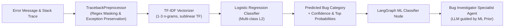
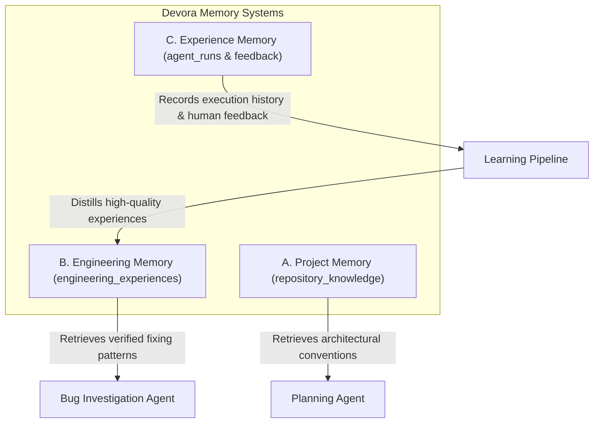

# Machine Learning & Continuous Memory Architecture
## Devora AI: Autonomous AI Software Engineer

---

### 1. Overview & Objectives

Devora AI combines **classical supervised machine learning** for deterministic, fast bug categorization with **vector-based semantic memory** (`pgvector`) to enable continuous learning across software engineering tasks.

The system adheres to two foundational axioms:
1. **Never fabricate evaluation results:** Models must be trained, evaluated, and versioned on validated datasets with strict train/val/test partition isolation.
2. **Never mix private repository knowledge across users:** Project memory is strictly tenant-scoped, and cross-project knowledge reuse requires explicit user authorization and data anonymization.

---

### 2. Dedicated ML Component: Bug Classification Engine

#### 2.1 Problem Formulation & Canonical Taxonomy
Software bugs present distinctive diagnostic fingerprints in error logs, tracebacks, and issue descriptions. To enable specialized agent routing and targeted root-cause analysis, the Bug Classification Engine predicts one of **eight canonical bug categories**:

| Category ID | Canonical Identifier | Diagnostic Signature | Characteristic Tokens & Exceptions |
|---|---|---|---|
| `CAT_1` | `syntax_error` | Parser failure prior to bytecode execution | `SyntaxError`, `IndentationError`, `TabError`, `invalid syntax`, `unexpected EOF` |
| `CAT_2` | `import_dependency_error` | Missing libraries, version skew, import failures | `ModuleNotFoundError`, `ImportError`, `cannot import name`, `No module named` |
| `CAT_3` | `type_error` | Incompatible data types, signature mismatch | `TypeError`, `unsupported operand type(s)`, `cannot unpack non-iterable` |
| `CAT_4` | `attribute_null_reference_error` | Dereferencing missing or `None` objects | `AttributeError`, `'NoneType' object has no attribute`, null pointer access |
| `CAT_5` | `index_key_error` | Out of range index or missing dictionary key | `IndexError`, `KeyError`, `list index out of range`, `key not found` |
| `CAT_6` | `runtime_logic_error` | Unhandled runtime state or assertion failures | `ZeroDivisionError`, `RecursionError`, `AssertionError`, `ValueError`, `OverflowError` |
| `CAT_7` | `database_network_error` | Schema violations, socket drops, deadlocks | `OperationalError`, `IntegrityError`, `ConnectionRefusedError`, `TimeoutError`, `asyncpg` |
| `CAT_8` | `permission_security_error` | Access denied, expired token, RBAC violation | `PermissionError`, `401 Unauthorized`, `403 Forbidden`, `JWTExpired`, `InvalidSignature` |

---

#### 2.2 ML Tech Stack & Pipeline Architecture

* **Framework:** Scikit-learn (`1.9.1`), Pandas (`3.1.1`), NumPy (`2.5.5`), Joblib (`1.6.0`).
* **Feature Representation:** TF-IDF Vectorizer with sublinear term frequency, word n-grams (1-3), and character patterns preserving exception classes.
* **Classifier:** Multi-class Logistic Regression with L2 regularization (`solver='lbfgs'`, `C=5.0`, `max_iter=1000`).
* **Serialization & Versioning:** Joblib artifacts with cryptographic SHA-256 integrity verification (`backend/app/ml/artifacts/v1.0.0/`).
* **Inference Latency:** Sub-millisecond (&lt; 1.0 ms) feature extraction and classification.



---

#### 2.3 Data Preprocessing & Sanitization
Tracebacks contain environment-specific noise that causes model overfitting. The preprocessor (`backend/app/ml/preprocessor.py`) applies deterministic normalization:
1. **Hex Memory Addresses:** Masked via `r'0x[0-9a-fA-F]+'` -> `<HEX_ADDR>`.
2. **File Paths:** Masked via `r'([A-Za-z]:)?([/\\].+?[/\\]([a-zA-Z0-9_\-\.]+\.[a-zA-Z0-9_]+))'` -> `<FILE_PATH>/filename.py` (preserves module identity while eliminating local directory path skew).
3. **Line Numbers:** Masked via `r'\bline \d+\b'` -> `line <LINE_NUM>`.
4. **IP Addresses & URLs:** Masked to `<IP_ADDR>` and `<URL>`.
5. **UUIDs & Timestamps:** Masked to `<UUID>` and `<TIMESTAMP>`.
6. **Exception Class Preservation:** Explicitly identifies and preserves top-level diagnostic exception types (e.g., `ZeroDivisionError`, `ModuleNotFoundError`, `KeyError`).

---

#### 2.4 Controlled Training & Promotion Pipeline
To prevent data contamination and erratic production behavior, model retraining is **never performed automatically after every task**. Instead, a controlled offline promotion pipeline is enforced:

```
[Curated Dataset: 160+ seed samples] 
                   |
                   v
[Stratified 70/15/15 Split] (Train: 111, Validation: 25, Holdout Test: 24)
                   |
                   v
[Feature Extraction & Logistic Regression Fit]
                   |
                   v
[Evaluation Suite] (Accuracy, Precision, Recall, Macro/Weighted F1, 8x8 Confusion Matrix)
                   |
                   v
[Promotion Gate Check]:
   - Holdout Weighted F1 >= 0.85
   - Minimum Precision per category >= 0.70
   - Model SHA-256 Checksum Verification
                   |
            +------+------+
            |             |
         (PASS)        (FAIL)
            |             |
            v             v
[Promote to vN Artifact]  [Reject & Log Flaws]
[Set in active_model.json]
```

#### 2.5 Continuous Learning Candidate Pool
When an autonomous task completes successfully (all tests pass and human developer approves changes):
1. The verified bug diagnosis from `root_cause_analysis` is mapped to its canonical category.
2. The initial `MLPrediction` database record is updated with `verified_category` and `is_correct = (predicted == verified)`.
3. The sample is appended to `backend/app/ml/data/bug_tracebacks.jsonl` with duplicate prevention, joining the candidate pool for future controlled retraining.
4. Automatic model retraining is strictly gated behind developer evaluation.

---

### 3. Persistent Memory Architecture

Devora maintains three interconnected memory subsystems using PostgreSQL and `pgvector`:



#### 3.1 Subsystem A: Project Knowledge & Semantic Memory
* **Scope:** Single repository; strictly tenant-isolated.
* **Storage:**
  * `repository_knowledge`: Fine-grained AST symbols, classes, methods, and file structural summaries.
  * `repository_memories`: High-level persistent engineering conventions, architecture rules, testing patterns, and verified outcomes with `vector(768)` embeddings.
* **Embedding Model:** Google Gemini `text-embedding-004` (768 dimensions), with L2-normalized pseudo-random projection vector fallback during offline or test execution.
* **Contents:**
  * Code architecture and module hierarchy (`architecture`).
  * Coding style and conventions (`coding_conventions`).
  * Framework and library specifications (`framework_usage`).
  * Unit test and integration test patterns (`testing_patterns`).
  * Common errors and resolved root causes (`common_errors`).
  * Verified completed task outcomes (`task_outcome`).

#### 3.2 Subsystem B: Engineering Memory (`engineering_experiences`)
* **Scope:** Reusable engineering knowledge.
* **Contents:**
  * Bug categories and root cause signatures.
  * Proven repair strategies (e.g., "Safe division with fallback for empty sequences").
  * Effective test fixtures and assertion patterns.

#### 3.3 Subsystem C: Experience Memory (`agent_runs`, `file_changes`, `feedback`, `memory_feedback`)
* **Scope:** Full audit trace of historical task execution and memory utility.
* **Contents:**
  * Original prompt, commit SHA, and generated plan.
  * Complete unified diff and applied patches.
  * Test execution stdout/stderr and exit code.
  * Developer feedback rating: `ACCEPTED`, `REJECTED`, `NEEDS_CHANGES`, `INCORRECT_SOLUTION`, `INCOMPLETE_SOLUTION`.
  * Memory feedback: `is_helpful` binary flag with notes; auto-invalidates memories flagged 3+ times.

---

### 4. Experience Learning & Retrieval Lifecycle

#### 4.1 Ingestion & Quality Validation Pipeline
Not all completed tasks become permanent memories. To avoid garbage-in, garbage-out retrieval, candidate experiences pass through a quality validator:

1. **Execution Evidence Gate:** All automated tests must have passed (`passed = TRUE`, `exit_code = 0`).
2. **Human Acceptance Gate:** The developer must have explicitly approved or marked the feedback as `ACCEPTED`. Tasks rejected by developers are never stored as positive guidance.
3. **Deduplication Check:** Cosine similarity against existing repository memories in the same category must be `< 0.92`. If similarity is `>= 0.92`, the existing memory is updated in place.
4. **Verification Status Weighting:**
   * `developer_confirmed` (1.3x multiplier)
   * `verified_outcome` (1.2x multiplier)
   * `observed_fact` (1.0x multiplier)
   * `ai_hypothesis` (0.7x multiplier)
5. **Stale Invalidation:** When a task modifies source files, existing memories referencing those files are automatically marked `is_stale = TRUE` and downweighted by 0.5x or excluded.

#### 4.2 Semantic Retrieval Query
When a new task is initialized, Devora queries `repository_memories` using cosine distance with verification weighting:

```sql
SELECT 
    id,
    category,
    title,
    content,
    verification_status,
    is_stale,
    1 - (embedding <=> :query_embedding) AS raw_similarity
FROM repository_memories
WHERE repository_id = :current_repo_id 
  AND is_stale = FALSE
ORDER BY embedding <=> :query_embedding ASC
LIMIT 5;
```

```sql
SELECT 
    id,
    problem_summary,
    root_cause,
    resolution_strategy,
    1 - (embedding <=> :query_embedding) AS similarity_score
FROM engineering_experiences
WHERE (
    repository_id = :current_repo_id 
    OR (is_anonymized = TRUE AND is_verified = TRUE)
)
AND (task_category = :task_category OR bug_category = :bug_category)
ORDER BY embedding <=> :query_embedding ASC
LIMIT 3;
```

---

## 4. Phase 6: Machine Learning Bug Classification System

Devora deploys a statistical machine learning classifier upstream of LLM reasoning to categorize software defects and provide probabilistic priors.

### 4.1 Feature Pipeline
- **Traceback Sanitization:** Scrubbing absolute paths, tokens, UUIDs, memory addresses, and sensitive parameters.
- **n-gram TF-IDF:** Word and character n-grams (`ngram_range=(1, 3)`, `max_features=2500`, sublinear TF scaling).
- **8 Canonical Defect Classes:** `syntax_error`, `import_dependency_error`, `type_error`, `attribute_null_reference_error`, `index_key_error`, `runtime_logic_error`, `database_network_error`, `permission_security_error`.

### 4.2 Algorithm & Calibration
- Multi-class Logistic Regression with balanced class weighting and L2 regularization.
- Probability distribution outputs over all classes.
- Ambiguity heuristic: flag low-confidence predictions when $P(\text{top}) < 0.40$ or $P(\text{top}) - P(\text{second}) < 0.15$.

---

## 5. Phase 7: Adaptive Engineering Intelligence & Benchmark System

### 5.1 Experience Ranking and Status Multipliers
Experiences are indexed with 768-dimensional embeddings and ranked using weighted cosine relevance:
$$\text{Weighted Score} = \text{CosineSimilarity}(v_{\text{query}}, v_{\text{exp}}) \times W_{\text{status}}$$

Where $W_{\text{status}}$ is defined as:
- **`verified_successful` ($1.3\times$):** Proven solutions from tasks whose tests passed and changes were approved.
- **`verified_failed` ($0.5\times$):** Downweighted negative guidance; used by the Planner as constraints on approaches to avoid.
- **`unverified_hypothesis` ($0.7\times$):** Unverified proposed fixes.
- **`incomplete_attempt` ($0.2\times$):** Incomplete workflows.

### 5.2 Structured Failure Learning
Failures during testing (`exit_code != 0`), static analysis, or review are recorded into `task_failure_records`:
- **Verification Stage:** `TESTING`, `CODE_REVIEW`, `SECURITY_AUDIT`, `DEVELOPER_REVIEW`.
- **Failure Taxonomy:** `INCORRECT_ASSUMPTION`, `IMPLEMENTATION_DEFECT`, `DEPENDENCY_ISSUE`, `ENVIRONMENT_PROBLEM`.
- **Preserved Artifacts:** Failed strategy, snapshot error log, review notes, and synthesized prevention lessons.

### 5.3 Seven Canonical Engineering Benchmarks
To guarantee reproducible performance, Devora evaluates against 7 canonical benchmark tasks:
1. `BM-BUG-01`: ZeroDivisionError in invoice calculator (`bug_investigation`)
2. `BM-BUG-02`: KeyError resolution in JWT token decoding (`bug_fixing`)
3. `BM-EXPLORE-01`: Architecture & symbol exploration in unfamiliar repository (`repository_exploration`)
4. `BM-REFACTOR-01`: Monolithic database pool extraction into modular factory (`refactoring`)
5. `BM-DEP-01`: Pydantic & Tenacity dependency resolution (`dependency_problems`)
6. `BM-TEST-01`: Flaky async pytest mock assertions repair (`test_failure_resolution`)
7. `BM-QUAL-01`: Strict Mypy type annotations and Ruff compliance (`code_quality`)
