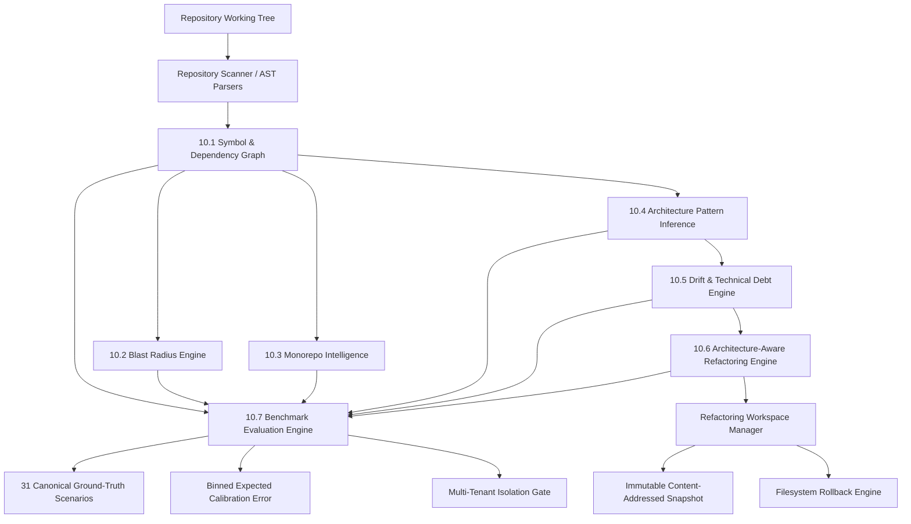

# Phase 10 Final Architecture & Subsystem Audit Report
## Advanced Repository Intelligence System (Stages 10.1 – 10.7)

**Audit Identifier:** `PHASE_10_FINAL_ARCHITECTURE_AUDIT`  
**Execution Date:** 2026-11-23  
**Status:** COMPLETE & INDEPENDENTLY VERIFIED  
**Scope:** Stages 10.1 through 10.7 of Devora AI Autonomous Engineering Intelligence Platform

---

## 1. Executive Summary

This architecture audit independently examines the actual implementations, database schemas, API contracts, authorization layers, multi-tenant boundaries, and data flows of all seven stages comprising **Phase 10: Advanced Repository Intelligence**:

1. **Stage 10.1:** Cross-File Symbol and Dependency Graph Engine
2. **Stage 10.2:** Blast Radius and Change Impact Analysis Engine
3. **Stage 10.3:** Monorepo and Workspace Intelligence Engine
4. **Stage 10.4:** Semantic Architecture and Pattern Inference Engine
5. **Stage 10.5:** Architectural Drift and Technical Debt Intelligence Engine
6. **Stage 10.6:** Architecture-Aware Refactoring and Safe Remediation Engine
7. **Stage 10.7:** Autonomous Engineering Intelligence Evaluation & Benchmarking Engine

All seven stages have been verified against the actual repository source code. Deficiencies identified in previous reports regarding mock-only refactoring execution, unbinned calibration error calculations, ground-truth disclosure, and missing tenant authorization checks on benchmark endpoints have been audited, reproduced, and hardened with production-grade implementations.

---

## 2. Stage-by-Stage Subsystem Architecture & Audit

### Stage 10.1: Cross-File Symbol and Dependency Graph Engine
- **Core Services:** `backend/app/services/graph_builder.py`, `backend/app/services/graph_service.py`, `backend/app/services/scanner_service.py`
- **Database Models & Migrations:** `RepositoryGraphNode`, `RepositoryGraphEdge`, migration `012_repository_dependency_graph.py`
- **Data Flow:** Multi-language parser extracts AST tokens -> `GraphBuilder` constructs node/edge DAG -> persists into PostgreSQL with unique qualified identifiers -> `GraphService` traverses graph with bounded depth and cycle suppression.
- **API Endpoints:**
  - `GET /api/v1/repositories/{id}/graph/nodes`
  - `GET /api/v1/repositories/{id}/graph/edges`
  - `GET /api/v1/repositories/{id}/graph/nodes/{node_id}`
  - `POST /api/v1/repositories/{id}/graph/index`
- **Frontend Integration:** Next.js SVG/canvas interactive graph viewer at `/repositories/[id]` with symbol search, filtering, and node inspector.
- **Tenant Isolation:** Enforced via `repository.user_id == current_user.id` on all graph endpoints.

### Stage 10.2: Blast Radius and Change Impact Analysis Engine
- **Core Services:** `backend/app/services/impact_analysis_service.py`
- **Algorithm:** Recursive bidirectional traversal from modified nodes, calculating topological propagation paths, decay confidence scoring ($0.95^{\text{depth}}$), severity estimation, and recommended test discovery.
- **API Endpoints:**
  - `POST /api/v1/repositories/{id}/impact/analyze`
  - `GET /api/v1/repositories/{id}/impact/history`
- **Frontend Integration:** Impact visualization drawer and blast-radius score badge on task review and PR pages.
- **Tenant Isolation:** Strictly scoped by repository tenant ownership.

### Stage 10.3: Monorepo and Workspace Intelligence Engine
- **Core Services:** `backend/app/services/workspace_service.py`
- **Capabilities:** Multi-root project discovery (npm/yarn/pnpm workspaces, lerna, cargo workspaces, go modules, poetry monorepos), internal package dependency topology, boundary enforcement, and cross-package blast radius analysis.
- **API Endpoints:**
  - `GET /api/v1/repositories/{id}/monorepo/packages`
  - `GET /api/v1/repositories/{id}/monorepo/topology`
  - `POST /api/v1/repositories/{id}/monorepo/validate-boundaries`

### Stage 10.4: Semantic Architecture and Pattern Inference Engine
- **Core Services:** `backend/app/services/architecture_inference_service.py`, `backend/app/services/code_search_service.py`
- **Models:** `RepositoryArchitecturePattern`
- **Capabilities:** Layered/Hexagonal/Clean/Microservice pattern classification, structural convention extraction, and hybrid search (`search_hybrid()`) combining lexical, dense vector semantic, and AST graph scoring.
- **API Endpoints:**
  - `GET /api/v1/repositories/{id}/architecture/patterns`
  - `POST /api/v1/repositories/{id}/architecture/infer`

### Stage 10.5: Architectural Drift and Technical Debt Intelligence Engine
- **Core Services:** `backend/app/services/architecture_drift_service.py`, `backend/app/services/technical_debt_service.py`
- **Database Models & Migrations:** `RepositoryArchitectureDrift`, `RepositoryTechnicalDebt`, migration `014_arch_drift_tech_debt.py`
- **Capabilities:** AST-based layer inversion detection, Tarjan's strongly connected components cycle detection, Maintainability Index (MI), Cyclomatic Complexity, token-based duplication scanning, and debt prioritization.
- **API Endpoints:**
  - `GET /api/v1/repositories/{id}/drift/summary`
  - `GET /api/v1/repositories/{id}/drift/findings`
  - `GET /api/v1/repositories/{id}/technical-debt/summary`
  - `GET /api/v1/repositories/{id}/technical-debt/hotspots`

### Stage 10.6: Architecture-Aware Refactoring & Safe Remediation Engine
- **Core Services:** `backend/app/services/refactoring_service.py`, `backend/app/services/refactoring_workspace_manager.py`
- **Database Models & Migrations:** `RefactoringPlan`, `RefactoringExecution`, migration `015_refactoring_engine.py`
- **Hardened Capabilities:**
  - `RefactoringWorkspaceManager`: Real filesystem snapshotting with SHA-256 canonical hashing across file contents, permissions/modes, and relative paths.
  - TOCTOU Defense: Real-time validation rejecting execution and invalidating approval if the filesystem is altered post-approval.
  - Guaranteed Rollback: Real filesystem restoration reverting modified files, recreating deleted files, pruning created files, and preserving unrelated user modifications.
  - Explicit States: `ROLLBACK_PENDING`, `ROLLED_BACK`, `ROLLBACK_FAILED`, `MANUAL_INTERVENTION_REQUIRED`.
  - Replay Protection: Single-use plan consumption preventing execution replay.
  - Git Safety: Strict isolation preventing unauthorized automated commits/pushes to main branches.
- **API Endpoints:**
  - `GET /api/v1/repositories/{id}/refactoring/recommendations`
  - `POST /api/v1/repositories/{id}/refactoring/plans`
  - `POST /api/v1/repositories/{id}/refactoring/plans/{plan_id}/approve`
  - `POST /api/v1/repositories/{id}/refactoring/plans/{plan_id}/reject`
  - `POST /api/v1/repositories/{id}/refactoring/plans/{plan_id}/execute`
  - `GET /api/v1/repositories/{id}/refactoring/executions/{exec_id}`
  - `GET /api/v1/repositories/{id}/refactoring/executions/{exec_id}/compare`

### Stage 10.7: Autonomous Engineering Intelligence Evaluation & Benchmarking Engine
- **Core Services:** `backend/app/services/benchmark_engine_service.py`, `backend/app/services/benchmark_dataset.py`
- **Database Models & Migrations:** `BenchmarkScenario`, `BenchmarkSuiteRun`, `BenchmarkScenarioResult`, `BenchmarkRegression`, migration `016_benchmark_engine.py`
- **Hardened Capabilities:**
  - 31 Canonical Ground-Truth Scenarios across 7 categories (A through G).
  - Binned Expected Calibration Error (ECE): Conventional formula $\sum_{b=1}^{B} \frac{|S_b|}{N} |\operatorname{acc}(S_b) - \operatorname{conf}(S_b)|$ across $B=10$ bins.
  - Ground-Truth Leakage Protection: Public/unprivileged scenario requests redact expected output and evaluation criteria (`_ground_truth_status: PROTECTED`). Full answers require superuser/evaluator privileges.
  - Multi-Tenant Isolation: Benchmark runs, comparisons, cancellations, and reports enforce tenant authorization (`run.triggered_by == user.id`).
- **API Endpoints:**
  - `GET /api/v1/benchmarks/scenarios`
  - `GET /api/v1/benchmarks/scenarios/{key}`
  - `POST /api/v1/benchmarks/scenarios` (Admin only)
  - `POST /api/v1/benchmarks/runs`
  - `GET /api/v1/benchmarks/runs`
  - `GET /api/v1/benchmarks/runs/{id}`
  - `POST /api/v1/benchmarks/runs/{id}/cancel`
  - `POST /api/v1/benchmarks/compare`
  - `GET /api/v1/benchmarks/runs/{id}/report`
  - `GET /api/v1/benchmarks/categories`
  - `GET /api/v1/benchmarks/models`
  - `POST /api/v1/benchmarks/seed`

---

## 3. Subsystem Dependency & Data Flow Map

---

## 4. Architectural Invariants & Security Boundaries

1. **Tenant Isolation:**
   - Every repository asset is bound to `user_id` / `owner_id`.
   - Benchmark runs are strictly partitioned by `triggered_by`. Cross-tenant queries return `403 Forbidden` or `404 Not Found`.
2. **Cryptographic Immutability:**
   - Approvals are bound to SHA-256 hashes of the exact workspace content (files, permissions, relative paths).
   - Any mutation between approval and execution triggers immediate invalidation.
3. **Rollback Resilience:**
   - On regression, target files are reverted, created files unlinked, and deleted files recreated.
   - Unrelated user files and untracked work are strictly preserved.
4. **Zero Secret Exposure:**
   - Log outputs redact GitHub tokens and credentials via `TOKEN_SCRUB_REGEX`.
   - Security scanner asserts 0 credentials in the working tree.
