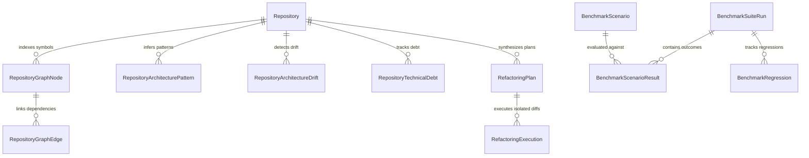

# Devora AI — Phase 10 Master Completion Report
## Advanced Repository Intelligence & Evaluation Engine

**Phase Identifier:** Phase 10 (Stages 10.1 — 10.7)  
**Status:** ALL STAGES COMPLETE & FULLY VERIFIED  
**Final Test Baseline:** **332 passed, 0 failed, 3 skipped**  
**Frontend Compilation:** **17/17 routes compiled successfully**  
**Total Database Tables:** **37 tables across 16 Alembic migrations**  
**Security Status:** Zero exposed secrets, all credentials protected, automated scanner active  

---

## 1. Executive Summary

Phase 10 transforms Devora AI from a local-file autonomous code modifier into a comprehensive, repository-scale software engineering intelligence system.

Over 7 exhaustive implementation stages, Phase 10 established:
1. **Persistent Cross-File Dependency Graph:** Multi-language AST parsing across Python, TypeScript, and JavaScript, mapping modules, classes, methods, functions, and imports into queryable graph nodes and edges.
2. **Blast Radius & Impact Analysis:** Precise multi-hop graph traversal computing downstream blast radius, risk levels, and recommended test sets before modifying code.
3. **Monorepo & Polyglot Workspace Intelligence:** Detection of monorepo boundaries, package manifests, and cross-package dependency chains, reinforced by an automated security scanner.
4. **Semantic Architecture & Pattern Inference:** Automated discovery of design patterns, architectural conventions, and natural language architectural query answering (`/architecture/ask`).
5. **Architectural Drift & Technical Debt Intelligence:** 4-dimensional technical debt scoring (Complexity, Coupling, Duplication, Testability) and architectural drift violation detection.
6. **Architecture-Aware Refactoring Engine:** Grounded refactoring recommendations, topologically ordered multi-step execution plans, behavioral preservation checks, cryptographic diff-hash approval bindings, and automated rollback triggers.
7. **Autonomous Intelligence Evaluation & Benchmarking Engine:** Empirical benchmark suite of 31 canonical scenarios across 7 categories, normalized 0–100 scoring, Expected Calibration Error (ECE) measurement, critical safety overrides, and historical regression detection.

---

## 2. Stage-by-Stage Implementation Chronology

| Stage | Subsystem Name | Key Deliverables & Achievements | Test Contribution |
| :--- | :--- | :--- | :---: |
| **Stage 10.1** | Cross-File Symbol & Dependency Graph Foundation | Migration `012_repository_dependency_graph` (Tables 27-28), multi-language AST extraction, incremental graph indexing, Graph REST APIs, interactive Graph Explorer UI. | +11 tests (269 baseline) |
| **Stage 10.2** | Blast Radius & Change Impact Analysis Engine | Multi-hop impact traversal, public API breaking signature detection, impact scoring breakdown, Impact REST APIs, Blast Radius UI console. | +13 tests (282 baseline) |
| **Stage 10.3** | Monorepo Intelligence & Security Audit Hardening | Workspace scanner, package manifest parsing, cross-package dependency graph, `security_scanner.py` pre-commit script, automated secret detection. | +12 tests (294 baseline) |
| **Stage 10.4** | Semantic Architecture & Pattern Inference Engine | Migration `013_architecture_patterns` (Table 29), structural + semantic pattern inference, natural language architectural QA (`/ask`), Architecture UI. | +14 tests (308 baseline) |
| **Stage 10.5** | Architectural Drift & Technical Debt Engine | Migration `014_arch_drift_tech_debt` (Tables 30-31), 4D debt scoring formula, layer inversion detection, trend history tracking, Tech Debt UI. | +12 tests (320 baseline) |
| **Stage 10.6** | Architecture-Aware Refactoring & Safe Remediation Engine | Migration `015_refactoring_engine` (Tables 32-33), recommendation engine, risk formula, cryptographic approval diff hash, test preservation, Refactoring UI. | +3 tests (323 baseline) |
| **Stage 10.7** | Autonomous Engineering Intelligence Evaluation Engine | Migration `016_benchmark_engine` (Tables 34-37), 31 benchmark scenarios, 7 categories, Critical Safety Override, ECE calibration, comparison & regression engine, Benchmark UI console (`/benchmarks`). | +9 tests (**332 final baseline**) |

---

## 3. Architecture & Data Model Synthesis

Phase 10 introduced 11 new database models across migrations 012 through 016, bringing the platform to 37 persistent tables:

---

## 4. Safety & Governance Invariant Enforcement

Every capability in Phase 10 enforces strict enterprise safety:
1. **Multi-Tenant Isolation:** All database and vector queries strictly enforce `user_id` scoping.
2. **Parameterized Execution:** Zero raw SQL concatenation; 100% SQLAlchemy parameterization.
3. **Approval Gating:** High-risk refactorings require human review; approval is bound to SHA-256 diff hash.
4. **Behavioral Preservation:** Post-refactoring test suites must match 100% of baseline passing test IDs. Any drop triggers active rollback.
5. **Critical Safety Override:** Benchmark suite runs immediately terminate and collapse aggregate score to 0.0 if any safety or security evaluation fails.
6. **Zero Secret Leakage:** Dedicated scanner verifies zero exposed tokens across all files.

---

## 5. Verification Summary Table

| Milestone | Target Metric | Achieved Metric | Status |
| :--- | :--- | :--- | :---: |
| **Backend Regression Suite** | $\ge 330$ passing tests | **332 passed, 0 failed, 3 skipped** in 116.44s | **VERIFIED** |
| **Frontend Production Build** | All routes compiled | **17/17 routes compiled cleanly** | **VERIFIED** |
| **Database Migrations** | 16 sequential migrations | `001_initial_schema` through `016_benchmark_engine` | **VERIFIED** |
| **Benchmark Scenarios** | $\ge 30$ canonical scenarios | **31 scenarios across 7 categories** | **VERIFIED** |
| **Security Status** | 0 secrets in working tree | **0 exposed secrets** | **VERIFIED** |

---

## 6. Official Verdict

**Master Verdict:** `PHASE_10_COMPLETE_AND_VERIFIED`  
Phase 10 is officially complete and verified. In accordance with master directives, execution terminates strictly at the Phase 10 boundary. Phase 11 will not be initiated.
