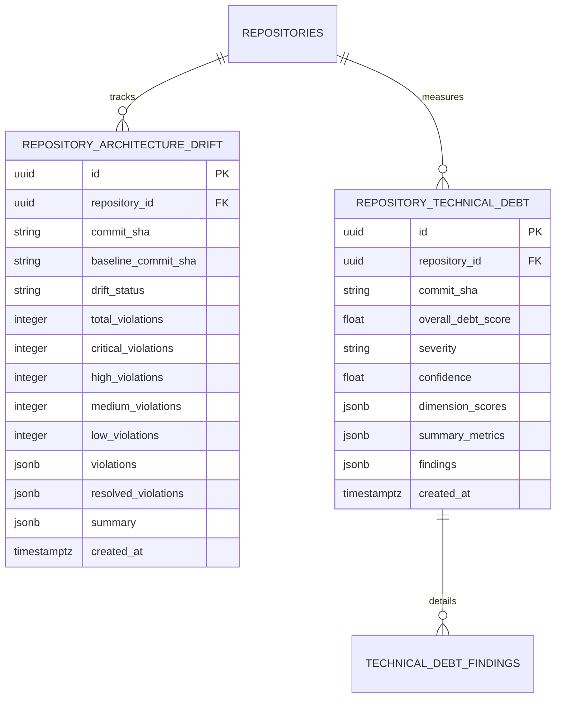
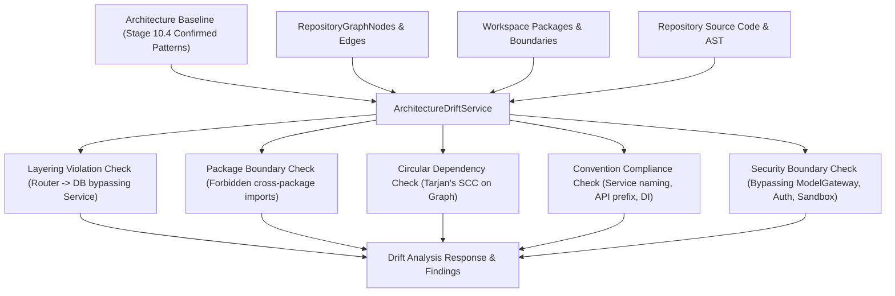

# DEVORA AI — PHASE 10, STAGE 10.5 IMPLEMENTATION PLAN
## Architectural Drift & Technical Debt Intelligence Engine

**Date:** November 20, 2026  
**Status:** DRAFT & READY FOR EXECUTION  
**Scope:** Architecture Drift Detection, Technical Debt Intelligence, Deterministic Scoring, Baseline History, Specialist Agent Integration, REST APIs, and Next.js SaaS UI  

---

## 1. Architectural Vision & Objectives

Phase 10 Stage 10.5 introduces continuous architectural governance and quantitative technical debt measurement into Devora AI. 

While Stage 10.4 established the empirical baseline of design patterns and coding conventions, Stage 10.5 monitors and enforces this baseline over time. When developers or autonomous agents introduce new code, Devora detects:
1. **Architectural Drift:** Layering violations, cross-package boundary breaches, circular dependencies, and convention deviations.
2. **Technical Debt:** Code duplication, cognitive/cyclomatic complexity, dependency bloat, maintainability hazards (TODOs, dead code risks), and test deficit.
3. **Deterministic Scoring:** An explainable 0–100 technical debt rating with clear severity bands, confidence indicators, and actionable remediation steps.
4. **Historical Baselines:** Commit-aware drift comparison tracking new vs. resolved violations over time.

---

## 2. Reuse of Existing Architecture

Stage 10.5 strictly builds upon and reuses existing verified infrastructure without duplication:
- **`ArchitectureInferenceService` (`backend/app/services/architecture_inference_service.py`):** Supplies confirmed design patterns and empirical coding conventions as the architectural truth.
- **`RepositoryArchitecturePattern` (`backend/app/models/repository_architecture_pattern.py`):** Persisted pattern catalog.
- **`RepositoryGraphNode` & `RepositoryGraphEdge` (`backend/app/models/repository_graph_*.py`):** Provides AST symbol hierarchy, callers, callees, imports, and cross-package links.
- **`WorkspaceService` (`backend/app/services/workspace_service.py`):** Supplies workspace boundaries and package dependency graphs across 5 language ecosystems.
- **`ImpactAnalysisService` (`backend/app/services/impact_analysis_service.py`):** Correlates high-impact files with test deficit.
- **`CodeSearchService` (`backend/app/services/search_service.py`):** Supplies semantic embeddings and hybrid retrieval.
- **`ReliabilityService` (`backend/app/services/reliability_service.py`):** Calibrates security posture and subsystem health.

---

## 3. Database Schema Design (Migration 014)

Two dedicated relational tables will be added via Alembic migration `014_architectural_drift_and_technical_debt.py`:

### Table 1: `repository_architecture_drift`
- `id` (UUID PK)
- `repository_id` (UUID FK -> `repositories.id` ON DELETE CASCADE)
- `commit_sha` (VARCHAR(100))
- `baseline_commit_sha` (VARCHAR(100))
- `drift_status` (VARCHAR(50): `HEALTHY`, `DRIFT_DETECTED`, `CRITICAL_DRIFT`)
- `total_violations` (INTEGER)
- `critical_violations` (INTEGER)
- `high_violations` (INTEGER)
- `medium_violations` (INTEGER)
- `low_violations` (INTEGER)
- `violations` (JSONB)
- `resolved_violations` (JSONB)
- `summary` (JSONB)
- `created_at` (TIMESTAMPTZ)

### Table 2: `repository_technical_debt`
- `id` (UUID PK)
- `repository_id` (UUID FK -> `repositories.id` ON DELETE CASCADE)
- `commit_sha` (VARCHAR(100))
- `overall_debt_score` (FLOAT: 0.0 to 100.0)
- `severity` (VARCHAR(50): `CRITICAL`, `HIGH`, `MEDIUM`, `LOW`, `CLEAN`)
- `confidence` (FLOAT: 0.0 to 1.0)
- `dimension_scores` (JSONB: complexity, duplication, dependency, architecture, test, maintainability)
- `summary_metrics` (JSONB)
- `findings` (JSONB: array of detailed debt findings)
- `created_at` (TIMESTAMPTZ)

---

## 4. Architecture Drift Detection Engine

Implemented in `backend/app/services/architecture_drift_service.py`:

### Specific Drift Detectors
1. **Layering Violations:**
   - Detects API routes directly querying DB (`db.execute(select(...))` or raw SQL) instead of delegating to domain services.
   - Detects services directly invoking HTTP presentation layer.
2. **Dependency Boundary Violations:**
   - Detects circular imports between packages/modules.
   - Detects packages importing internal implementation details of sibling packages instead of public APIs.
3. **Convention Violations:**
   - Classes in `services/` not adhering to `*Service` naming or `_service.py` filenames.
   - API endpoints omitting `/api/v1/` prefixing.
   - Handlers managing DB sessions directly rather than using FastAPI `Depends(get_db)`.
   - Raw exception raising bypassing `DevoraException`.
4. **Security Boundary Violations:**
   - Direct LLM calls bypassing `ModelGateway`.
   - Protected API routes missing `get_current_user` auth dependency.
   - Execution calls bypassing `SandboxService`.

---

## 5. Technical Debt Intelligence Engine

Implemented in `backend/app/services/technical_debt_service.py`:

### Five Debt Dimensions
1. **Code Duplication ($w_{dup} = 0.20$):**
   - AST node structural hashing comparing normalized function bodies.
   - Supplementary semantic similarity checks via `RepositoryKnowledge` embeddings (with explicit safeguard: semantic similarity alone does not prove duplication).
2. **Complexity Indicators ($w_{comp} = 0.25$):**
   - Long functions (>50 lines).
   - Deep block nesting (>4 levels).
   - Oversized classes (>300 lines).
   - High fan-out / excessive coupling (>12 dependencies).
3. **Dependency Debt ($w_{dep} = 0.20$):**
   - Cyclic module graphs.
   - Unresolved internal symbol references (`resolution_status == "UNRESOLVED"`).
   - Packages with high transitive dependency blast radius.
4. **Maintainability Debt ($w_{maint} = 0.15$):**
   - Dead/unreferenced functions (verified against entrypoints/dynamic registration to prevent false positives).
   - Concentrations of `TODO`, `FIXME`, `HACK`, `XXX` comments.
   - Catch-all exception suppression (`except Exception: pass`).
5. **Test Debt ($w_{test} = 0.20$):**
   - High-impact components (severity `CRITICAL` or `HIGH` in `ImpactAnalysisService`) lacking test coverage.
   - High flaky test recurrence from `FlakyTestRecord`.

### Deterministic Scoring Formula
$$\text{TechnicalDebtScore} = \min(100.0, 0.25 \cdot C + 0.20 \cdot D + 0.20 \cdot P + 0.20 \cdot T + 0.15 \cdot M)$$

*Severity Bands:*
- **`CRITICAL`:** $\ge 80.0$
- **`HIGH`:** $60.0 - 79.9$
- **`MEDIUM`:** $35.0 - 59.9$
- **`LOW`:** $1.0 - 34.9$
- **`CLEAN`:** $0.0$

---

## 6. Specialist Agent Integration

The drift and debt intelligence engine operates in an **advisory** capacity without destructive side-effects:

1. **Adaptive Planning Agent (`backend/app/agents/specialists/planner.py`):**
   - Injects repository technical debt score, critical violations, and high-debt files into the planning context.
   - Guides the planner to author implementation steps that resolve or avoid compounding existing debt.
2. **Code Review Agent (`backend/app/agents/specialists/code_reviewer.py`):**
   - Compares the git diff against the architectural baseline.
   - Flags newly introduced layering violations, added coupling, or duplicate functions.
   - Reports debt delta (+ / -) in constructive review comments.
3. **Security Review Agent (`backend/app/agents/specialists/security_reviewer.py`):**
   - Specifically checks for violations of security boundaries (ModelGateway, authentication, sandbox).
4. **Reporting Agent (`backend/app/agents/specialists/reporter.py`):**
   - Incorporates architectural drift status and technical debt impact into the final engineering audit report.

---

## 7. REST APIs & Frontend UI

### REST API Routes (`backend/app/api/v1/architecture.py`)
- `GET /api/v1/repositories/{id}/architecture/drift`: Fetch drift summary and violations.
- `POST /api/v1/repositories/{id}/architecture/drift/analyze`: Trigger drift detection analysis.
- `GET /api/v1/repositories/{id}/technical-debt`: Fetch debt summary score and dimension breakdown.
- `POST /api/v1/repositories/{id}/technical-debt/analyze`: Trigger technical debt recalculation.
- `GET /api/v1/repositories/{id}/technical-debt/findings`: Paginated list of debt findings with filters.
- `GET /api/v1/repositories/{id}/technical-debt/findings/{finding_id}`: Detail view of a single finding.
- `GET /api/v1/repositories/{id}/technical-debt/trends`: Historical debt score progression.

### Next.js Frontend Console (`frontend/src/components/repository/architecture-health-tab.tsx`)
- Sub-views:
  1. **Drift Overview:** Overall drift status badge, new vs. resolved violations, severity distribution.
  2. **Technical Debt Dashboard:** Radial debt score gauge, 5 dimension progress bars, summary KPI cards.
  3. **Findings Explorer:** Category & severity filter chips, searchable findings table, expandable evidence code snippets, remediation instructions.
  4. **Architecture History:** Commit baseline comparison, findings resolved in recent commits, debt progression over time.
  5. **Package Health:** Cross-package coupling metrics and circular dependency graph alerts.

---

## 8. Verification Strategy & Regression Boundaries

1. **Unit Tests:**
   - `backend/tests/unit/test_architecture_drift.py`: Layering violations, package cycles, convention checks, security boundary breaches.
   - `backend/tests/unit/test_technical_debt.py`: Duplication detection, complexity calculation, test debt correlation, scoring normalization.
2. **Integration Tests:**
   - `backend/tests/integration/test_architecture_drift_api.py`: Full API lifecycle, analyze, fetch, filter, tenant isolation, and pagination.
3. **Full Regression Test:**
   - Execute all 308+ tests across the backend test suite; verify zero regressions.
   - Execute Next.js build; verify 16/16 routes compile cleanly.
4. **Security Audit Check:**
   - Re-execute `security_scanner.py --scan-history` to ensure clean working tree and verified history logging.
