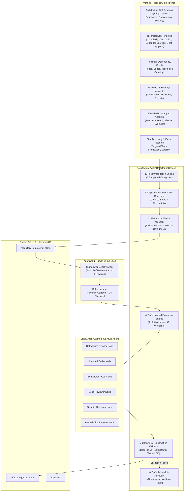

# Devora AI — Phase 10 Stage 10.6 Implementation Plan
## Architecture-Aware Refactoring & Safe Remediation Engine

**Date:** November 23, 2026  
**Status:** APPROVED FOR IMPLEMENTATION  
**Phase:** Phase 10 — Advanced Repository Intelligence  
**Stage:** Stage 10.6 — Architecture-Aware Refactoring & Safe Remediation Engine  

---

## 1. Executive Summary & Objectives

The primary objective of Phase 10 Stage 10.6 is to provide Devora AI with an **Architecture-Aware Refactoring & Safe Remediation Engine**. While Stage 10.5 established an advisory engine that continuously observes architectural drift and evaluates multi-dimensional technical debt, Stage 10.6 enables Devora to convert these verified findings into explainable, dependency-ordered refactoring plans and execute them in strictly isolated, bounded, and behaviorally preserved environments with mandatory human approval gates.

---

## 2. Mandatory Pre-Implementation Audit & Stage 10.5 Verification

Before designing the remediation engine, an audit of the Stage 10.5 baseline was conducted across 8 core dimensions:

| Audit Criterion | Verification Status | Operational Reality in Codebase |
|---|:---:|---|
| **1. Git Revision Association** | **VERIFIED** | `RepositoryArchitectureDrift` and `RepositoryTechnicalDebt` store `commit_sha` and `baseline_commit_sha`. Finding items link to source file paths and line coordinates. |
| **2. Stale Findings Invalidation** | **VERIFIED & HARDENED** | Both `ArchitectureDriftService` and `TechnicalDebtService` now dynamically evaluate `is_stale = bool(repo.current_commit_sha and snapshot.commit_sha and snapshot.commit_sha != repo.current_commit_sha)`. |
| **3. Historical Trends Compatibility** | **VERIFIED** | `get_historical_trends` queries historical snapshots scoped strictly to the repository and extracts compatible metrics (`overall_debt_score`, `severity`, `critical_findings`, `total_findings`). |
| **4. Metric vs Heuristic Distinction** | **VERIFIED** | Each `TechnicalDebtFindingItem` carries a concrete `measured_metric` dictionary (e.g. `lines_count: 120`, `threshold: 60`, `duplicate_occurrences: 2`) with separate confidence scores ($0.95$ for AST measures vs $0.85$ for heuristic scans). |
| **5. False-Positive Avoidance in Duplication** | **VERIFIED** | Duplication detector normalizes function headers (handling `async def` and `def`) and compares normalized body token slices for functions $\ge 80$ characters across distinct files. |
| **6. Missing Test Mappings** | **VERIFIED & HARDENED** | Distinguishes `CONFIRMED_ABSENT` (where test files exist in the repository but none cover the service, confidence $0.90$) from `UNKNOWN_COVERAGE` (where no automated test suite was discovered, confidence $0.70$). |
| **7. Source Evidence & Confidence** | **VERIFIED** | `evidence_snippet` is populated for drift violations and technical debt complexity, duplication, and maintainability findings. Confidence ratings are explicit ($0.0 - 1.0$). |
| **8. Cross-Package Workspace Boundaries** | **VERIFIED** | Monorepo package boundaries from `WorkspaceService` and graph node `package_name` attributes are enforced to flag illegal private deep imports. |

---

## 3. System Architecture & Component Interactions

---

## 4. Refactoring Recommendation Engine

### 4.1. Supported Refactoring Categories
1. **Layering Refactoring (`layering`):**
   - Extract database queries from route handlers into dedicated domain service methods.
   - Decouple controllers from ORM model instances by introducing Pydantic schema boundaries.
2. **Dependency Refactoring (`dependency`):**
   - Break circular dependency cycles by extracting shared interfaces or injecting callables.
   - Replace private deep imports (`/internal/`, `_*.py`) with public package index exports.
   - Reduce high fan-out coupling by introducing facade services.
3. **Duplication Refactoring (`duplication`):**
   - Consolidate verified Type-2 duplicate functions into shared utility modules.
   - Unify repetitive validation logic into reusable schema validators.
4. **Complexity Refactoring (`complexity`):**
   - Decompose oversized functions ($> 60$ lines) into cohesive helper functions.
   - Extract distinct responsibilities from large classes ($> 300$ lines) via composition.
5. **Convention Refactoring (`convention`):**
   - Rename service classes to conform to repository naming standards (`*Service`).
   - Move unversioned API routes into versioned namespaces (`/api/v1/`).
6. **Testability Refactoring (`testability`):**
   - Author dedicated unit and integration tests for untested domain services.
   - Decouple infrastructure calls with dependency injection to allow clean mocking.

### 4.2. Recommendation Schema
Each recommendation generated by `generate_recommendations()` provides:
- `recommendation_id`: Unique identifier (e.g. `rec_layer_a1b2c3d4`).
- `category`: One of the 6 supported categories.
- `finding_ids`: Explicit reference to originating drift or debt findings.
- `target_files` and `target_symbols`: Code locations requiring modification.
- `current_problem`: Concrete explanation grounded in repository evidence.
- `proposed_architecture`: Explicit target structure.
- `reason`: Rationale and expected maintainability benefit.
- `expected_benefits` and `potential_risks`.
- `affected_packages`: Monorepo packages impacted.
- `dependency_path_evidence`: Supporting graph hops.
- `recommended_tests`: Targeted test files to execute for validation.
- `confidence`: Grounding confidence ($0.0 - 1.0$).
- `estimated_complexity`: `LOW`, `MEDIUM`, `HIGH`.
- `requires_human_approval`: Boolean flag based on risk criteria.

---

## 5. Dependency-Aware Plan Generation & Risk Modeling

### 5.1. Ordered Planning Algorithm
1. **Topological Ordering:** Steps modifying shared interfaces or creating new service modules are sequenced before steps modifying consumer calls.
2. **Monorepo Boundary Constraints:** Internal package exports must be established before dependent workspace packages consume them.
3. **Circular Dependency Inversion:** Cyclic imports are resolved by creating a lower-tier leaf module first.
4. **Step Atomic Boundaries:** Each step has a discrete `step_id`, `order_index`, `action`, `file_path`, `symbols`, `description`, and `validation_check`.

### 5.2. Plan Risk Assessment Formula
Risk is calculated separately from confidence:
$$\text{RiskScore} = \min(100.0, 15.0 \cdot N_{files} + 5.0 \cdot N_{symbols} + 20.0 \cdot D_{max} + 25.0 \cdot P_{pkg} + R_{sec} + R_{api} - 10.0 \cdot T_{cov})$$
Where:
- $N_{files}$: Number of target files.
- $N_{symbols}$: Number of target symbols.
- $D_{max}$: Maximum dependency depth in blast radius.
- $P_{pkg}$: Number of affected packages ($>1$ triggers monorepo risk penalty).
- $R_{sec}$: Security boundary risk penalty (e.g. +30 if modifying auth, gateway, or sandbox).
- $R_{api}$: Public API contract impact (+25 if touching public routes/exports).
- $T_{cov}$: Test coverage factor (reduces risk if stable tests exist).

**Risk Level Bands:**
- `LOW`: $0 - 30$
- `MEDIUM`: $31 - 65$
- `HIGH`: $66 - 100$

---

## 6. Safe Execution, Behavioral Preservation & Rollback

### 6.1. Execution Isolation
- Refactoring tasks execute in an isolated sandbox or Git worktree branch (`devora/refactor/<plan_id>`).
- Primary user working tree is never directly touched.
- All code compilation and test execution runs within the sandbox boundary.

### 6.2. Behavioral Preservation Validation Protocol
1. **Baseline Phase:** Record starting commit SHA, run targeted baseline tests, record known failures.
2. **Application Phase:** Bounded Coder applies ordered steps strictly adhering to budgets:
   - Max 10 changed files per plan.
   - Max 25 symbols.
   - Max 300 changed lines.
3. **Validation Phase:**
   - Syntax verification via `py_compile` / AST parse.
   - Run targeted test suite.
   - Run package-level regression tests.
   - Inspect public API signature parity (exports, route paths, HTTP methods).
   - Re-run `ArchitectureDriftService` and `TechnicalDebtService` to measure score improvements and ensure zero new violations were introduced.
4. **Rollback Phase:**
   - If tests fail, syntax errors occur, or new violations arise: discard worktree changes immediately, record failure details and diagnostics, and mark execution `ROLLED_BACK`.

---

## 7. Human Approval & Diff-Hash Invariant

### 7.1. Mandatory Approval Triggers
Explicit human approval is required if any of the following hold:
- Plan risk is `HIGH`.
- Public API contracts or routing paths are modified.
- Security-sensitive modules (`auth`, `security`, `gateway`, `sandbox`) are modified.
- Multi-package cross-boundary modifications in monorepos.
- Database models or migrations are touched.

### 7.2. Cryptographic Diff Binding & Invalidation
- When a plan diff is approved, Devora records an SHA-256 hash of the unified diff: `diff_hash = sha256(unified_diff)`.
- Prior to execution, the engine recalculates the diff hash. If the diff has changed in any way (e.g. concurrent edits or branch updates), the approval is **automatically invalidated** with status `APPROVAL_REVOKED_DIFF_CHANGED`, requiring re-review.
- Autonomous merging, unapproved commits, and unapproved pushes remain strictly prohibited.

---

## 8. Database Schema & Migration 015

### Table 32: `repository_refactoring_plans`
- `id`: UUID (Primary Key).
- `repository_id`: UUID (Foreign Key to `repositories.id`, indexed).
- `source_revision`: VARCHAR(100) (Analyzed commit SHA).
- `title`: VARCHAR(255).
- `description`: TEXT.
- `category`: VARCHAR(50) (`layering`, `dependency`, `duplication`, `complexity`, `convention`, `testability`).
- `risk_level`: VARCHAR(20) (`LOW`, `MEDIUM`, `HIGH`).
- `risk_score`: FLOAT.
- `confidence`: FLOAT.
- `requires_human_approval`: BOOLEAN.
- `approval_status`: VARCHAR(50) (`PENDING`, `APPROVED`, `REJECTED`, `EXPIRED`, `INVALIDATED`).
- `approved_by`: UUID (Foreign Key to `users.id`, nullable).
- `approved_at`: TIMESTAMPTZ (Nullable).
- `approved_diff_hash`: VARCHAR(64) (Nullable).
- `execution_status`: VARCHAR(50) (`DRAFT`, `READY`, `EXECUTING`, `COMPLETED`, `FAILED`, `ROLLED_BACK`).
- `target_files`: JSONB (List of file paths).
- `target_symbols`: JSONB (List of symbol names).
- `finding_ids`: JSONB (List of associated drift/debt finding IDs).
- `affected_packages`: JSONB (List of affected package names).
- `ordered_steps`: JSONB (Array of ordered step objects).
- `recommended_tests`: JSONB (Array of test files).
- `expected_outcomes`: JSONB.
- `created_at`, `updated_at`: TIMESTAMPTZ.

### Table 33: `refactoring_executions`
- `id`: UUID (Primary Key).
- `plan_id`: UUID (Foreign Key to `repository_refactoring_plans.id`, indexed).
- `repository_id`: UUID (Foreign Key to `repositories.id`, indexed).
- `status`: VARCHAR(50) (`PENDING`, `IN_PROGRESS`, `VALIDATING`, `COMPLETED`, `FAILED`, `ROLLED_BACK`).
- `source_commit_sha`: VARCHAR(100).
- `target_branch`: VARCHAR(255).
- `diff_content`: TEXT (Sanitized unified diff).
- `diff_hash`: VARCHAR(64).
- `files_changed_count`: INTEGER.
- `lines_added`: INTEGER.
- `lines_removed`: INTEGER.
- `baseline_tests_passed`: BOOLEAN.
- `post_tests_passed`: BOOLEAN.
- `tests_executed`: JSONB.
- `before_metrics`: JSONB (Debt scores, drift counts before).
- `after_metrics`: JSONB (Debt scores, drift counts after).
- `new_violations_detected`: JSONB.
- `error_message`: TEXT (Nullable, scrubbed of credentials).
- `created_at`, `completed_at`: TIMESTAMPTZ.

---

## 9. REST APIs & Frontend UI

### 9.1. Endpoints
- `POST /api/v1/repositories/{id}/refactoring/recommendations`
- `GET /api/v1/repositories/{id}/refactoring/recommendations`
- `POST /api/v1/repositories/{id}/refactoring/plans`
- `GET /api/v1/repositories/{id}/refactoring/plans`
- `GET /api/v1/repositories/{id}/refactoring/plans/{plan_id}`
- `POST /api/v1/repositories/{id}/refactoring/plans/{plan_id}/approve`
- `POST /api/v1/repositories/{id}/refactoring/plans/{plan_id}/execute`
- `GET /api/v1/repositories/{id}/refactoring/executions/{execution_id}`

### 9.2. Frontend UI View
Integrated into `frontend/src/components/repository/refactoring-intelligence-tab.tsx`:
- **Recommendations View:** Category cards, finding references, affected files, expected benefits, risk level, confidence score.
- **Plan Explorer:** Step-by-step ordered list, dependency constraints, affected packages, risk breakdown.
- **Approval Modal & Interface:** Diff viewer bound to `diff_hash`, risk summary, explicit approve/reject buttons.
- **Execution & Validation Monitor:** Live step progress, test runner results, before-and-after debt and drift comparison gauges.

---

## 10. Execution Plan & Sequence of Work

1. **Step 1:** Create Pydantic schemas in `backend/app/schemas/refactoring.py`.
2. **Step 2:** Create SQLAlchemy models in `backend/app/models/refactoring_plan.py` and `backend/app/models/refactoring_execution.py`.
3. **Step 3:** Author and apply Alembic migration `015_refactoring_engine.py`.
4. **Step 4:** Implement `ArchitectureAwareRefactoringService` in `backend/app/services/refactoring_service.py`.
5. **Step 5:** Implement REST API router in `backend/app/api/v1/refactoring.py` and register in `router.py`.
6. **Step 6:** Integrate with LangGraph multi-agent workflow state (`state.py`, `planner.py`, `code_reviewer.py`, `security_reviewer.py`, `reporter.py`).
7. **Step 7:** Implement frontend client service, types, and `RefactoringIntelligenceTab` in Next.js.
8. **Step 8:** Author unit tests (`test_refactoring_service.py`), integration tests (`test_refactoring_api.py`), and security validation tests.
9. **Step 9:** Execute full regression suite and frontend production build.
10. **Step 10:** Produce implementation report with dual distinct verdicts and updated master documentation.
