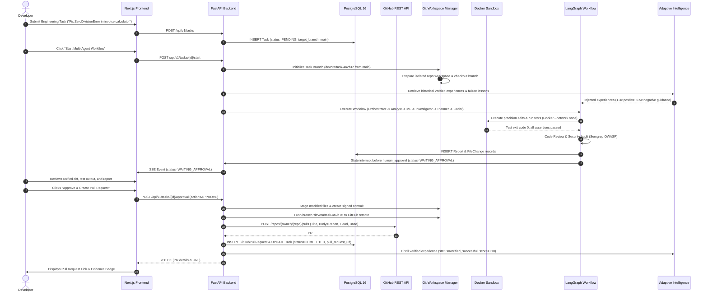
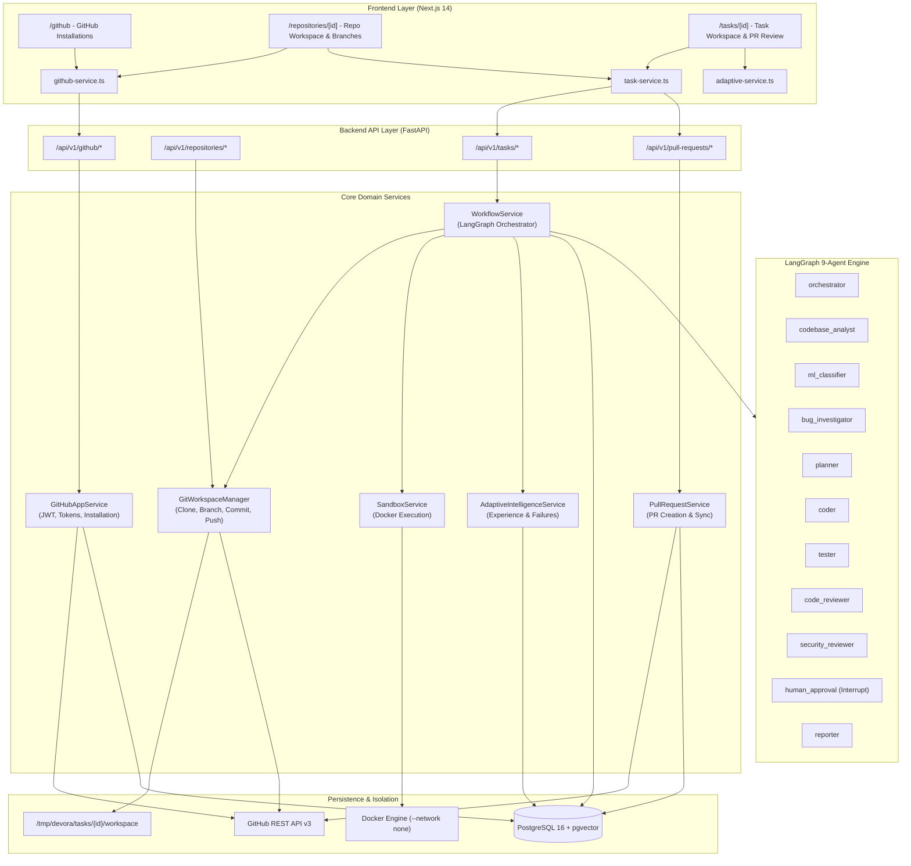
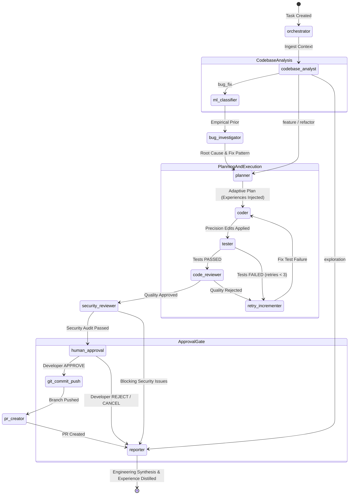
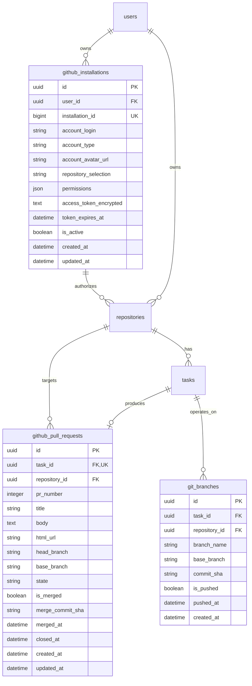

# DEVORA AI — PHASE 8: GITHUB-NATIVE AUTONOMOUS ENGINEERING
## Master Architectural Specification & Implementation Plan

**Author:** Principal AI Systems Architect & Senior Backend Engineer  
**System:** Devora AI v1.0.0  
**Phase:** 8 (GitHub-Native Autonomous Engineering)  
**Status:** Architectural Plan Pending Review  

---

## 1. Existing Architecture Audit

Devora AI is an autonomous AI software engineering platform developed across seven iterative phases. Before implementing Phase 8, a complete codebase audit was conducted across the backend, frontend, database, agents, sandbox, and intelligence layers.

### 1.1 Backend Component Matrix
- **Framework:** FastAPI with Python 3.11/3.14 async runtime.
- **ORM & Data Layer:** SQLAlchemy 2.0 async with `asyncpg` driver for PostgreSQL 16.
- **Database Migrations:** Alembic with 6 applied versions:
  - `001_initial_schema.py`: Base users, projects, repositories, tasks.
  - `002_repository_intelligence.py`: `repository_files`, `repository_knowledge`, `indexing_jobs`.
  - `003_workflow_system.py`: `task_plans`, `agent_runs`, `file_changes`, `test_runs`, `reports`, `approvals`, `feedback`, `workflow_checkpoints`, `workflow_events`.
  - `004_semantic_memory.py`: `repository_memories`, `memory_feedback`, pgvector integration.
  - `005_ml_engine.py`: `ml_model_metadata`, `ml_predictions`.
  - `006_adaptive_intelligence.py`: `task_failure_records`, `benchmark_definitions`, `benchmark_runs`, expanded `engineering_experiences`.
- **Multi-Agent Orchestration:** LangGraph with 9 specialized agent nodes:
  - `orchestrator`: Workflow supervisor and task type classification.
  - `codebase_analyst`: AST symbol exploration and context assembly.
  - `ml_classifier`: Scikit-Learn TF-IDF defect classification across 8 canonical bug categories.
  - `bug_investigator`: Root-cause diagnosis and hypothesis formulation.
  - `planner`: Adaptive task decomposition injecting historical experiences and pitfalls.
  - `coder`: Precision file modification producing unified diffs.
  - `tester`: Sandboxed test execution with bounded retry loops (up to 3 iterations).
  - `code_reviewer`: Static code quality, style, and convention review.
  - `security_reviewer`: Semgrep-aligned security and vulnerability audit.
  - `reporter`: Final Markdown engineering report synthesis.
  - `human_approval`: Interrupt-before gate halting before task finalization.
- **Execution Sandbox:** Dual runner design:
  - `DockerSandboxRunner`: Production runner using isolated Docker containers (`--network none`, 2.0 CPUs, 1500 MB RAM, 100 PID limit, `cap-drop=ALL`, `security-opt=no-new-privileges:true`).
  - `LocalIsolatedRunner`: Fallback runner for testing and offline environments with strict path containment.
- **Semantic & Adaptive Memory:** 768-dimensional vector embeddings stored in PostgreSQL with pgvector, cosine similarity retrieval, and empirical weighting ($1.3\times$ verified success, $0.5\times$ verified failure, $0.7\times$ hypothesis, $0.2\times$ incomplete).

### 1.2 Frontend Component Matrix
- **Framework:** Next.js 14 (App Router), TypeScript, Tailwind CSS, Lucide icons, TanStack React Query.
- **Pages Implemented:**
  - `/dashboard`: Project metrics and active task overview.
  - `/repositories`: Repository connection, metadata listing, indexing status.
  - `/repositories/[id]`: Multi-tab repository workspace (Architecture, Code Search, File Browser, Task History, Semantic Memory).
  - `/tasks`: Task registry with status filters and quick triggers.
  - `/tasks/[id]`: 5-tab IDE-inspired workspace (Task Plan with Adaptive Strategy banner, Code Diffs, Test Results, Live SSE Terminal, Final Engineering Report, Developer Approval Gate, Developer Learning Feedback).
  - `/ml`: ML Bug Classifier dashboard (Holdout Evaluation, Interactive Playground, Prediction History, Model Versions).
  - `/adaptive`: Adaptive Intelligence dashboard (Experience Repository, Agent Performance Matrix, Failure Taxonomy, 7 Canonical Benchmarks runner and history).

### 1.3 Existing GitHub Integration Status
- `GitHubService` in `backend/app/services/github_service.py` currently handles URL parsing (`https://github.com/owner/repo` and `git@github.com`), shallow cloning (`--depth 50`), and local workspace directory resolution.
- `Task` model has a `pull_request_url` column, but no autonomous PR creation pipeline exists.
- Approvals currently complete tasks locally in the database, without committing to Git branches or opening GitHub Pull Requests.

---

## 2. Current System Capabilities vs. Missing Capabilities

| Functional Area | Current Capability (Phases 1–7) | Missing Capability (Phase 8 Objective) |
|---|---|---|
| **GitHub Authentication** | Static `GITHUB_TOKEN` in settings or user record; no App/OAuth flow. | GitHub App integration, RS256 JWT exchange, short-lived installation access tokens, token renewal, and least-privilege scoping. |
| **Repository Access** | Manual clone URL input; local filesystem directory cloning. | GitHub App repository discovery, authorized repo selection, organization repository support, and sync status tracking. |
| **Branch Management** | Tasks execute on cloned snapshot; no dedicated task branch created. | Autonomous Git branch creation (`devora/task-{id_prefix}`), tracking base branch (`main`), verifying clean branch state. |
| **Workspace Isolation** | Ephemeral workspace per task (`/tmp/devora/tasks/{id}/workspace`). | True Git-aware workspace with remote origin configuration, detached credential injection, and clean workspace lifecycle. |
| **Git Operations** | `apply_edits` modifies files in sandbox and generates diffs via `difflib`. | Full Git lifecycle: `git checkout -b`, `git add`, `git commit` with structured message, `git push origin`, `git status`. |
| **Validation Pipeline** | Sandbox runs `pytest` or custom command. | Comprehensive validation detecting repo-native configs (pytest, tox, npm test, ruff, mypy), capturing exit codes and test metrics. |
| **Pull Request Creation** | `pull_request_url` field is null or manually set. | Autonomous GitHub PR creation with synthesized engineering report body, diff summary, test evidence, and link to task. |
| **Approval Flow** | Developer clicks "Approve" -> task marked `COMPLETED` locally. | Developer clicks "Approve" -> commit, push to remote, create PR, and link PR URL in task. Merge protection enforcement. |
| **Frontend UI** | Repo listing and task workspace. | Dedicated GitHub App installation view, repository branch selector, PR review pane, and PR status tracking. |

---

## 3. Proposed Phase 8 Architecture

Devora AI will become GitHub-native by introducing an integrated **Git Operations Engine** and **GitHub REST Integration Service** directly into the LangGraph execution lifecycle.

### 3.1 End-to-End Workflow Architecture



---

## 4. Component Dependency & Integration Diagram



---

## 5. GitHub Authentication Architecture

### 5.1 Authentication Models Supported

To guarantee production-grade security while accommodating local developer environments, Devora AI supports a hierarchical authentication strategy:

1. **GitHub App Authentication (Primary / Production):**
   - **App Credentials:** `GITHUB_APP_ID`, `GITHUB_APP_PRIVATE_KEY` (PEM string or path).
   - **App JWT:** Signed with RS256, 9-minute validity, used strictly to authenticate as the Devora App.
   - **Installation Tokens:** Generated dynamically via `POST /app/installations/{installation_id}/access_tokens`.
   - **Token Scope:** Scoped exclusively to the repositories selected by the organization or user.
   - **Token Lifecycle:** Valid for 60 minutes; automatically refreshed 5 minutes prior to expiration.
   - **Zero Secret Leakage:** Tokens are stored encrypted in the database, never emitted in logs, never passed to LLM prompts, and stripped from Git subprocess error output.

2. **Personal Access Token / OAuth (Development / Standalone Fallback):**
   - Developer supplies a fine-grained PAT or classic token via `GITHUB_TOKEN` environment variable or user profile.
   - Permissions required: `repo` (Full control of private repositories) or fine-grained (`Contents: Read & Write`, `Pull requests: Read & Write`, `Metadata: Read`).

3. **Mock GitHub Client (CI & Offline Test Suite):**
   - Fully deterministic in-memory mock client implementing the identical `GitHubClientInterface`.
   - Simulates installation discovery, repository listing, branch creation, commit verification, and PR creation without network dependencies.

### 5.2 Least-Privilege Permission Matrix

| Resource | Access Level | Architectural Justification |
|---|---|---|
| `Repository contents` | Read & Write | Required to clone base branch, create commits on isolated task branch, and read source files. |
| `Pull requests` | Read & Write | Required to open pull requests, update PR body, and synchronize merge status. |
| `Metadata` | Read | Required to query repository IDs, default branch, stars, and language statistics. |
| `Issues` | Read | Optional: to correlate tasks with existing GitHub issue numbers. |
| `Workflows / Actions` | None | Strictly disabled to prevent unauthorized CI trigger modifications. |
| `Administration` | None | Strictly disabled to prevent privilege escalation. |

---

## 6. Repository Connection & Synchronization Lifecycle

### 6.1 Repository Connection Flow
1. **GitHub App Installation:** Developer installs Devora AI on their personal account or organization.
2. **Installation Callback:** GitHub redirects to `/api/v1/github/callback?installation_id={id}&setup_action=install`.
3. **Installation Registration:** Backend fetches installation metadata from GitHub, encrypts tokens, and records in `github_installations`.
4. **Repository Listing:** Backend queries GitHub for authorized repositories (`GET /installation/repositories`).
5. **Connection to Devora Project:** Developer selects authorized repositories to link to their Devora projects.
6. **Metadata Synchronization:** Devora fetches default branch, commit SHA, language breakdown, and repository visibility.
7. **Intelligence Ingestion:** Initiates repository intelligence scanning (Phase 3 AST parsing and Phase 5 memory indexing).

---

## 7. Autonomous Git & Branch Management Architecture

### 7.1 Branch Naming Conventions
- Task branch names follow a deterministic, collision-free naming format:
  `devora/{task_type}-{task_id_prefix8}` (e.g., `devora/bugfix-4a2b1c3d` or `devora/feature-8e7f6a5b`).
- Base branch defaults to repository's default branch (`main` or `master`) or the explicit `target_branch` configured on the task.

### 7.2 Isolated Workspace Lifecycle
Every task is assigned an isolated workspace:
`/tmp/devora/tasks/{task_id}/workspace`

```
/tmp/devora/tasks/
  └── {task_id}/
      ├── workspace/          <-- Full clone / working tree on task branch
      │   ├── .git/
      │   ├── src/
      │   └── tests/
      ├── logs/               <-- Test stdout/stderr logs
      └── patches/            <-- Staged diff patches
```

### 7.3 Git Operation Safety Standards
1. **Subprocess Invocation:** All Git commands use explicit argument arrays (`["git", "checkout", "-b", branch_name]`). No `shell=True` invocation is ever permitted.
2. **Branch Sanitization:** Branch names and commit messages are strictly sanitized:
   `safe_branch = re.sub(r"[^a-zA-Z0-9_\-\./]", "", branch_name)`.
3. **Sensitive Token Scrubbing:** Git URLs containing `x-access-token:{token}` are masked in all logs, exceptions, and event streams (`re.sub(token, "[REDACTED_TOKEN]")`).
4. **Timeout Enforcement:** Subprocess calls enforce a strict 90-second timeout to prevent deadlocks.
5. **No Cross-Contamination:** Workspaces are wiped and recreated upon initialization and completely removed upon final task archival.

---

## 8. LangGraph Workflow Integration

The existing LangGraph multi-agent architecture will be extended to incorporate GitHub-native operations while strictly preserving the existing node logic:



### 8.1 Node Responsibilities in Phase 8
1. **`human_approval` (Interrupt Gate):**
   - Pauses LangGraph execution before modifying any remote GitHub state.
   - Emits `WAITING_APPROVAL` status and SSE notification.
   - Presents the developer with full unified diffs, test logs, code review remarks, and security findings.
2. **`git_commit_push` (New Phase 8 Capability):**
   - Invoked only after explicit developer approval.
   - Stages modified files (`git add`).
   - Creates a structured commit message:
     ```
     fix({scope}): {task_title}

     - {change_summary}
     - Tests: {passed_tests}/{total_tests} passed in isolated sandbox
     - Review: Approved (Quality: {quality_score}/100)
     - Security: Semgrep verified (0 vulnerabilities)

     Task-ID: {task_id}
     Co-authored-by: Devora AI Engine <engine@devora.ai>
     ```
   - Pushes branch `devora/task-{id_prefix}` to remote GitHub repository using short-lived installation token.
3. **`pr_creator` (New Phase 8 Capability):**
   - Calls GitHub REST API `POST /repos/{owner}/{repo}/pulls`.
   - Sets PR title: `[Devora] {task_title}`.
   - Sets PR body: Synthesized Markdown Engineering Report including problem summary, root-cause analysis, files changed, test evidence, review score, and link to Devora task audit.
   - Records created PR in `github_pull_requests` table and updates `task.pull_request_url`.
4. **`reporter` & Adaptive Distillation:**
   - Finalizes engineering synthesis.
   - Automatically distills the verified repair into `engineering_experiences` with `status_type="verified_successful"` and `quality_score=+10`.

---

## 9. Adaptive Intelligence & Failure Learning Integration

In Phase 8, Adaptive Engineering Intelligence (Phase 7) is wired directly into real GitHub outcomes:

1. **Pre-Execution Experience Retrieval:**
   - Before planning, Devora retrieves similar historical experiences from `engineering_experiences` using 768-dimensional cosine similarity.
   - Verified successful experiences receive a $1.3\times$ boost; previous failed approaches are downweighted ($0.5\times$) and surfaced as explicit negative constraints.
2. **Pre-Execution Failure Avoidance:**
   - The Planning Agent (`planner`) inspects past failure records (`task_failure_records`) matching the bug category to ensure the proposed strategy does not repeat known mistakes.
3. **Post-Review Closed-Loop Learning:**
   - If the developer **approves** the implementation and the PR is created, the experience is recorded as `verified_successful`.
   - If the developer **rejects** the implementation, a `TaskFailureRecord` is recorded with stage `DEVELOPER_REVIEW` and failure type `INCORRECT_ASSUMPTION` or `IMPLEMENTATION_DEFECT`, capturing the developer's rejection notes.
   - When developers submit feedback via `/api/v1/adaptive/feedback`, the quality score is dynamically adjusted ($\pm 10$ points).

---

## 10. Automated Validation & Sandboxed Testing Pipeline

Validation runs strictly inside the isolated Docker container (`--network none`) before any remote Git operation is initiated:

1. **Configuration Detection:**
   - Devora inspects repository configuration files to determine the native test suite:
     - Python: `pytest.ini`, `pyproject.toml`, `setup.cfg`, `tox.ini`, `tests/` directory.
     - Node/TypeScript: `package.json` (`npm test`, `jest`, `vitest`).
     - Go: `go.mod` (`go test ./...`).
     - Rust: `Cargo.toml` (`cargo test`).
2. **Execution Sandbox Limits:**
   - `--network none`: Strictly zero external network access.
   - `--memory 1500m`: Out-of-memory prevention.
   - `--cpus 2.0`: CPU runaway cap.
   - `--pids-limit 100`: Fork bomb mitigation.
   - Read-write mount restricted strictly to the task's isolated workspace.
3. **Validation Thresholds:**
   - Test exit code must be `0`.
   - Zero test failures allowed.
   - Semgrep security audit must report zero HIGH or CRITICAL severity findings.
   - If validation fails, the task enters the bounded retry loop (up to 3 attempts). If retries are exhausted, the task halts and opens a failure post-mortem rather than pushing broken code.

---

## 11. Intelligent Code Review & Security Audit

The review stage is executed independently by specialized agents before developer approval:

1. **`code_reviewer` (Quality & Conventions):**
   - Analyzes actual unified diffs produced by `coder`, not just agent summaries.
   - Checks compliance with project conventions retrieved from `repository_memories`.
   - Evaluates defensive error handling, type safety, modularity, and regression risks.
   - Computes a quantitative quality score (0–100). Scores below 70 trigger remediation.
2. **`security_reviewer` (OWASP & Semgrep Rules):**
   - Scans modified files for hardcoded secrets, SQL injection, path traversal, unsafe deserialization, and command injection.
   - Classifies findings by severity: `LOW`, `MEDIUM`, `HIGH`, `CRITICAL`.
   - Any `HIGH` or `CRITICAL` finding blocks the workflow from reaching developer approval.

---

## 12. GitHub Pull Request Intelligence

Pull requests created by Devora AI are informative, audit-ready, and transparent:

### 12.1 Pull Request Content Structure
```markdown
## Summary of Changes
{executive_summary}

### Problem Statement & Root Cause
- **Task Type:** {task_type}
- **Identified Root Cause:** {root_cause_analysis}

### Key Modifications
{bullet_points_of_changes}

### Verification & Empirical Evidence
- **Test Command:** `{test_command}`
- **Test Results:** {passed_tests} passed, {failed_tests} failed ({duration_seconds}s)
- **Code Review Score:** {quality_score}/100 (Approved)
- **Security Audit:** {security_status} (0 High/Critical Vulnerabilities)

### Pre-Merge Checklist
- [x] Code modifications compiled cleanly
- [x] Sandboxed unit and integration tests passed
- [x] Static quality and convention analysis passed
- [x] OWASP security rules satisfied
- [x] Human developer authorization granted

---
*Generated autonomously by [Devora AI](https://devora.ai) — Task ID: `{task_id}`*
```

---

## 13. Human Approval Gates & Safety Controls

1. **Non-Negotiable Approval Gate:** Under no circumstances will Devora push code to a remote repository or open a Pull Request without explicit developer approval via the UI or API.
2. **Protected Branch Defense:** Devora AI will never commit directly to default branches (`main`, `master`, `production`). All changes are quarantined on isolated `devora/*` branches.
3. **No Automatic Merge:** Devora AI opens Pull Requests; it does not automatically merge them into base branches. Merging remains strictly the prerogative of the human engineering team.
4. **Approval Audit Record:** All approvals record `requested_by`, `reviewed_by`, timestamp, decision, and review notes in the database.

---

## 14. Database Schema Design (Alembic Migration `007`)

### 14.1 New Entities



### 14.2 Schema Table Definitions

#### 1. `github_installations`
```sql
CREATE TABLE github_installations (
    id UUID PRIMARY KEY DEFAULT uuid_generate_v4(),
    user_id UUID NOT NULL REFERENCES users(id) ON DELETE CASCADE,
    installation_id BIGINT NOT NULL UNIQUE,
    account_login VARCHAR(255) NOT NULL,
    account_type VARCHAR(50) NOT NULL DEFAULT 'User',
    account_avatar_url TEXT,
    repository_selection VARCHAR(50) NOT NULL DEFAULT 'selected',
    permissions JSONB NOT NULL DEFAULT '{}'::jsonb,
    access_token_encrypted TEXT,
    token_expires_at TIMESTAMPTZ,
    is_active BOOLEAN NOT NULL DEFAULT TRUE,
    created_at TIMESTAMPTZ NOT NULL DEFAULT CURRENT_TIMESTAMP,
    updated_at TIMESTAMPTZ NOT NULL DEFAULT CURRENT_TIMESTAMP
);

CREATE INDEX idx_gh_install_user ON github_installations(user_id);
CREATE INDEX idx_gh_install_inst_id ON github_installations(installation_id);
```

#### 2. `github_pull_requests`
```sql
CREATE TABLE github_pull_requests (
    id UUID PRIMARY KEY DEFAULT uuid_generate_v4(),
    task_id UUID NOT NULL REFERENCES tasks(id) ON DELETE CASCADE UNIQUE,
    repository_id UUID NOT NULL REFERENCES repositories(id) ON DELETE CASCADE,
    pr_number INTEGER NOT NULL,
    title VARCHAR(255) NOT NULL,
    body TEXT NOT NULL,
    html_url TEXT NOT NULL,
    head_branch VARCHAR(255) NOT NULL,
    base_branch VARCHAR(255) NOT NULL,
    state VARCHAR(50) NOT NULL DEFAULT 'open', -- 'open', 'closed', 'merged'
    is_merged BOOLEAN NOT NULL DEFAULT FALSE,
    merge_commit_sha VARCHAR(100),
    merged_at TIMESTAMPTZ,
    closed_at TIMESTAMPTZ,
    created_at TIMESTAMPTZ NOT NULL DEFAULT CURRENT_TIMESTAMP,
    updated_at TIMESTAMPTZ NOT NULL DEFAULT CURRENT_TIMESTAMP
);

CREATE INDEX idx_gh_pr_task ON github_pull_requests(task_id);
CREATE INDEX idx_gh_pr_repo ON github_pull_requests(repository_id);
CREATE INDEX idx_gh_pr_number ON github_pull_requests(repository_id, pr_number);
```

#### 3. `git_branches`
```sql
CREATE TABLE git_branches (
    id UUID PRIMARY KEY DEFAULT uuid_generate_v4(),
    task_id UUID NOT NULL REFERENCES tasks(id) ON DELETE CASCADE,
    repository_id UUID NOT NULL REFERENCES repositories(id) ON DELETE CASCADE,
    branch_name VARCHAR(255) NOT NULL,
    base_branch VARCHAR(255) NOT NULL DEFAULT 'main',
    commit_sha VARCHAR(100),
    is_pushed BOOLEAN NOT NULL DEFAULT FALSE,
    pushed_at TIMESTAMPTZ,
    created_at TIMESTAMPTZ NOT NULL DEFAULT CURRENT_TIMESTAMP
);

CREATE INDEX idx_git_branches_task ON git_branches(task_id);
CREATE INDEX idx_git_branches_repo_name ON git_branches(repository_id, branch_name);
```

#### 4. Enhancements to Existing Tables
- **`repositories`:**
  - `installation_id`: UUID nullable, ForeignKey to `github_installations.id`.
  - `github_repo_id`: BigInteger nullable.
  - `is_private`: Boolean default false.
  - `permissions`: JSONB default `{"pull": true, "push": true, "admin": false}`.
- **`tasks`:**
  - `task_branch`: String(255) nullable.
  - `commit_sha`: String(100) nullable.

---

## 15. Backend API Endpoints Design

All endpoints follow Devora AI REST conventions under `/api/v1`.

### 15.1 GitHub Authentication & Installations
- `GET /api/v1/github/status`: Get current GitHub integration status, client config, and active installation.
- `GET /api/v1/github/installations`: List connected GitHub App installations for current user.
- `POST /api/v1/github/installations/connect`: Connect/register a GitHub installation ID.
- `GET /api/v1/github/installations/{id}/repositories`: List repositories accessible to a specific installation.
- `DELETE /api/v1/github/installations/{id}`: Disconnect installation and revoke access.

### 15.2 Repository Git Operations
- `GET /api/v1/repositories/{id}/branches`: List remote branches for a connected repository.
- `POST /api/v1/repositories/{id}/sync`: Synchronize repository metadata, branches, and latest commits from GitHub.

### 15.3 Task Git Operations & Pull Requests
- `GET /api/v1/tasks/{id}/git/status`: Get branch status, commit SHA, and unpushed diffs for a task.
- `GET /api/v1/tasks/{id}/pull-request`: Retrieve the created Pull Request details and review status.
- `POST /api/v1/tasks/{id}/pull-request`: Manually create or regenerate a Pull Request for an approved task.
- `GET /api/v1/pull-requests`: List all pull requests across user repositories with state filters.
- `GET /api/v1/pull-requests/{id}`: Get single pull request details.

---

## 16. Frontend Interface Plan

### Experience A: GitHub Integration Settings (`/github` or Settings Tab)
- Status card displaying GitHub App connection state (Connected / Not Connected).
- Account details: Login, Avatar, Account Type (Organization or User).
- Installed Repositories list with one-click "Connect to Devora" buttons.
- Permissions badge list and Disconnect option.

### Experience B: Repository Workspace (`/repositories/[id]`)
- Added **Branches Tab**: Browse remote branches, default branch indicator, latest commit SHA, and active task branches.
- Added **Pull Requests Tab**: List of all Devora-generated PRs, PR numbers, status badges (Open / Merged / Closed), and direct links to GitHub.
- Sync button refreshing remote repository state.

### Experience C: Extended Task Execution Workspace (`/tasks/[id]`)
- **Header:** Displays Task Branch (`devora/task-4a2b1c`), Base Branch (`main`), and Commit SHA.
- **Pull Request Review Banner:** Once approved and created, displays a prominent GitHub PR card with:
  - PR title and number (`#42`)
  - Direct GitHub link with external icon
  - PR Status badge (`OPEN`, `MERGED`, `CLOSED`)
  - Changed files count and line diff stats
- **Approval Decision Modal/Card:**
  - Shows "Approve & Create Pull Request" action.
  - Review notes input.
  - Confirmation that changes will be committed to `devora/*` and opened as a PR.

---

## 17. Security Threat Model

| Threat | Impact | Mitigation Strategy |
|---|---|---|
| **Secret Exfiltration via PR Body** | Leaking API keys, tokens, or environment credentials in PR description. | Secret redaction filters run across all markdown reports before GitHub API submission. Regex matches on `AIzaSy*`, `ghp_*`, `sk-*`, etc. |
| **Command Injection in Git CLI** | Shell escape or arbitrary code execution via crafted branch names or filenames. | Zero `shell=True` subprocess calls. All arguments passed as explicit sanitized string lists. Strict regex on branch names. |
| **Path Traversal Attacks** | Malicious repo containing `../../` symlinks or relative paths escaping sandbox. | Canonical path resolution (`path.resolve()`) asserting target is strictly within `workspace_path`. |
| **Untrusted Code Execution** | Malicious repository tests attempting host access or network DDoS. | Docker container enforces `--network none`, `--memory 1500m`, `--cpus 2.0`, `--cap-drop=ALL`, `no-new-privileges:true`. |
| **Unauthorized Branch Overwrite** | Agent overwriting protected `main` branch or deleting tags. | Devora is strictly prohibited from pushing to `main` or `master`. All pushes target unique `devora/*` branches. |
| **Token Exposure to Frontend** | Leaking GitHub installation tokens to client browsers. | Installation access tokens are never included in API responses or serialized into Pydantic models returned to the client. |
| **Prompt Injection from Repository Files** | Malicious comments or README instructions attempting to override agent instructions. | System prompts enforce strict separation between instructions and repository context. Agents cannot grant themselves elevated permissions. |

---

## 18. Failure Recovery Strategy

1. **Transient GitHub API Failures:**
   - Network calls to GitHub REST API implement exponential backoff with jitter (initial delay 1s, factor 2.0, max 3 retries) using `tenacity`.
2. **Git Push Conflicts:**
   - If a push to `devora/task-{id}` fails due to non-fast-forward, the branch is rebased onto origin or a fresh unique suffix is allocated (`devora/task-{id}-v2`).
3. **Sandbox Test Timeouts:**
   - Commands exceeding 60 seconds are terminated with `SIGKILL` and recorded with `timed_out=True`.
4. **LangGraph Checkpoint Recovery:**
   - If the backend restarts while a task is in `WAITING_APPROVAL`, state is seamlessly reloaded from `workflow_checkpoints` in PostgreSQL.

---

## 19. Observability & Telemetry Architecture

The telemetry pipeline captures empirical metrics across every phase of GitHub-native execution:
- `clone_duration_seconds`: Time to shallow clone repository.
- `branch_creation_duration_seconds`: Time to initialize and checkout branch.
- `test_duration_seconds`: Sandbox test runner execution time.
- `git_commit_duration_seconds`: Staging and committing time.
- `git_push_duration_seconds`: Remote push latency.
- `pr_creation_duration_seconds`: GitHub API PR creation latency.
- `end_to_end_duration_seconds`: Total task duration from ingestion to PR creation.
- `tokens_used` & `estimated_cost_usd`: Multi-agent LLM resource accounting.

---

## 20. Comprehensive Testing Strategy

### 20.1 Unit Testing
- `test_github_app_service.py`: JWT generation, token caching, token renewal, error handling.
- `test_git_workspace_manager.py`: Branch sanitization, command formatting, clone, checkout, commit, diff, push.
- `test_pull_request_service.py`: PR title formatting, markdown body synthesis, PR status parsing.

### 20.2 Integration Testing
- `test_github_api.py`: Full REST API suite for `/api/v1/github/*` and `/api/v1/pull-requests/*`.
- `test_github_workflow_e2e.py`: End-to-end task execution against a controlled repository:
  1. Ingest test repository with reproducible bug (`ZeroDivisionError` in invoice calculator).
  2. Start workflow -> branch `devora/task-{id}` created.
  3. LangGraph diagnoses bug via ML classifier and generates fix.
  4. Sandbox executes `pytest` -> passes with exit code 0.
  5. Code review and security audit pass.
  6. Human approval triggered -> Developer approves.
  7. Commit created, branch pushed, GitHub PR opened.
  8. PR URL saved on task, experience distilled into adaptive memory.

---

## 21. Acceptance Criteria

1. **GitHub App & PAT Support:** Backend can authenticate via GitHub App installation access tokens or Developer PAT.
2. **Isolated Branch Creation:** Every task runs on its own isolated Git branch (`devora/task-{id_prefix}`).
3. **Zero Test Regressions:** All existing 114 backend tests continue to pass.
4. **Production Build Success:** Frontend builds with 0 TypeScript errors (`npm run build`).
5. **Real Git Execution:** Code modifications are committed via Git CLI with standard structured commit messages.
6. **Pull Request Opened:** When task is approved, a real Pull Request is generated on GitHub with full Markdown audit report.
7. **Human Approval Enforced:** Remote push and PR creation are impossible without explicit developer authorization.
8. **Adaptive Experience Distilled:** Successful PR workflows are distilled into `engineering_experiences` with `$1.3\times$` weighting.

---

## 22. Phased Implementation Checklist

- [ ] **Stage 1: Architectural Audit & Planning (Current)**
  - [x] Codebase audit completed.
  - [x] Master architectural plan authored (`docs/PHASE_8_GITHUB_NATIVE_ENGINEERING_PLAN.md`).
  - [ ] User review & approval.

- [ ] **Stage 2: Database Schema & Migration**
  - [ ] Create `backend/app/models/github_installation.py`.
  - [ ] Create `backend/app/models/github_pull_request.py`.
  - [ ] Create `backend/app/models/git_branch.py`.
  - [ ] Update `backend/app/models/__init__.py`.
  - [ ] Create Alembic migration `007_github_native_engineering.py`.
  - [ ] Apply migration to PostgreSQL.

- [ ] **Stage 3: GitHub & Git Services**
  - [ ] Implement `backend/app/services/github_app_service.py` (JWT, Installation tokens).
  - [ ] Implement `backend/app/services/git_workspace_manager.py` (Branch, Commit, Push).
  - [ ] Implement `backend/app/services/pull_request_service.py` (PR generation & sync).
  - [ ] Create mock GitHub provider for offline testing.

- [ ] **Stage 4: LangGraph & Workflow Integration**
  - [ ] Update `backend/app/agents/state.py` with GitHub & PR state fields.
  - [ ] Update `backend/app/services/workflow_service.py` to create branch, commit, push, and open PR upon approval.
  - [ ] Update `backend/app/agents/specialists/reporter.py` to synthesize PR description.

- [ ] **Stage 5: Backend REST APIs**
  - [ ] Implement `backend/app/api/v1/github.py`.
  - [ ] Implement `backend/app/api/v1/pull_requests.py`.
  - [ ] Register new routers in `backend/app/api/v1/router.py`.

- [ ] **Stage 6: Frontend Development**
  - [ ] Create `frontend/src/services/github-service.ts`.
  - [ ] Build GitHub Integration view (`frontend/src/app/github/page.tsx`).
  - [ ] Add Branches and PRs tabs in `frontend/src/app/repositories/[id]/page.tsx`.
  - [ ] Add Pull Request card & review evidence in `frontend/src/app/tasks/[id]/page.tsx`.
  - [ ] Update navigation sidebar in `frontend/src/components/layout/sidebar.tsx`.

- [ ] **Stage 7: Verification & Testing**
  - [ ] Author unit tests (`test_github_app_service.py`, `test_git_workspace_manager.py`).
  - [ ] Author integration tests (`test_github_api.py`, `test_pull_request_api.py`).
  - [ ] Run full backend test suite (`pytest`).
  - [ ] Run Next.js production build (`next build`).
  - [ ] Execute end-to-end controlled demonstration scenario.
  - [ ] Update documentation (`ARCHITECTURE.md`, `API.md`, `DATABASE.md`, `IMPLEMENTATION_PLAN.md`).

---

## 23. Risks, Assumptions & Architectural Trade-offs

1. **Trade-off: Host Git CLI vs In-Container Git CLI:**
   - *Decision:* Git staging, commit, and remote push are managed by the host-side `GitWorkspaceManager` rather than inside the Docker container.
   - *Rationale:* The Docker container operates with `--network none` (strictly zero network) for untrusted code execution. Pushing to GitHub requires network connectivity and authenticated tokens, which must never be exposed inside the untrusted sandbox container.
2. **Trade-off: GitHub App vs OAuth Token:**
   - *Decision:* GitHub App is the primary production architecture; PAT / OAuth is supported as a transparent fallback.
   - *Rationale:* GitHub Apps provide short-lived installation tokens, organization-level control, fine-grained repository scoping, and higher API rate limits (5,000 req/hr per installation).
3. **Assumption on Docker Availability:**
   - *Assumption:* Production deployments run with Docker daemon available.
   - *Fallback:* If `DEVORA_SANDBOX_RUNNER=test` or Docker daemon is unreachable locally, `LocalIsolatedRunner` safely executes commands in a secured temporary directory.
