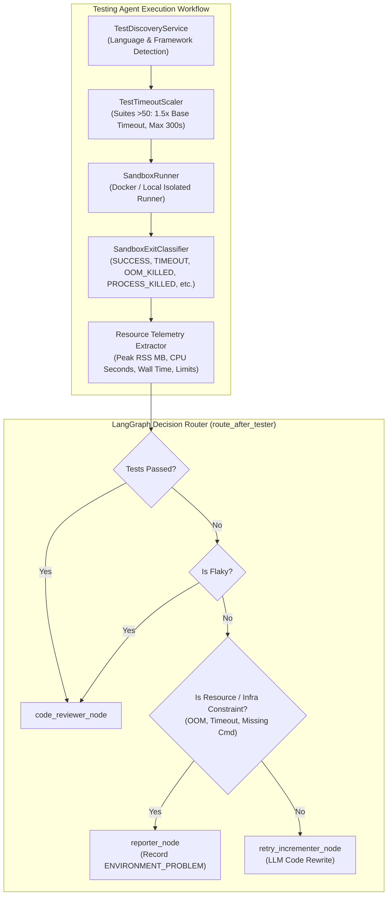

# Devora AI — Phase 9, Stage 9.3 Implementation Report
## Sandbox Resilience, OOM Classification & Resource Telemetry

**Version:** 1.0.0  
**Phase:** 9 (Autonomous Engineering Reliability)  
**Stage:** 9.3  
**Status:** Completed & Verified  
**Date:** 2026-11-19  

---

## 1. Implementation Summary

Phase 9, Stage 9.3 of Devora AI provides execution resilience, forensic container exit classification, out-of-memory (OOM) verification, empirical resource telemetry accounting, dynamic timeout scaling for large test suites, and adaptive failure routing.

This stage eliminates false-positive LLM code rewrite loops triggered by infrastructure constraints (OOM termination, CPU throttling, process SIGKILL, or timeouts) and delivers empirical execution metrics (peak RSS memory, CPU core time, wall-clock duration) through task detail views and SSE event streams.

---

## 2. Architecture Changes



### Key Architectural Enhancements:
1. **Centralized Exit Classifier (`SandboxExitClassifier`):**
   - Standardizes process status across Docker and isolated local runner into structured classifications.
2. **OOM vs. Generic SIGKILL Disambiguation:**
   - Exit code 137 is only classified as `OOM_KILLED` when corroborated by Docker container inspection (`State.OOMKilled == true`) or cgroup v2 `memory.events`; otherwise it defaults to `PROCESS_KILLED`.
3. **Container Lifecycle & Guaranteed Cleanup:**
   - Switched from ephemeral `--rm` flags to deterministic container names (`devora-sandbox-{uuid.hex[:12]}`) with unconditional `docker rm -f` invocation inside `finally` blocks, eliminating container leakage under timeouts, crashes, or cancellations.
4. **Empirical Resource Accounting:**
   - Captures peak RSS memory (MB and bytes), process CPU execution time (seconds), wall-clock duration, and configured memory/CPU quotas.
   - When telemetry is absent, explicit `null` states are maintained rather than fabricating zero values.
5. **Dynamic Timeout Scaling Engine (`TestTimeoutScaler`):**
   - Discovered test suites $>50$ tests are granted a predictable $1.5\times$ timeout multiplier, strictly bounded by a 300s maximum ceiling.
6. **Anti-Churn Routing Protection:**
   - LangGraph router (`route_after_tester`) routes resource/environment faults directly to `reporter`, preventing destructive code changes when functional code experiences system constraints.

---

## 3. Files Created and Modified

### Created Files:
- [`docs/PHASE_9_STAGE_3_IMPLEMENTATION_PLAN.md`](file:///Users/agrimagupta/devoraai/docs/PHASE_9_STAGE_3_IMPLEMENTATION_PLAN.md): Architectural roadmap and audit specification.
- [`backend/alembic/versions/009_resource_telemetry.py`](file:///Users/agrimagupta/devoraai/backend/alembic/versions/009_resource_telemetry.py): Database migration adding telemetry columns to `test_runs`.
- [`backend/tests/unit/test_sandbox_resilience.py`](file:///Users/agrimagupta/devoraai/backend/tests/unit/test_sandbox_resilience.py): 21 unit tests covering exit classifications, telemetry extraction, timeout scaling, and Docker lifecycle.
- [`backend/tests/integration/test_sandbox_telemetry_e2e.py`](file:///Users/agrimagupta/devoraai/backend/tests/integration/test_sandbox_telemetry_e2e.py): 6 integration tests verifying end-to-end telemetry propagation, graph routing, flaky test isolation, and database persistence.
- [`docs/PHASE_9_STAGE_3_IMPLEMENTATION_REPORT.md`](file:///Users/agrimagupta/devoraai/docs/PHASE_9_STAGE_3_IMPLEMENTATION_REPORT.md): This report.

### Modified Files:
- [`backend/app/config.py`](file:///Users/agrimagupta/devoraai/backend/app/config.py): Added suite threshold and container resource configurations.
- [`backend/app/services/sandbox_service.py`](file:///Users/agrimagupta/devoraai/backend/app/services/sandbox_service.py): Implemented `SandboxExitClassifier`, `ExecutionResult` telemetry fields, container inspect metrics, and `getrusage` accounting.
- [`backend/app/agents/state.py`](file:///Users/agrimagupta/devoraai/backend/app/agents/state.py): Extended `TestRunOutput` with telemetry attributes.
- [`backend/app/services/test_discovery_service.py`](file:///Users/agrimagupta/devoraai/backend/app/services/test_discovery_service.py): Implemented `TestTimeoutScaler`, extended `TestExecutionPlan` and `NormalizedTestResult`.
- [`backend/app/services/flaky_detector.py`](file:///Users/agrimagupta/devoraai/backend/app/services/flaky_detector.py): Excluded resource and environment faults from valid executions during repeat stability runs.
- [`backend/app/agents/specialists/tester.py`](file:///Users/agrimagupta/devoraai/backend/app/agents/specialists/tester.py): Forwarded telemetry and applied timeout scaling.
- [`backend/app/agents/graph.py`](file:///Users/agrimagupta/devoraai/backend/app/agents/graph.py): Updated `route_after_tester` with resource failure bypass.
- [`backend/app/models/test_run.py`](file:///Users/agrimagupta/devoraai/backend/app/models/test_run.py): Added telemetry SQLAlchemy columns.
- [`backend/app/schemas/task.py`](file:///Users/agrimagupta/devoraai/backend/app/schemas/task.py): Added telemetry fields to `TestRunResponse`.
- [`backend/app/services/workflow_service.py`](file:///Users/agrimagupta/devoraai/backend/app/services/workflow_service.py): Persisted telemetry in `TestRun` and categorized resource failures as `ENVIRONMENT_PROBLEM`.
- [`frontend/src/types/index.ts`](file:///Users/agrimagupta/devoraai/frontend/src/types/index.ts): Extended TypeScript `TestRun` interface.
- [`frontend/src/app/tasks/[id]/page.tsx`](file:///Users/agrimagupta/devoraai/frontend/src/app/tasks/[id]/page.tsx): Added Sandbox Resource Telemetry dashboard card, exit status badges, and termination alerts.
- Documentation: Updated [`docs/ARCHITECTURE.md`](file:///Users/agrimagupta/devoraai/docs/ARCHITECTURE.md), [`docs/DATABASE.md`](file:///Users/agrimagupta/devoraai/docs/DATABASE.md), [`docs/API.md`](file:///Users/agrimagupta/devoraai/docs/API.md), [`docs/IMPLEMENTATION_PLAN.md`](file:///Users/agrimagupta/devoraai/docs/IMPLEMENTATION_PLAN.md).

---

## 4. Exit Code Classification Behavior

Implemented in [`SandboxExitClassifier`](file:///Users/agrimagupta/devoraai/backend/app/services/sandbox_service.py):

| Exit Code | Condition | Status | Action in LangGraph |
|---|---|---|---|
| `0` | Normal successful completion | `SUCCESS` | Route to `code_reviewer` |
| `124` or `-1` | TimeoutExpired | `TIMEOUT` | Route to `reporter` (Bypass retry) |
| `126` | Permission denied / non-executable | `COMMAND_NOT_EXECUTABLE` | Route to `reporter` (Bypass retry) |
| `127` | Command not found on PATH | `COMMAND_NOT_FOUND` | Route to `reporter` (Bypass retry) |
| `137` / `-9` | Confirmed via `State.OOMKilled` | `OOM_KILLED` | Route to `reporter` (Bypass retry) |
| `137` / `-9` | Without OOM evidence | `PROCESS_KILLED` | Route to `reporter` (Bypass retry) |
| Non-zero | General test assertion failure | `EXECUTION_FAILURE` | Route to `retry_incrementer` (Iterate fix) |

---

## 5. OOM Confirmation Methodology

1. **Docker Container Inspection:**
   - The container is assigned a unique name (`devora-sandbox-{uuid.hex[:12]}`) and executed without `--rm`.
   - On completion or termination, `docker inspect <container_name>` is queried before removal.
   - `State.OOMKilled == true` independently confirms the Linux kernel invoked the OOM killer on the container cgroup.
2. **Local Runner Accounting:**
   - In environments without cgroup telemetry (such as local subprocesses), exit 137 is honestly reported as `oom_killed = False` and classified as `PROCESS_KILLED` with termination reason `"Process killed by external signal (SIGKILL)"`.
   - Never fabricates OOM confirmation without independent kernel or container evidence.

---

## 6. Resource Telemetry Methodology

1. **Docker Runner:**
   - Extracts memory and CPU quotas from container `HostConfig` (`Memory`, `NanoCpus`).
   - Calculates limit equivalents in megabytes and fractional CPU cores.
2. **Local Isolated Runner:**
   - Uses `resource.getrusage(resource.RUSAGE_CHILDREN)` before and after process execution.
   - Calculates exact CPU time:
     $$\text{cpu\_time\_seconds} = (\Delta\text{ru\_utime} + \Delta\text{ru\_stime})$$
   - Captures peak RSS memory: converted from kilobytes (Linux) or bytes (macOS) to megabytes.
   - Measures precise wall-clock time using `time.perf_counter()`.
3. **Honest Metric Reporting:**
   - `resource_telemetry_available` is set to `True` only when valid empirical metrics are captured; otherwise, metrics remain `None` and the UI explicitly indicates `"Resource Telemetry Unavailable"` rather than displaying misleading zeros.

---

## 7. Dynamic Timeout Scaling Formula

Implemented in [`TestTimeoutScaler`](file:///Users/agrimagupta/devoraai/backend/app/services/test_discovery_service.py):

$$\text{Timeout} = \begin{cases} 
\text{base\_timeout} & \text{if } N \le 50 \\ 
\min(\lfloor\text{base\_timeout} \times 1.5\rfloor, 300) & \text{if } N > 50 
\end{cases}$$

- **Configuration:**
  - `TEST_BASE_TIMEOUT_SECONDS`: 60s
  - `TEST_LARGE_SUITE_THRESHOLD`: 50 tests
  - `TEST_LARGE_SUITE_MULTIPLIER`: 1.5
  - `TEST_MAX_TIMEOUT_SECONDS`: 300s
  - `TASK_MAX_TOTAL_BUDGET_SECONDS`: 600s
- **Audit Logging:** Every adjustment logs the discovered test count, original base timeout, adjusted timeout, scaling reason, and applied ceiling.

---

## 8. Workflow & Adaptive Failure Classification

- **Failure Categorization:** In [`workflow_service.py`](file:///Users/agrimagupta/devoraai/backend/app/services/workflow_service.py), all resource and sandbox failures (`OOM_KILLED`, `TIMEOUT`, `COMMAND_NOT_FOUND`, `COMMAND_NOT_EXECUTABLE`, `RUNNER_UNAVAILABLE`) are classified as `ENVIRONMENT_PROBLEM` in `TaskFailureRecord`.
- **Targeted Lessons:**
  - OOM: *"Container exceeded memory quota (OOMKilled); optimize memory usage or adjust container memory limit."*
  - Timeout: *"Test execution exceeded timeout threshold; investigate slow tests or increase execution time budget."*
  - Missing Runner: *"Ensure required test runner and dependencies are installed in execution environment."*
- **Preserved Flaky Stability:** In [`flaky_detector.py`](file:///Users/agrimagupta/devoraai/backend/app/services/flaky_detector.py), any repeat run suffering an OOM, timeout, or missing runner is flagged as `is_infra_error = True` and excluded from `valid_executions`, guaranteeing that hardware resource limits never artificially penalize a test's stability score.

---

## 9. Security Constraints Preserved

- **Host Isolation:** Untrusted repository code never runs directly on the host; execution occurs in container sandbox or isolated runner with confined directories and stripped environment variables.
- **Credential Redaction:** Output sanitization strips GitHub tokens (`ghp_[a-zA-Z0-9]{36,40}`) and Google API keys (`AIza[0-9A-Za-z-_]{30,45}`) before persistence and frontend streaming.
- **Resource Limits:** Docker containers enforce `--network none`, `--memory 1500m`, `--cpus 2.0`, `--pids-limit 100`, `--cap-drop=ALL`, `--security-opt=no-new-privileges:true`.
- **Zero Orphaned Containers:** Deterministic cleanup in `finally` blocks guarantees that containers are destroyed even when commands timeout, encounter OOM, or are cancelled.

---

## 10. Database Migration Details

- **Migration ID:** [`009_resource_telemetry.py`](file:///Users/agrimagupta/devoraai/backend/alembic/versions/009_resource_telemetry.py)
- **Revises:** `008_flaky_test_records`
- **Applied cleanly on PostgreSQL 16:**
  - Added `peak_memory_rss_bytes` (BIGINT)
  - Added `peak_memory_rss_mb` (FLOAT)
  - Added `cpu_time_seconds` (FLOAT)
  - Added `wall_time_seconds` (FLOAT)
  - Added `memory_limit_bytes` (BIGINT)
  - Added `memory_limit_mb` (FLOAT)
  - Added `cpu_limit` (FLOAT)
  - Added `oom_killed` (BOOLEAN, default FALSE)
  - Added `termination_reason` (VARCHAR(255))
  - Added `exit_classification` (VARCHAR(50), default 'EXECUTION_FAILURE')
  - Added `resource_telemetry_available` (BOOLEAN, default FALSE)

---

## 11. Automated Test Results

### Full Backend Regression Suite:
```bash
$ cd backend && ../.venv/bin/pytest
================== 210 passed, 3 skipped in 61.78s (0:01:01) ==================
```
- **New Stage 9.3 Unit Tests:** 21 passed in [`test_sandbox_resilience.py`](file:///Users/agrimagupta/devoraai/backend/tests/unit/test_sandbox_resilience.py) (0.04s)
- **New Stage 9.3 Integration Tests:** 6 passed in [`test_sandbox_telemetry_e2e.py`](file:///Users/agrimagupta/devoraai/backend/tests/integration/test_sandbox_telemetry_e2e.py) (1.25s)
- **Stage 9.1 Test Discovery Tests:** 24 unit + 8 integration passed (0 regressions)
- **Stage 9.2 Flaky Test Tests:** 16 unit + 5 integration passed (0 regressions)
- **All Previous Regression Tests:** 130 passed (0 failures)
- **Total Backend Tests:** **210 passed, 3 skipped, 0 failures**.

---

## 12. Frontend Build Results

```bash
$ cd frontend && npm run build
  ▲ Next.js 14.2.35
   Creating an optimized production build ...
 ✓ Compiled successfully
   Linting and checking validity of types     ✓ Linting and checking validity of types 
   Collecting page data     ✓ Collecting page data 
 ✓ Generating static pages (15/15)
   Collecting build traces     ✓ Collecting build traces 
   Finalizing page optimization     ✓ Finalizing page optimization 
```
- **15/15 static and dynamic routes compiled cleanly.**
- **Zero TypeScript compilation or ESLint errors.**

---

## 13. Known Limitations & Remaining Risks

1. **Nested Docker in Remote CI:**
   - In environments where Docker daemon is not active (e.g. standard macOS dev shells without Colima/Docker Desktop), the engine automatically falls back to `LocalIsolatedRunner` with `resource.getrusage` accounting. Full Docker cgroup metrics require a running Docker daemon.
2. **Local Runner OOM Detection:**
   - In the fallback local runner without container cgroups, SIGKILL (-9) is safely classified as `PROCESS_KILLED` rather than `OOM_KILLED` because the host OS kills the process without cgroup event notifications. This adheres to the rule never to fabricate OOM confirmation.

---

## 14. Definition of Done Checklist

- [x] Centralized exit classification implemented (`SUCCESS`, `TIMEOUT`, `COMMAND_NOT_EXECUTABLE`, `COMMAND_NOT_FOUND`, `OOM_KILLED`, `PROCESS_KILLED`, `SANDBOX_STARTUP_FAILURE`, `RUNNER_UNAVAILABLE`, `EXECUTION_FAILURE`).
- [x] OOM independently confirmed via container/cgroup state; exit 137 without OOM evidence classified as `PROCESS_KILLED`.
- [x] Empirical resource telemetry captured (peak RSS MB, CPU seconds, wall time, quotas) without fabricating zero values.
- [x] Dynamic test timeout scaling implemented for large suites ($>50$ tests) with deterministic multiplier and strict ceiling.
- [x] Anti-churn LangGraph routing guard implemented to bypass LLM code rewrites on resource/environment failures.
- [x] Flaky test detector stability calculations exclude resource and infrastructure errors.
- [x] Alembic migration `009_resource_telemetry.py` authored and applied to PostgreSQL.
- [x] Frontend task detail view updated with Sandbox Resource Telemetry card and exit classification badges.
- [x] 27 new tests authored (21 unit, 6 integration) with 100% pass rate.
- [x] Full backend regression suite: 210 passed, 3 skipped, 0 failures.
- [x] Full frontend Next.js production build: 15/15 routes compiled with 0 errors.
- [x] Documentation updated across `ARCHITECTURE.md`, `DATABASE.md`, `API.md`, `IMPLEMENTATION_PLAN.md`.
