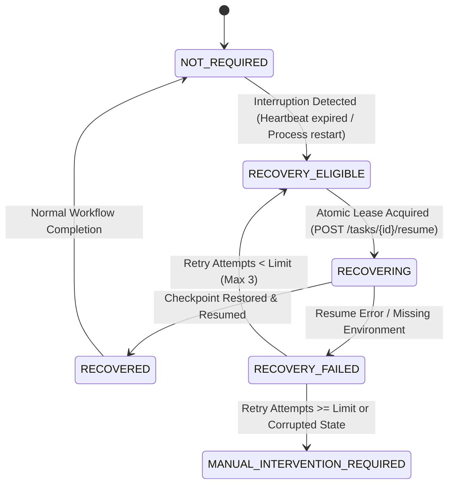

# Devora AI — Phase 9, Stage 9.4 Implementation Plan
## Workflow Recovery Manager & Safe Autonomous Task Resumption

**Version:** 1.0.0  
**Phase:** 9 (Autonomous Engineering Reliability)  
**Stage:** 9.4  
**Status:** In Progress / Approved for Implementation  
**Target Baseline:** 210 passed backend tests, 15/15 compiled frontend routes  

---

## 1. Executive Summary

Phase 9, Stage 9.4 introduces the **Workflow Recovery Manager** to provide enterprise-grade fault tolerance, durable PostgreSQL checkpointing at every specialist agent stage, deterministic interruption detection, atomic worker lease management, and safe, idempotent workflow resumption.

This stage ensures that unexpected infrastructure events (backend container restarts, worker crashes, network timeouts, or process terminations) do not force Devora to discard completed engineering effort or repeat destructive side effects (such as duplicate Git commits, pushes, pull requests, or corrupted adaptive memories).

---

## 2. Current Architecture & Recovery Audit

### 2.1 Existing Checkpoint & Execution Architecture
- **LangGraph State Graph (`graph.py`):**
  - Compiles with a `BaseCheckpointSaver`. Defaults to in-memory `MemorySaver()`, which is ephemeral and lost upon process termination.
- **Database Model (`workflow_checkpoints`):**
  - Table exists with `id`, `task_id`, `thread_id`, `checkpoint_ns`, `checkpoint_id`, `parent_checkpoint_id`, and `state_blob`.
  - However, checkpoints are currently written only upon human approval interruption or workflow completion in `workflow_service.py`. Intervening agent steps (`codebase_analyst`, `planner`, `coder`, `tester`) do not save incremental durable checkpoints.
- **Git Workspaces (`git_workspace_manager.py`):**
  - `prepare_task_workspace` removes existing workspaces via `shutil.rmtree` if found. During recovery, this would destroy patches generated by the `coder` before testing could resume.
- **Task Lifecycle & Heartbeat:**
  - `Task` model has `status` (`PLANNING`, `IN_PROGRESS`, `WAITING_APPROVAL`, `COMPLETED`, `FAILED`).
  - No heartbeat timestamp or worker lease tracking exists to distinguish an actively running worker from a crashed/zombie worker.
- **Human Approval & GitHub Operations:**
  - Tasks at `WAITING_APPROVAL` pause for human input. Resumption must never bypass approval or push without explicit authorization.

### 2.2 Identified Gaps & Deficiencies
1. **Ephemeral In-Memory Checkpoints:** LangGraph state is held in process memory; server restarts erase thread state.
2. **Missing Per-Node Durability:** If a crash occurs during `tester`, work done by `planner` and `coder` is lost unless saved to PostgreSQL at each node transition.
3. **No Interruption Detection:** Inactive `IN_PROGRESS` tasks linger indefinitely with no automated recovery classification.
4. **Destructive Workspace Re-creation:** `prepare_task_workspace` blindly deletes existing task directories, breaking safe restart from patch checkpoints.
5. **Lack of Concurrency Control:** Simultaneous worker restarts could trigger duplicate recovery loops for the same task.
6. **No Resume API Endpoint:** Developers have no way to resume an interrupted task from the frontend or API.

---

## 3. Technical Design & Architecture Specifications

### 3.1 Interruption Detection & Recovery State Machine

The system introduces a deterministic recovery state machine for tasks:



#### Eligibility Rules:
A task is eligible for recovery IF:
1. `task.status in ("PLANNING", "IN_PROGRESS")` (NOT `COMPLETED`, `CANCELLED`, `WAITING_APPROVAL`, or `FAILED`).
2. Interruption evidence exists:
   - Worker heartbeat timestamp expired (`now - last_heartbeat_at > HEARTBEAT_TIMEOUT_SECONDS`, default 120s), OR
   - Server process restart detected, OR
   - Explicit developer resume requested.
3. Task has at least one valid checkpoint in `workflow_checkpoints`.
4. `task.recovery_attempts < MAX_RECOVERY_ATTEMPTS` (default 3).
5. State blob is non-empty, deserializable, and matches schema version.

---

### 3.2 Durable Incremental Checkpointing Engine

1. **Per-Node Checkpoint Persistence:**
   In `workflow_service.py`, inside the LangGraph state machine streaming loop:
   - When each specialist node completes (`codebase_analyst`, `ml_classifier`, `bug_investigator`, `planner`, `coder`, `tester`, `code_reviewer`, `security_reviewer`, `reporter`), immediately persist a `WorkflowCheckpoint` record.
   - Store: `task_id`, `thread_id`, `node_name`, `step_number`, `state_blob` (with secret redaction), `version=1`.
   - Update `task.last_heartbeat_at = datetime.now(timezone.utc)`.
2. **Secret Redaction:**
   Before persisting `state_blob` to PostgreSQL, scrub GitHub tokens (`ghp_...`, `x-access-token:...`) and Google Gemini API keys (`AIza...`).
3. **Safe Serialization:**
   Ensure non-serializable objects (sockets, open file handles) are stripped; serialize pure JSON dictionaries.

---

### 3.3 Safe Resumption & Idempotency Safeguards

1. **Workspace Preservation:**
   Update `GitWorkspaceManager.prepare_task_workspace(..., preserve_existing=True)`.
   - If the task directory and valid Git repository already exist on disk, reuse them and verify `status`.
   - Reconstruct from checkpoint `applied_file_changes` if ephemeral directory was purged.
2. **Side-Effect Idempotency:**
   - **Git Branch Creation:** Check if branch `devora/{type}-{id[:8]}` already exists locally/remotely before attempting checkout `-B`.
   - **File Edits:** If resuming from `tester` or later, do not re-apply file diffs.
   - **Commits & Pushes:** Check `task.commit_sha` before executing git commit.
   - **Pull Requests:** Check `task.pull_request_url` before calling GitHub API.
   - **Adaptive Experience Distillation:** Distill only once when reaching `COMPLETED`.
3. **Approval Safety (Non-Negotiable):**
   - If resumed state is at or beyond `security_reviewer`, evaluate if `human_approval` has been submitted.
   - If not approved, pause at `WAITING_APPROVAL` with `Approval` record created.
   - NEVER commit, push, or open a pull request without explicit `APPROVED` status.

---

### 3.4 Concurrency & Worker Lease Management

To prevent multiple workers from recovering the same task concurrently:
- Atomic status transition with row-level locking (`with_for_update`):
  ```sql
  UPDATE tasks
  SET recovery_status = 'RECOVERING',
      recovery_lease_owner = :worker_id,
      recovery_lease_expires_at = :expires_at,
      recovery_attempts = recovery_attempts + 1
  WHERE id = :task_id
    AND (recovery_lease_owner IS NULL OR recovery_lease_expires_at < NOW() OR recovery_lease_owner = :worker_id)
  ```
- If another worker holds a valid lease (`recovery_lease_expires_at > NOW()`), reject duplicate recovery requests with `409 Conflict`.
- Stale workers whose lease expired cannot overwrite newer checkpoints.

---

## 4. Database Schema & Migration Requirements

Alembic migration: `010_workflow_recovery.py` (down-revision: `009_resource_telemetry`).

### Columns added to `tasks`:
- `recovery_status`: `VARCHAR(50)`, default `'NOT_REQUIRED'`, not null, indexed
- `recovery_attempts`: `INTEGER`, default 0, not null
- `last_heartbeat_at`: `TIMESTAMPTZ`, nullable, indexed
- `recovery_lease_owner`: `VARCHAR(100)`, nullable
- `recovery_lease_expires_at`: `TIMESTAMPTZ`, nullable
- `recovery_error`: `TEXT`, nullable

### Columns added to `workflow_checkpoints`:
- `node_name`: `VARCHAR(100)`, nullable, indexed
- `step_number`: `INTEGER`, nullable
- `version`: `INTEGER`, default 1, not null

---

## 5. API Endpoints

1. `POST /api/v1/tasks/{task_id}/resume`:
   - Resumes an interrupted task from its last valid checkpoint.
   - Returns 200 OK with `TaskResumeResponse` or 409 Conflict / 400 Bad Request if ineligible.
2. `GET /api/v1/tasks/{task_id}/recovery`:
   - Returns diagnostic recovery status, heartbeat, attempt counts, and eligibility.
3. `POST /api/v1/tasks/recovery/scan`:
   - Administrator / worker endpoint to scan for interrupted tasks and flag them as `RECOVERY_ELIGIBLE`.

---

## 6. Frontend UI/UX Integration

In `frontend/src/app/tasks/[id]/page.tsx`:
1. **Interrupted Workflow Alert Banner:**
   - Appears when `task.recovery_status === "RECOVERY_ELIGIBLE"` or `task.status === "IN_PROGRESS"` with expired heartbeat.
   - Shows last recorded checkpoint node (e.g. `coder` or `planner`) and timestamp.
   - Provides a one-click **"Resume Workflow"** button.
2. **Manual Intervention Alert:**
   - Appears when `task.recovery_status === "MANUAL_INTERVENTION_REQUIRED"`.
   - Explains reason (e.g. recovery attempts exceeded limit or corrupted state) with guidance.
3. **Real-time SSE Recovery Progress:**
   - Listens for `recovery_started`, `checkpoint_restored`, and `recovery_completed` events.

---

## 7. Files to Create and Modify

### New Files:
- `docs/PHASE_9_STAGE_4_IMPLEMENTATION_PLAN.md` (this file)
- `backend/alembic/versions/010_workflow_recovery.py`
- `backend/app/services/recovery_manager.py`
- `backend/app/schemas/recovery.py`
- `backend/tests/unit/test_workflow_recovery.py`
- `backend/tests/integration/test_workflow_recovery_e2e.py`
- `docs/PHASE_9_STAGE_4_IMPLEMENTATION_REPORT.md`

### Modified Files:
- `backend/app/config.py` (add recovery timeout and limit settings)
- `backend/app/models/task.py` (add recovery columns)
- `backend/app/models/workflow_checkpoint.py` (add node_name, step_number, version)
- `backend/app/services/git_workspace_manager.py` (preserve existing workspace on recovery)
- `backend/app/services/workflow_service.py` (per-node incremental checkpointing, heartbeat updates, resume method)
- `backend/app/api/v1/tasks.py` (add /resume and /recovery endpoints)
- `frontend/src/types/index.ts` (TypeScript types for recovery status and responses)
- `frontend/src/services/task-service.ts` (add resumeTask and getRecoveryStatus methods)
- `frontend/src/app/tasks/[id]/page.tsx` (Interrupted workflow alert banner and resume button)
- Documentation: `ARCHITECTURE.md`, `DATABASE.md`, `API.md`, `IMPLEMENTATION_PLAN.md`

---

## 8. Testing Strategy

1. **Unit Tests (`test_workflow_recovery.py`):**
   - Checkpoint creation and deterministic secret redaction.
   - State serialization / deserialization round-trip.
   - Recovery eligibility decision matrix (completed, in-progress, expired heartbeat, max attempts).
   - Atomic worker lease acquisition and lease expiration reclamation.
   - Corrupted or incompatible checkpoint detection.
2. **Integration Tests (`test_workflow_recovery_e2e.py`):**
   - Simulating worker interruption after `planner` and resuming through `coder`, `tester`, and `reporter`.
   - Simulating interruption after `coder` and resuming `tester` without wiping out code modifications.
   - Safe pause at `human_approval` after recovery (never bypassing developer authorization).
   - Concurrent recovery attempts (preventing dual worker executions).
   - REST API endpoints (`POST /tasks/{id}/resume` and `GET /tasks/{id}/recovery`).
3. **Regression Baseline:**
   - All 210 existing backend tests must continue passing.
   - Frontend Next.js production build: 15/15 routes must compile with zero errors.
