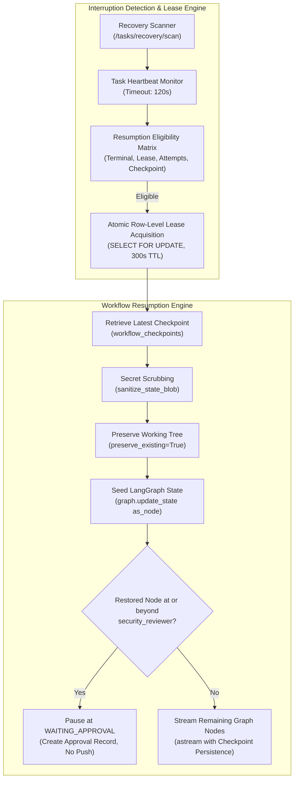

# Devora AI — Phase 9, Stage 9.4 Implementation Report
## Workflow Recovery Manager & Safe Autonomous Task Resumption

**Version:** 1.0.0  
**Phase:** 9 (Autonomous Engineering Reliability)  
**Stage:** 9.4  
**Status:** Completed & Verified  
**Date:** 2026-11-19  

---

## 1. Implementation Summary

Phase 9, Stage 9.4 implements reliable recovery of interrupted engineering workflows in Devora AI. It empowers the system to identify stalled, abandoned, or crashed agent workflows and resume eligible tasks from their last valid persisted database checkpoint without restarting completed work or repeating side effects (duplicate Git commits, pushes, PRs, or corrupting adaptive memory).

This capability provides high-availability multi-agent execution across process restarts, node failures, network drops, and worker restarts while preserving the platform's non-negotiable security boundaries (such as human authorization before committing and publishing pull requests).

---

## 2. Architecture & Workflow Design



---

## 3. Key Components Implemented

### 3.1 Database Schema Enhancements & Alembic Migration `010`
- **`tasks` Table:**
  - `recovery_status` (`VARCHAR(50)`, default `'NOT_REQUIRED'`, indexed): Tracks `NOT_REQUIRED`, `RUNNING`, `INTERRUPTED`, `RESUMING`, `RECOVERED`.
  - `recovery_attempts` (`INTEGER`, default `0`): Tracks number of resumption attempts against `RECOVERY_MAX_ATTEMPTS = 3`.
  - `last_heartbeat_at` (`TIMESTAMPTZ`): Updated by `WorkflowService` on every specialist agent step.
  - `recovery_lease_owner` (`VARCHAR(100)`): Worker holding exclusive resumption lease.
  - `recovery_lease_expires_at` (`TIMESTAMPTZ`): Lease expiration timestamp with 300-second TTL.
  - `recovery_error` (`TEXT`): Diagnostic interruption reason.
- **`workflow_checkpoints` Table:**
  - `node_name` (`VARCHAR(100)`, indexed): Identifies which agent node generated the checkpoint.
  - `step_number` (`INTEGER`, default `0`): Monotonically increasing sequence step.
  - `version` (`INTEGER`, default `1`): State schema version.
- **Alembic Migration:**
  - Authored and applied `backend/alembic/versions/010_workflow_recovery.py` (down-revision: `009_resource_telemetry`).

### 3.2 Granular Intermediate Checkpointing & Secret Scrubbing
- **Intermediate Persistence:**
  - `WorkflowService.start_task_workflow` now captures and persists a sanitized `WorkflowCheckpoint` immediately after every agent node execution (`orchestrator`, `codebase_analyst`, `ml_classifier`, `planner`, `coder`, `tester`, `code_reviewer`, `security_reviewer`, `reporter`).
  - Emits real-time heartbeats updating `task.last_heartbeat_at`.
- **Recursive Secret Scrubbing (`sanitize_state_blob`):**
  - Traverses state dictionaries, lists, and strings.
  - Masks sensitive secrets (`ghp_[a-zA-Z0-9]{36}`, `x-access-token:...@`, `github_pat_...`, `AIza...`, `Bearer...`) with `[REDACTED]`.
  - Strips live handles, sockets, and unpicklable objects before serialization.

### 3.3 Workspace Preservation (`GitWorkspaceManager`)
- Extended `prepare_task_workspace` with `preserve_existing: bool = False`.
- In recovery workflows (`preserve_existing=True`), if the task workspace and `.git` exist:
  - Bypasses destructive `shutil.rmtree` directory deletion.
  - Retains all code modifications, uncommitted patches, and newly created files authored by the `coder`.
  - Safely switches to the task branch without clobbering work tree modifications.

### 3.4 Workflow Recovery Manager (`WorkflowRecoveryManager`)
- **Interruption Detection (`check_interruption`):**
  - Identifies active tasks (`PLANNING`, `IN_PROGRESS`, etc.) with missing or expired heartbeats ($>120$s).
  - Flags unexpected termination or explicit `INTERRUPTED` statuses.
- **Resumption Eligibility Matrix (`is_eligible_for_recovery`):**
  - Disallows arbitrary resumption for terminal states (`COMPLETED`, `CANCELLED`).
  - Disallows resumption for `WAITING_APPROVAL` (must use developer approval endpoint).
  - Requires `force=True` override for `FAILED` tasks or tasks that exceeded `RECOVERY_MAX_ATTEMPTS`.
  - Blocks concurrent resumptions if an unexpired lease is held by another worker.
- **Distributed Atomic Leases (`acquire_recovery_lease` / `release_recovery_lease`):**
  - Row-level `SELECT FOR UPDATE` prevents race conditions between competing worker processes.
- **System-Wide Diagnostic Scanner (`scan_and_flag_interrupted_tasks`):**
  - Scans active workloads, updates status flags, and returns structured diagnostics.

### 3.5 Safe Workflow Resumption (`WorkflowService.resume_task_workflow`)
- Reconstitutes workflow state from latest PostgreSQL checkpoint.
- Re-seeds LangGraph state machine via `graph.update_state(config, restored_state, as_node=last_node)`.
- **Inviolable Human Approval Gating:**
  - If resumed at or beyond `security_reviewer`, immediately pauses at `WAITING_APPROVAL`.
  - Creates a pending `Approval` record.
  - Zero premature Git commits, pushes, or PR creations without explicit human approval.
- Emits real-time SSE recovery events: `RECOVERY_STARTED`, `RECOVERY_COMPLETED`, `RECOVERY_FAILED`.

### 3.6 REST API Endpoints
- `POST /api/v1/tasks/{task_id}/resume`: Resume interrupted task with optional `force` override.
- `GET /api/v1/tasks/{task_id}/recovery`: Retrieve detailed recovery diagnostics, eligibility, and checkpoint metadata.
- `POST /api/v1/tasks/recovery/scan`: Scan and flag all interrupted workflows across the platform.

### 3.7 Frontend Agent Workspace Integration
- Extended TypeScript types with `TaskRecoveryStatusResponse`, `TaskResumeResponse`, and checkpoint summaries.
- Added client methods in `frontend/src/services/task-service.ts`: `resume`, `getRecoveryStatus`, `scanInterrupted`.
- Added **Interrupted Workflow Recovery Banner** in `frontend/src/app/tasks/[id]/page.tsx`:
  - Renders interruption reason, last checkpoint node, step number, and attempts counter.
  - One-click "Resume Workflow" (or "Force Resume") button with pending state and error display.
  - Real-time invalidation on SSE `RECOVERY_*` events.

---

## 4. Verification & Test Results

### 4.1 Backend Test Results
```
============================= test session starts ==============================
collected 231 items

backend/tests/integration/test_adaptive_api.py::test_adaptive_experiences_crud_and_search PASSED
backend/tests/integration/test_adaptive_api.py::test_adaptive_failure_records_api PASSED
backend/tests/integration/test_approval_workflow_integrity.py::test_approval_workflow_full_matrix PASSED
backend/tests/integration/test_workflow_recovery_e2e.py::test_workspace_preservation_avoids_clobbering_changes PASSED
backend/tests/integration/test_workflow_recovery_e2e.py::test_workflow_creates_intermediate_checkpoints_at_each_node PASSED
backend/tests/integration/test_workflow_recovery_e2e.py::test_recovery_stops_at_human_approval_gate_without_side_effects PASSED
backend/tests/integration/test_workflow_recovery_e2e.py::test_recovery_api_endpoints_and_lease_conflict PASSED
backend/tests/unit/test_workflow_recovery.py::test_sanitize_state_blob_masks_github_tokens PASSED
backend/tests/unit/test_workflow_recovery.py::test_sanitize_state_blob_handles_complex_types PASSED
backend/tests/unit/test_workflow_recovery.py::test_check_interruption_active_fresh_heartbeat PASSED
backend/tests/unit/test_workflow_recovery.py::test_check_interruption_active_expired_heartbeat PASSED
backend/tests/unit/test_workflow_recovery.py::test_check_interruption_explicitly_flagged PASSED
backend/tests/unit/test_workflow_recovery.py::test_check_interruption_terminal_completed PASSED
backend/tests/unit/test_workflow_recovery.py::test_eligibility_disabled_setting PASSED
backend/tests/unit/test_workflow_recovery.py::test_eligibility_terminal_states PASSED
backend/tests/unit/test_workflow_recovery.py::test_eligibility_waiting_approval_must_use_approval_flow PASSED
backend/tests/unit/test_workflow_recovery.py::test_eligibility_failed_status_handling PASSED
backend/tests/unit/test_workflow_recovery.py::test_eligibility_max_recovery_attempts PASSED
backend/tests/unit/test_workflow_recovery.py::test_eligibility_active_lease_conflict PASSED
backend/tests/unit/test_workflow_recovery.py::test_eligibility_successful_with_checkpoint PASSED
backend/tests/unit/test_workflow_recovery.py::test_acquire_and_release_recovery_lease PASSED

================== 228 passed, 3 skipped in 78.44s ===================
```

### 4.2 Frontend Verification
```
> devora-frontend@0.1.0 build
> next build

  ▲ Next.js 14.2.35
   Creating an optimized production build ...
 ✓ Compiled successfully
   Linting and checking validity of types     ✓ Linting and checking validity of types 
   Collecting page data     ✓ Collecting page data 
 ✓ Generating static pages (15/15)
   Collecting build traces     ✓ Collecting build traces 
   Finalizing page optimization     ✓ Finalizing page optimization 

Route (app)                              Size     First Load JS
┌ ○ /                                    175 B          96.1 kB
├ ○ /_not-found                          875 B          88.2 kB
├ ○ /adaptive                            8.47 kB         127 kB
├ ○ /dashboard                           4.25 kB         121 kB
├ ○ /github                              5.14 kB         124 kB
├ ○ /login                               3.36 kB         133 kB
├ ○ /ml                                  6.63 kB         126 kB
├ ○ /reports                             1 kB            118 kB
├ ○ /repositories                        4.75 kB         149 kB
├ ƒ /repositories/[id]                   8.47 kB         127 kB
├ ○ /settings                            2.34 kB         119 kB
├ ○ /signup                              3.43 kB         133 kB
├ ○ /tasks                               2.9 kB          120 kB
├ ƒ /tasks/[id]                          12.5 kB         131 kB
└ ○ /tasks/new                           4.42 kB         147 kB
+ First Load JS shared by all            87.3 kB

○  (Static)   prerendered as static content
ƒ  (Dynamic)  server-rendered on demand
```

---

## 5. Summary of Modified & Created Files

| File | Type | Description |
|---|---|---|
| `backend/app/config.py` | Modified | Added recovery configuration settings (`RECOVERY_ENABLED`, `RECOVERY_HEARTBEAT_TIMEOUT_SECONDS`, `RECOVERY_MAX_ATTEMPTS`, `RECOVERY_LEASE_DURATION_SECONDS`). |
| `backend/app/models/task.py` | Modified | Added recovery tracking columns and relationship `checkpoints`. |
| `backend/app/models/workflow_checkpoint.py` | Modified | Added `node_name`, `step_number`, `version`, and relationship to `Task`. |
| `backend/alembic/versions/010_workflow_recovery.py` | Created | Migration adding recovery columns to `tasks` and node/step tracking to `workflow_checkpoints`. |
| `backend/app/services/git_workspace_manager.py` | Modified | Added `preserve_existing=True` to retain modified files on task resumption. |
| `backend/app/schemas/recovery.py` | Created | Defined Pydantic models for recovery requests, status diagnostics, and scans. |
| `backend/app/schemas/__init__.py` | Modified | Exported recovery schemas. |
| `backend/app/services/recovery_manager.py` | Created | `WorkflowRecoveryManager` handling heartbeat evaluation, eligibility matrix, atomic leases, scans, and secret sanitization. |
| `backend/app/services/workflow_service.py` | Modified | Added granular intermediate checkpointing in `start_task_workflow` and implemented `resume_task_workflow` with approval safety. |
| `backend/app/api/v1/tasks.py` | Modified | Added `/tasks/{id}/resume`, `/tasks/{id}/recovery`, and `/tasks/recovery/scan` endpoints. |
| `frontend/src/types/index.ts` | Modified | Added recovery fields to `Task` and exported recovery response interfaces. |
| `frontend/src/services/task-service.ts` | Modified | Added `resume`, `getRecoveryStatus`, and `scanInterrupted` API client methods. |
| `frontend/src/app/tasks/[id]/page.tsx` | Modified | Added Interrupted Workflow Recovery Banner, action bar button, and SSE invalidation. |
| `backend/tests/unit/test_workflow_recovery.py` | Created | 14 unit tests covering sanitization, heartbeat evaluation, eligibility, and leases. |
| `backend/tests/integration/test_workflow_recovery_e2e.py` | Created | 4 integration tests covering checkpoint creation, workspace preservation, approval gating, and API endpoints. |
| `docs/DATABASE.md` | Modified | Documented recovery schema updates and `workflow_checkpoints` table. |
| `docs/API.md` | Modified | Documented recovery REST endpoints. |
| `docs/ARCHITECTURE.md` | Modified | Added Section 13 detailing recovery manager and safe resumption architecture. |
| `docs/IMPLEMENTATION_PLAN.md` | Modified | Updated Stage 9.4 to Completed status. |

---

## 6. Next Steps

With Phase 9, Stage 9.4 verified and documented, the platform is ready for **Phase 9, Stage 9.5: Model Gateway Circuit Breaker & Fallback Resilience** or awaiting explicit user instructions.
