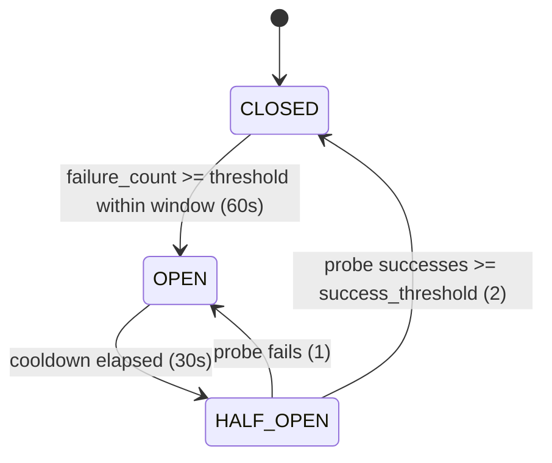

# Devora AI — Phase 9, Stage 9.5 Implementation Plan
## Model Gateway Circuit Breaker & Fallback Resilience

**Version:** 1.0.0  
**Phase:** 9 (Autonomous Engineering Reliability)  
**Stage:** 9.5  
**Date:** 2026-11-19  
**Status:** Approved & Ready for Execution  

---

## 1. Executive Summary & Objective

In Devora AI, all 9 specialist engineering agents (`orchestrator`, `codebase_analyst`, `bug_investigator`, `planner`, `coder`, `tester`, `code_reviewer`, `security_reviewer`, `reporter`) depend on the centralized `ModelGateway` for reasoning, structured decision-making, code generation, and test analysis.

The objective of **Phase 9, Stage 9.5** is to eliminate fragile failure modes caused by upstream LLM provider outages, rate limits (HTTP 429), timeouts, overload spikes, and intermittent network interruptions. We will implement:

1. **Independent Circuit Breakers:** Per-provider/model circuit state machine (`CLOSED`, `OPEN`, `HALF_OPEN`) preventing continuous hammered requests against down providers.
2. **Centralized Intelligent Retry Policy:** Exponential backoff with full jitter, bounded execution budgets, and classification of retryable vs non-retryable errors, replacing ad-hoc retries.
3. **Capability-Aware Provider & Model Fallback:** Automatic failover from primary models (e.g., `gemini-2.5-flash`) to secondary/fallback models (e.g., `gemini-1.5-flash` or backup adapters), verifying schema capabilities and preserving cumulative token accounting.
4. **Normalized Failure Taxonomy:** 15 standardized error classifications preventing transient LLM failures from masquerading as implementation defects or triggering destructive code rewrite loops.
5. **PostgreSQL Health Persistence & Concurrency Safety:** Centralized model health and circuit state telemetry tracking across worker processes.
6. **Provider Health API & SSE Streaming:** Real-time event notifications (`MODEL_RETRY_STARTED`, `MODEL_CIRCUIT_OPENED`, etc.) and authenticated administrative endpoint `GET /api/v1/models/health`.
7. **Frontend Gateway Observability:** A compact Model Gateway Health widget in the Task Workspace showing live circuit state, retry counts, active provider, and fallback status.

---

## 2. Existing Gateway Architecture Audit

### 2.1 Current Implementation Overview
- **`BaseLLMProvider` (`base.py`):** Abstract interface declaring `generate_structured(prompt, response_model, ...)`, `generate_text(...)`, and `generate_embedding(text)`.
- **`GeminiProvider` (`gemini.py`):** Wraps Google GenAI SDK (`google.genai`), manages concurrency via `asyncio.Semaphore(5)`, and has an internal `for attempt in range(1, max_retries + 1)` loop with naive `await asyncio.sleep(2 ** attempt)`.
- **`MockLLMProvider` (`mock.py`):** Deterministic mock provider supplying domain models (`AnalysisOutput`, `TaskPlanOutput`, `CodingOutput`, etc.) for unit/integration testing and offline operation.
- **`ModelGateway` (`gateway.py`):** Singleton manager initializing the provider, tracking cumulative tokens (`total_tokens_used`, `prompt_tokens_used`, `completion_tokens_used`), and exposing delegation methods.

### 2.2 Identified Gaps & Deficiencies
1. **Ad-Hoc, Unbounded Retries:** `GeminiProvider` implements its own loop without jitter, ignoring provider `Retry-After` headers and retrying even when the error is a permanent authentication failure or bad request.
2. **Missing Circuit Breaker:** Repeated HTTP 503 (Overloaded) or network drops cause every agent in the pipeline to retry repeatedly until timeouts elapse, creating high latency and risk of synchronized retry storms.
3. **No Dynamic Model Fallback:** If `gemini-2.5-flash` experiences an outage or quota exhaustion, `ModelGateway` crashes completely rather than failing over to `gemini-1.5-flash`.
4. **Token Accounting Leakage on Fallback:** Failed attempts and fallback attempts are not unified in token metrics.
5. **Lack of Failure Classification:** All errors raise a generic `LLMGenerationError`, which LangGraph or `WorkflowService` cannot inspect to distinguish transient network issues from code defects.
6. **No Health Telemetry or Visibility:** Operators and developers cannot inspect circuit breaker status, provider availability, or fallback event history.

---

## 3. Circuit Breaker Engine Design

### 3.1 States & State Transitions
Each provider/model pair (e.g. `gemini:gemini-2.5-flash`, `gemini:gemini-1.5-flash`, `mock:default`) maintains its own independent state machine:



- **`CLOSED`:** Normal operation. Requests pass through to provider. Failures within a sliding time window increment consecutive and window failure counters.
- **`OPEN`:** Provider is down or degraded. Requests fail immediately with `CircuitOpenError` without hitting the upstream API.
- **`HALF_OPEN`:** Cooldown duration has elapsed. A bounded number of probe requests (`CIRCUIT_BREAKER_HALF_OPEN_MAX_CALLS = 2`) are admitted to evaluate recovery. If all probe calls succeed, the circuit resets to `CLOSED`. Any probe failure immediately trips the circuit back to `OPEN`.

### 3.2 Configuration Parameters
```python
CIRCUIT_BREAKER_ENABLED = True
CIRCUIT_BREAKER_FAILURE_THRESHOLD = 5
CIRCUIT_BREAKER_FAILURE_WINDOW_SECONDS = 60
CIRCUIT_BREAKER_OPEN_DURATION_SECONDS = 30
CIRCUIT_BREAKER_HALF_OPEN_MAX_CALLS = 2
CIRCUIT_BREAKER_SUCCESS_THRESHOLD = 2
```

### 3.3 Failure Filtering Rules
- **Counted as Provider Failures:** Connection drops, socket timeouts, HTTP 500/502/503/504, repeated provider overload exceptions.
- **Excluded from Circuit Breaker:** Client validation errors (HTTP 400), invalid JSON schema validation caused by prompt mismatch, user cancellation, operator configuration errors.
- **Rate Limits (HTTP 429):** Tracked distinctly with backoff guidance; circuit only opens if consecutive 429s persist beyond the failure threshold.

---

## 4. Intelligent Retry Engine Design

### 4.1 Jittered Exponential Backoff
Ad-hoc provider retries are removed from `GeminiProvider` and centralized in `ModelGateway.execute_with_resilience`:
$$\text{delay} = \text{uniform}\left(0, \min(\text{max\_delay}, \text{base\_delay} \times 2^{\text{attempt}})\right)$$

```python
MODEL_RETRY_ENABLED = True
MODEL_RETRY_MAX_ATTEMPTS = 3
MODEL_RETRY_BASE_DELAY_SECONDS = 1.0
MODEL_RETRY_MAX_DELAY_SECONDS = 15.0
MODEL_RETRY_MAX_ELAPSED_SECONDS = 45.0
```

### 4.2 Retry Constraints & Guarantees
1. **Respect `Retry-After`:** If the provider returns a `Retry-After` header or parameter, respect it up to `MODEL_RETRY_MAX_DELAY_SECONDS`.
2. **Deadline & Budget Awareness:** Abort retries if the task execution budget or cancellation token is triggered.
3. **No Multiplied Retries:** Agents and LangGraph nodes must not wrap gateway calls in secondary nested retry loops.
4. **Circuit Check on Each Attempt:** If a failure causes the circuit breaker to trip to `OPEN`, remaining retries on that provider are immediately aborted and failover is initiated.

---

## 5. Intelligent Provider and Model Fallback

### 5.1 Fallback Chain Architecture
`ModelGateway` will support a configured sequence of models:
```python
MODEL_FALLBACK_ENABLED = True
PRIMARY_PROVIDER = "gemini"
PRIMARY_MODEL = "gemini-2.5-flash"
FALLBACK_CHAIN = [
    {"provider": "gemini", "model": "gemini-1.5-flash"},
]
```

### 5.2 Capability Validation
Before invoking a fallback model:
1. Verify capability: must support JSON structured output mode (`response_schema`).
2. Verify context window size: must be capable of processing the current prompt length.
3. If no compatible fallback is healthy, raise `ModelProviderUnavailableError`.

### 5.3 Execution Telemetry on Fallback
When a fallback succeeds:
- All token usage from both initial failed attempt(s) and the successful fallback are aggregated.
- Broadcast SSE event `MODEL_FALLBACK_SUCCEEDED` with `{primary: "gemini-2.5-flash", fallback: "gemini-1.5-flash"}`.
- Record metadata in response: `model_used`, `fallback_invoked: True`, `fallback_reason`.

---

## 6. Centralized Failure Taxonomy

Standardized domain exception hierarchy in `app.agents.gateway.exceptions`:

| Exception Class | Classification Code | Retryable? | Trips Circuit? | Description |
|---|---|---|---|---|
| `ProviderConnectionError` | `PROVIDER_CONNECTION_ERROR` | Yes | Yes | Network unreachable, TCP disconnect |
| `ProviderTimeoutError` | `PROVIDER_TIMEOUT` | Yes | Yes | Read or connect timeout |
| `ProviderRateLimitedError` | `PROVIDER_RATE_LIMITED` | Yes | Conditional | HTTP 429 quota/rate limit |
| `ProviderOverloadedError` | `PROVIDER_OVERLOADED` | Yes | Yes | HTTP 503 model overloaded |
| `ProviderServerError` | `PROVIDER_SERVER_ERROR` | Yes | Yes | HTTP 500 internal provider error |
| `ProviderAuthenticationError`| `PROVIDER_AUTHENTICATION_ERROR`| No | No | Invalid API key or permission denied |
| `ModelNotFoundError` | `MODEL_NOT_FOUND` | No | No | Model name unrecognized by provider |
| `ModelUnavailableError` | `MODEL_UNAVAILABLE` | Yes | Yes | Model temporarily offline in region |
| `InvalidModelRequestError` | `INVALID_MODEL_REQUEST` | No | No | Malformed prompt, invalid arguments |
| `InvalidStructuredOutputError`| `INVALID_STRUCTURED_OUTPUT` | Yes (bounded)| No | Pydantic validation error |
| `CircuitOpenError` | `CIRCUIT_OPEN` | No (on model) | N/A | Circuit breaker is in OPEN state |
| `RetryExhaustedError` | `RETRY_EXHAUSTED` | No | No | Max retries reached on model |
| `FallbackExhaustedError` | `FALLBACK_EXHAUSTED` | No | No | All models in fallback chain failed |
| `ModelProviderUnavailableError`| `MODEL_PROVIDER_UNAVAILABLE`| No | Yes | All providers down/unreachable |

---

## 7. LangGraph Workflow & Recovery Integration

1. **No Untrusted Execution:** Models only generate diffs, plans, and reports. Execution happens inside Docker sandboxes.
2. **Provider Failures $\neq$ Code Defects:** If all model providers fail, the workflow marks `task.status = "FAILED"` and `task.recovery_status = "INTERRUPTED"` with `recovery_error = "Model provider unavailable: [reason]"`.
3. **No False-Positive Code Retries:** Model outages will NEVER trigger `retry_incrementer` or code revisions.
4. **Recovery Compatibility:** Because the workflow is marked `INTERRUPTED` and granular intermediate checkpoints were saved in Stage 9.4, once provider connectivity is restored, the user can click "Resume Workflow" in the UI to resume without losing completed work!

---

## 8. Persistence & Concurrency Strategy

1. **Database Model (`model_gateway_health`):**
   - Stores per-model telemetry: `provider_name`, `model_name`, `circuit_state`, `consecutive_failures`, `consecutive_successes`, `total_calls`, `total_failures`, `total_retries`, `total_fallbacks`, `average_latency_ms`, `last_failure_reason`, `last_failure_at`, `last_success_at`.
   - Migration `011_model_gateway_resilience.py`.
2. **In-Memory & Database Synchronization:**
   - In-memory circuit breaker handles sub-millisecond call interception with `asyncio.Lock`.
   - Flushes state updates to PostgreSQL on state transitions (`CLOSED` $\rightarrow$ `OPEN`, etc.) and throttled metrics updates.

---

## 9. API & Frontend Integration

### 9.1 REST Endpoints
- `GET /api/v1/models/health`: Authenticated endpoint returning overall gateway status, active model, fallback model, token metrics, and per-provider circuit statuses.

### 9.2 Frontend Agent Workspace
- Dedicated **Model Gateway Health & Resilience** card in `/tasks/[id]`:
  - Active provider & model badge.
  - Circuit Breaker Status pill (`CLOSED` green, `HALF_OPEN` amber, `OPEN` red).
  - Retry counter and Fallback indicator.
  - Informative warning when recovering or fallback is active.

---

## 10. Verification Plan

1. **Unit Tests (`test_circuit_breaker.py`):**
   - Circuit transitions: CLOSED $\rightarrow$ OPEN on threshold (5 failures).
   - Instant rejection when OPEN.
   - Transition to HALF_OPEN after cooldown.
   - Successful probes close circuit; failed probes reopen circuit.
   - Sliding failure window expiration.
   - Independent breakers per provider/model.
2. **Unit Tests (`test_model_gateway_resilience.py`):**
   - Exponential backoff with jitter calculation.
   - Non-retryable error handling.
   - Rate limit retry-after header handling.
   - Fallback execution from primary to secondary model.
   - Cumulative token accounting across fallback chain.
   - Schema validation preservation on fallback.
   - Credential redaction in errors and logs.
3. **Integration Tests (`test_model_gateway_e2e.py`):**
   - End-to-end agent node invocation with simulated provider outages.
   - Workflow recovery compatibility when gateway fails.
   - `GET /api/v1/models/health` endpoint tests.
   - Zero code-churn loop verification on model outage.
4. **Full Regression Suite:**
   - Verify all 228 baseline tests pass.
   - Next.js production build (`npm run build`) verifies 15/15 routes.
