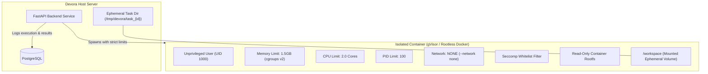

# Security & Execution Sandbox Architecture
## Devora AI: Autonomous AI Software Engineer

---

### 1. Threat Model & STRIDE Analysis

Operating an autonomous software engineer involves processing untrusted code repositories, executing unit tests, running shell commands, and integrating with external source code management (GitHub). The following STRIDE analysis governs Devora's defense-in-depth posture:

| Threat Category | Potential Attack Vector | Devora Security Defense |
|---|---|---|
| **Spoofing** | Attacker impersonates an authorized developer to trigger agent execution or PR merges. | Strict JWT authentication with short TTL, GitHub OAuth with scoped permissions, cryptographic signature verification. |
| **Tampering** | Hostile repository contains malicious `setup.py`, test hooks, or modified binary dependencies. | Ephemeral sandbox execution; rootless container runtime; read-only mounts; strict seccomp filtering; baseline git snapshots. |
| **Repudiation** | Actions taken by agents or users cannot be audited or traced. | Append-only database logs in `agent_runs` and `test_runs`; every tool invocation records timestamps, exact inputs, and stdout/stderr hashes. |
| **Information Disclosure** | LLM outputs or sandbox logs leak private repository code, credentials, or API tokens. | Multi-tenant isolation at database level; automatic regex-based credential masking on all logs and SSE streams; zero cross-tenant vector sharing. |
| **Denial of Service** | Malicious test script spawns fork-bombs, allocates all RAM, or hangs indefinitely. | Linux cgroups v2 memory limits (1.5GB), CPU quotas (2 cores), PID limits (100 processes), and strict wall-clock timeouts (60 seconds). |
| **Elevation of Privilege** | Sandbox escape via container breakout or host directory traversal. | Unprivileged container execution (`UID 1000`); no root capabilities (`--cap-drop=ALL`); disabled network (`--network none`); no host filesystem access. |

---

### 2. Sandbox Security Architecture

All code execution, static analysis, and test suites run inside an isolated Docker sandbox managed by `backend/app/services/sandbox_service.py`.

#### 2.1 Sandboxing Guardrails

1. **Network Disabled by Default:**
   All execution runs with `--network none`. Untrusted code or dependencies cannot make outbound network requests to exfiltrate data or download malicious payloads.
2. **Explicit Permission for Package Installation:**
   If a task requires installing a new dependency (e.g., `pip install`), the workflow pauses and requests explicit Human Approval before network access is temporarily bridged through a secure proxy.
3. **Resource Quotas:**
   * **Memory:** Maximum 1.5 GB. Containers exceeding this are immediately terminated by the OOM killer and logged as `OUT_OF_MEMORY`.
   * **CPU:** Maximum 2.0 vCPUs throttled via CFS quota.
   * **Process Limit:** Maximum 100 PIDs to eliminate fork bombs.
   * **Timeout:** Maximum 60 seconds per test run. Hard kill (`SIGKILL`) sent at 65 seconds.
4. **Filesystem Isolation:**
   * The container root filesystem is mounted read-only (`--read-only`).
   * The repository is cloned into a unique temporary directory `/tmp/devora/tasks/{task_id}/workspace`.
   * Only this directory is mounted into the container as `/workspace`.
   * Host directories, `/var/run/docker.sock`, and environment variables of the host are never exposed.

---

### 3. Tool Execution Governance & Permission Tiers

Every tool available to specialist agents is assigned a strict permission tier:

| Tier | Category | Allowed Tools | Permission Model |
|---|---|---|---|
| **Tier 1** | **Read-Only Inspection** | `read_file`, `ast_search`, `tree_sitter_query`, `vector_search`, `list_files` | Auto-approved. No filesystem or state modifications. |
| **Tier 2** | **Workspace Modification** | `apply_file_diff`, `write_file_patch` | Confined strictly to `/workspace`. Cannot modify files outside the task workspace. |
| **Tier 3** | **Sandboxed Execution** | `run_pytest`, `run_ruff`, `run_mypy`, `run_semgrep` | Auto-approved inside the sandbox with `--network none` and resource limits. |
| **Tier 4** | **Privileged / External** | `install_dependency`, `push_branch`, `create_pull_request` | **Requires Explicit Human Approval.** Workflow halts until user clicks "Approve". |

---

### 4. Secret Management & Credential Scrubbing

1. **Zero Hardcoded Secrets Policy:** No API keys, credentials, or secrets may be committed or stored in source code.
2. **Safe Credential Injection:**
   * Environment variables are parsed strictly via Pydantic `BaseSettings`.
   * GitHub tokens are encrypted at rest using AES-GCM-256 before storage in PostgreSQL.
3. **Log Sanitization & Redaction:**
   All stdout, stderr, agent logs, and diffs pass through a high-performance redaction pipeline before persistence or transmission over SSE:
   * Regex patterns match GitHub tokens (`ghp_[a-zA-Z0-9]{36}`), Gemini API keys (`AIza[0-9A-Za-z-_]{35}`), AWS keys, and generic authorization headers.
   * Matches are replaced with `[REDACTED_SECRET]`.

---

### 5. Code Safety & Static Vulnerability Auditing

Before any generated patch is surfaced to a human developer for approval, the **Security Review Agent** executes an automated static analysis pipeline:

1. **Semgrep Security Scanning:**
   Executes `semgrep --config p/default --config p/owasp-top-ten --config p/cwe-top-25` against all modified files.
2. **AST-Level Dynamic Execution Bans:**
   Python AST validation scans for dangerous patterns injected into source code:
   * `eval()`, `exec()`, `__import__()`.
   * Unsafe deserialization: `pickle.loads()`, `yaml.load(Loader=Loader)`.
   * Raw SQL injection vulnerabilities (unparameterized query strings).
3. **Zero-Tolerance Gate:**
   Any `HIGH` or `CRITICAL` severity vulnerability immediately halts the task, flags `remediation_required = True`, and directs the workflow to the Reporting Agent with an explicit security failure warning.
